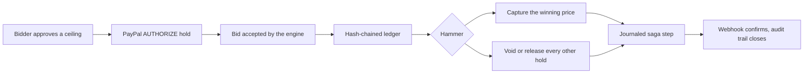

# GAVEL

[](https://github.com/harshbhx/gavel-auction/actions/workflows/ci.yml)
[](LICENSE)
[](package.json)
[](tsconfig.base.json)
[](#security-and-sandbox-notice)

**A live auction where every bid is a PayPal AUTHORIZE hold. Only the winning price is captured; every other hold is voided and released. A crash-safe settlement saga and a hash-chained audit trail keep the result provable.**

Built for the PayPal AI Hackathon 2026. PayPal sandbox only: no real money moves.

## How it works

Bidders approve a ceiling up front, which creates an authorization hold (nothing is charged). A deterministic engine runs the auction and writes every event to a hash-chained ledger. At the hammer, the settlement saga captures the winning price and releases the rest.



If the process dies mid-settlement, the saga journal lets it resume: it checks the truth at PayPal, then continues the capture and the voids instead of repeating them.

## Features

- English ascending auction with ceilings, soft close and a deterministic engine (`decide`, `evolve`, `replay`) that has no Node built-ins.
- Hash-chained ledger with a redacted public export and a verifier that detects edited or truncated chains.
- Settlement saga: truth check, capture of the winning price with `final_capture`, bounded concurrent voids, a journal, and resume after a crash.
- Webhook handling with signature verification and de-duplication.
- Hold creation and approval service on PayPal Orders v2 and Payments v2.
- A built-in fake PayPal server so everything runs offline in tests.
- Voice package: audio capture, Groq speech-to-text client and a bid parser with a confirm step.
- Replay player and bundle format for recorded auctions.
- Scenario DSL and property tests with replayable seeds.

## Packages

| Package             | Purpose                                                                            |
| ------------------- | ---------------------------------------------------------------------------------- |
| `packages/shared`   | Money in integer cents, ids, wire types, replay bundle format                      |
| `packages/engine`   | Pure auction core and hash-chained ledger                                          |
| `packages/payments` | Hold service, settlement saga, webhook verification, fake PayPal, gate scripts     |
| `packages/voice`    | Audio capture, speech-to-text clients, bid parser, decision step                   |
| `packages/server`   | Single-process host: HTTP routes, room runtime, settlement scheduling, file stores |
| `packages/e2e`      | Scenario DSL, runner and end-to-end specs                                          |
| `packages/web`      | Browser client (React and Vite); see its own README for its state                  |

Architecture diagram and details: [docs/submission/ARCHITECTURE.md](docs/submission/ARCHITECTURE.md).

## Quickstart

Needs Node 22 and npm.

```
npm ci
PUBLIC_URL=http://localhost:8080 TOKEN_SECRET=dev-token-secret ADMIN_KEY=dev-admin-key \
  PAYMENTS=fake PAYPAL_ENV=sandbox npm start -w @gavel/server
```

With `PAYMENTS=fake` the server uses the built-in fake PayPal and needs no network access or PayPal account. `PAYMENTS=sandbox` calls the PayPal sandbox and needs `PAYPAL_CLIENT_ID`, `PAYPAL_CLIENT_SECRET` and `PAYPAL_WEBHOOK_ID` (names in `.env.example`; never commit values). Production mode refuses fake payments. All server settings are listed in [packages/server/README.md](packages/server/README.md).

Tests, type checks, lint and the other quality checks run in GitHub Actions on every pull request; see [.github/workflows/ci.yml](.github/workflows/ci.yml). The same commands work locally: `npm test`, `npm run test:property` (each run prints its seed; `GAVEL_PROPERTY_SEED=<n>` replays it), `npm run typecheck`, `npm run lint`.

## What works today

The packages are built and tested separately, mostly against the fake PayPal. The booted server serves the ops, webhook and admin routes; the auction routes and a WebSocket gateway are not mounted yet, and no hosted demo is published. See [docs/DEMO.md](docs/DEMO.md) for the exact state.

| Area                      | Status                                                                    |
| ------------------------- | ------------------------------------------------------------------------- |
| Auction engine and ledger | Works, covered by unit, property and fixture tests                        |
| Settlement saga and holds | Works against the fake PayPal; sandbox gates below                        |
| Webhook verification      | Verified against real sandbox events (gate G4)                            |
| Server                    | Ops, webhook and admin routes; auction routes and sockets not mounted yet |
| Voice                     | Package with Groq speech-to-text only; not wired into a room yet          |
| Web client                | See [packages/web/README.md](packages/web/README.md)                      |

## PayPal sandbox gates

Each gate is a recorded run against the real PayPal sandbox. Source of truth: [docs/GATES.md](docs/GATES.md); raw run logs are in `docs/evidence/`.

| Gate | Question                                      | Status                                                                   |
| ---- | --------------------------------------------- | ------------------------------------------------------------------------ |
| G0   | Sandbox app and buyer accounts work           | PASS (connectivity and order creation only)                              |
| G1   | Partial capture and release of the remainder  | PASS for wallet and card buyers; guest capture not covered               |
| G2   | Card and guest AUTHORIZE                      | PASS (wallet and guest card authorized, PayPal SDK v6)                   |
| G3   | Honor period, validity and reauthorize        | NOT RUN                                                                  |
| G4   | Webhook signature verification on real events | PASS (6 real deliveries verified; tampered-event rejection is fake-only) |
| G5   | Speech-to-text accuracy on noisy bids         | NOT RUN                                                                  |

Behaviour not covered by a passed gate is established only against the project's own fake PayPal.

## Documentation

- [Architecture](docs/submission/ARCHITECTURE.md)
- [Decisions](docs/DECISIONS.md) and [plan](docs/PLAN.md)
- [Gate runbook](docs/RUNBOOK-GATES.md) and [gate results](docs/GATES.md)
- [Judge walkthrough](docs/JUDGES.md) and [demo guide](docs/DEMO.md)
- [Deploy staging](docs/DEPLOY.md)
- Package guides: [server](packages/server/README.md), [voice](packages/voice/README.md), [engine](packages/engine/README.md)

## Security and sandbox notice

GAVEL talks to the PayPal sandbox only. No live PayPal call is made and no real money moves. Do not put real card numbers, real accounts or personal data into the demo. Secrets are never committed; report vulnerabilities as described in [SECURITY.md](SECURITY.md).

## Contributing

Read [CONTRIBUTING.md](CONTRIBUTING.md) and the [code of conduct](CODE_OF_CONDUCT.md). Work goes through branches and pull requests, and the pull request template lists the checks.

## License

[MIT](LICENSE)
