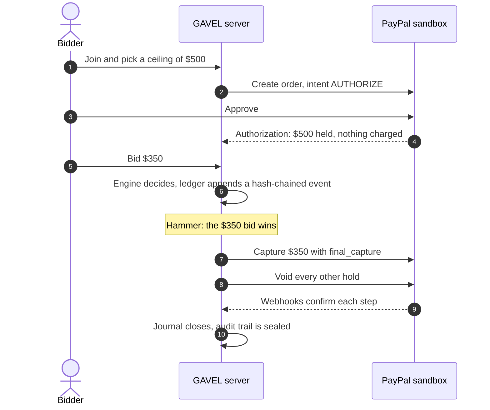
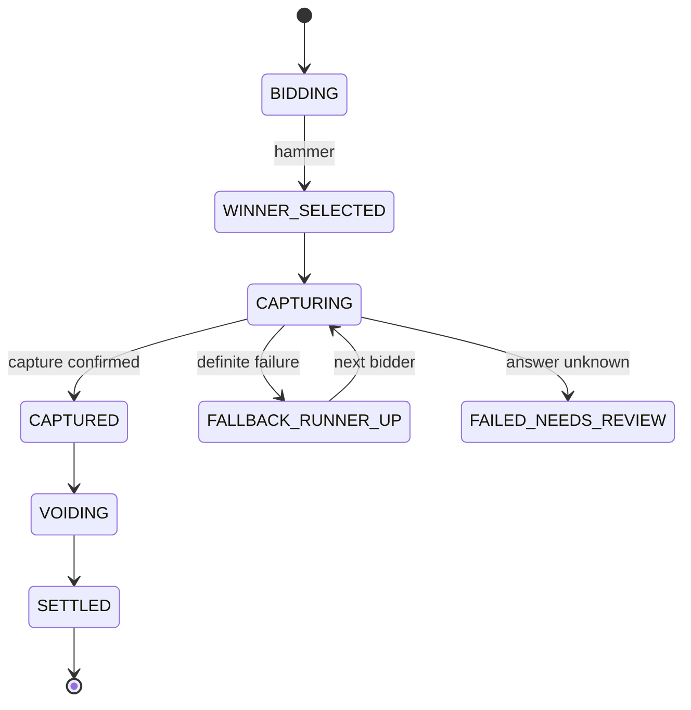

<div align="center">


<br>

[](https://github.com/harshbhx/gavel-auction/actions/workflows/ci.yml)
[](LICENSE)
[](package.json)
[](tsconfig.base.json)
[](#security-and-sandbox-notice)

**[How it works](#how-it-works)** &nbsp;|&nbsp; **[Features](#features)** &nbsp;|&nbsp; **[Run it](#run-it)** &nbsp;|&nbsp; **[Sandbox gates](#paypal-sandbox-gates)** &nbsp;|&nbsp; **[Docs](#documentation)**

</div>

<br>

**Every bid is a PayPal hold. Only the winner pays.**

> Online auctions have a trust problem at the hammer: the winner may never pay. GAVEL fixes it at the start. Every bidder approves a PayPal hold as their ceiling, and every bid is checked against that hold. When the hammer falls, only the winning price is captured and every other hold is voided. A journaled settlement saga is built so that a crash mid-settlement cannot double-charge anyone, and a hash-chained ledger keeps the result checkable. Bids can also be spoken, but a spoken bid never counts until the bidder confirms it. PayPal sandbox only: no real money moves.

Built for the PayPal Hackathon 2026.

### Live links (sandbox mode)

| What          | Link                                                                                                                                                  |
| ------------- | ----------------------------------------------------------------------------------------------------------------------------------------------------- |
| Web app       | [gavel-web.creharsh.workers.dev](https://gavel-web.creharsh.workers.dev), with the judge page at [`/try`](https://gavel-web.creharsh.workers.dev/try) |
| Documentation | [gavel-docs.creharsh.workers.dev](https://gavel-docs.creharsh.workers.dev)                                                                            |
| API           | Render, [`/healthz`](https://gavel-auction-aufz.onrender.com/healthz); the first request after idle can take about 30 seconds while the service wakes |

The hosted API runs in sandbox mode with temporary storage on the current host, so rooms can be lost on a restart. Whether a judge can start a key-less room depends on the host flag `JUDGE_ROOMS` (see [docs/DEPLOY.md](docs/DEPLOY.md)); [docs/DEMO.md](docs/DEMO.md) says what is verified and what is not.

<table>
  <tr>
    <td align="center" width="25%"><h3>7</h3>packages, one strict<br>TypeScript monorepo</td>
    <td align="center" width="25%"><h3>568</h3>test and spec files<br>(counted at commit 55a6fc1)</td>
    <td align="center" width="25%"><h3>15</h3>end-to-end scenarios,<br>from happy path to retries</td>
    <td align="center" width="25%"><h3>4 of 6</h3>sandbox gates passed;<br>G5 partial, G3 running</td>
  </tr>
</table>

## Why GAVEL

Online auctions have a trust problem at the hammer: the winner may never pay, and every losing bidder wonders what happened to their money. GAVEL moves the money question to the start.

|                         | A typical online auction           | GAVEL                                                                                                                                                               |
| ----------------------- | ---------------------------------- | ------------------------------------------------------------------------------------------------------------------------------------------------------------------- |
| When a bidder commits   | After winning, if they pay at all  | Before the first bid: PayPal holds their ceiling                                                                                                                    |
| What a losing bid costs | Nothing, but nothing guarantees it | Nothing: the hold is voided, never captured                                                                                                                         |
| What the winner pays    | Whatever the invoice says          | The winning price only, never the ceiling                                                                                                                           |
| If the server crashes   | Manual clean-up                    | The saga resumes from its journal and checks PayPal first (injected crashes against the fake PayPal; one in-process crash on the sandbox; no real process kill yet) |
| Proof of the result     | Trust the operator                 | A hash-chained ledger anyone can verify from a public export                                                                                                        |

## How it works

1. **Approve a ceiling.** A bidder approves the most they may bid. PayPal places an authorization hold for that amount. Nothing is charged.
2. **Bid.** A deterministic engine accepts or rejects each bid against the ceilings and writes every event to a hash-chained ledger.
3. **Hammer.** The settlement saga captures the winning price, voids every other hold, and records each step in a journal so a crash cannot double-charge anyone.



### Settlement that is designed to survive a crash

Crash recovery is verified with injected crashes against the project's fake PayPal. On the PayPal sandbox the nightly run (specs R7, R8 and R10; runs [42200708552](https://github.com/harshbhx/gavel-auction/actions/runs/42200708552) on 6 Nov 2026 and [42317068784](https://github.com/harshbhx/gavel-auction/actions/runs/42317068784) on 7 Nov 2026; redacted reports in [docs/evidence/nightly](docs/evidence/nightly)) settled one lot of three holds with the real saga and recovered from one in-process crash with one capture on the winner. No auction driven through a deployed server and no real process kill and restart has run on the sandbox (see [docs/GATES.md](docs/GATES.md)). If the process dies mid-settlement, the saga journal lets it resume: it checks the truth at PayPal, then continues the capture and the voids instead of repeating them. When PayPal's answer is unknown, the settlement stops for review rather than guessing. Simplified:



## Features

<table>
  <tr>
    <td valign="top" width="50%">
      <h4>Auction engine</h4>
      English ascending auction with ceilings and soft close. A deterministic core (<code>decide</code>, <code>evolve</code>, <code>replay</code>) with no Node built-ins, so the same events always give the same result.
    </td>
    <td valign="top" width="50%">
      <h4>Hash-chained ledger</h4>
      Every event is linked to the one before it. A redacted public export and a verifier detect an edited chain. A cut tail shows as not closed, and is proven only against a head hash published elsewhere.
    </td>
  </tr>
  <tr>
    <td valign="top">
      <h4>Settlement saga</h4>
      Truth check, capture of the winning price with <code>final_capture</code>, bounded concurrent voids, a journal, and resume after a crash.
    </td>
    <td valign="top">
      <h4>PayPal holds and webhooks</h4>
      Hold creation and approval on PayPal Orders v2 and Payments v2. Webhooks are signature-verified and de-duplicated.
    </td>
  </tr>
  <tr>
    <td valign="top">
      <h4>Voice bidding</h4>
      Audio capture, Deepgram and Groq speech-to-text clients with failover (Deepgram, then Groq, then cached transcripts) and a bid parser. Spoken bids always go through a confirm prompt.
    </td>
    <td valign="top">
      <h4>Replay and testing</h4>
      A replay player and bundle format for recorded auctions (controls, ladder and big screen views; no hosted recording yet), a built-in fake PayPal for offline tests, and a scenario DSL with property tests that print replayable seeds.
    </td>
  </tr>
</table>

### The Scoreboard interface

The web app (`packages/web`) was redesigned on 7 Nov 2026 in the Scoreboard design: flat panels, hard shadows, big numerals. Details in [docs/DESIGN.md](docs/DESIGN.md). Each line below is something the code does, covered by unit, component or browser tests that run in CI. None of it has been checked against the hosted site by a recorded click-through.

- **Hold button.** Press and hold for 3 seconds to approve a ceiling, or to hammer a lot on the console; release cancels. Keyboard users hold Space or Enter. The ceiling approval also offers a two-tap alternative for people who cannot hold; the console hammer does not.
- **Price roll.** Prices are integer cents in tabular numerals, and only the changed digits roll. Reduced motion swaps the value at once.
- **Hold card.** Hatched means held, solid means charged, hollow means released, always with a text status and a hide-amount toggle.
- **Ceiling slider.** Ticks at every step, snapping, and full keyboard control (arrows, PageUp, PageDown, Home, End).
- **Join code input.** One slot per character, auto-advance, paste that drops a `GVL-` prefix.
- **Three palettes.** Newsprint and Signal, Night Board and Salon, each checked against contrast pairs in a unit test. The switch component exists, but no screen mounts it yet, so the choice is only read from browser storage.
- **Alerts.** Outbid, win and sold alerts on the bidder phone and a gavel sound on the projector, with a mute toggle on the bidder screen.
- **Hold explainer and guided tour.** A help button on the landing, join, register, bid and receipt screens opens a sheet that explains the hold, or replays a six-step tour that opens by itself on a first visit.
- **Fundraiser thermometer.** The projector screen shows a goal bar when the auctioneer sets a goal. Only captured money counts as raised; money reserved for the winner is shown apart.
- **Shareable receipt.** A receipt can mint a link with a QR code and a copy button, and a print layout.
- **Judge rooms.** With the host flag `JUDGE_ROOMS=true`, "Start a demo auction" opens a key-less room on the PayPal sandbox (capped, rate limited, switchable off at runtime). The `/try` page gives the steps. Without the flag the button falls back to the operator-key demo route.

## Run it

Needs Node 22 and npm. No PayPal account is needed for the default run.

```bash
npm ci
PUBLIC_URL=http://localhost:8080 TOKEN_SECRET=dev-token-secret ADMIN_KEY=dev-admin-key \
  PAYMENTS=fake PAYPAL_ENV=sandbox npm start -w @gavel/server
```

With `PAYMENTS=fake` the server uses the built-in fake PayPal and needs no network access. Production mode refuses fake payments. All server settings are listed in [packages/server/README.md](packages/server/README.md).

To see the interface without a server, start the web dev server (`npm run dev -w @gavel/web`) and open `/r/demo/screen?scripted=1`. The flag plays a recorded scenario in the browser and makes no PayPal calls; `/r/demo/bid?scripted=1&at=3000` and the console and receipt routes work the same way. Only development builds honour the flag: a production build, including the hosted site, ignores it.

<details>
<summary><b>Use the real PayPal sandbox</b></summary>

<br>

Set `PAYMENTS=sandbox` and provide `PAYPAL_CLIENT_ID`, `PAYPAL_CLIENT_SECRET` and `PAYPAL_WEBHOOK_ID`. The names are in `.env.example`; keep the values in your local `.env` and never commit them. The gate runbook in [docs/RUNBOOK-GATES.md](docs/RUNBOOK-GATES.md) shows how each sandbox run is recorded.

</details>

<details>
<summary><b>Tests and quality checks</b></summary>

<br>

Every pull request runs tests, type checks, lint and the other quality checks in GitHub Actions ([ci.yml](.github/workflows/ci.yml)). The same commands work locally:

| Command                 | What it runs                                                                   |
| ----------------------- | ------------------------------------------------------------------------------ |
| `npm test`              | Unit tests for every package                                                   |
| `npm run test:property` | Property tests; each run prints its seed, `GAVEL_PROPERTY_SEED=<n>` replays it |
| `npm run typecheck`     | Strict TypeScript across the workspace                                         |
| `npm run lint`          | ESLint with zero warnings allowed                                              |

</details>

## What works today

The packages are built and tested separately, mostly against the fake PayPal. The booted server serves the ops, webhook, admin and auction HTTP routes (create, invites, join, read, control, auctioneer token), the room WebSocket gateway and the `/audio` voice socket. The scripted `/api/demo/*` routes are mounted only with `DEMO_MODE=1` and `PAYMENTS=fake`, which config refuses under production-like settings, so no hosted server has them. The web app and API are hosted in sandbox mode, but no end-to-end click-through of the hosted site is recorded. See [docs/DEMO.md](docs/DEMO.md) for the exact state.

Latency is partly within budget. On the real PayPal sandbox (`measure-sandbox` run 42346811713, 20 settlements of 6 holds each, [redacted evidence](docs/evidence/measure)), hammer to SETTLED has p95 5591 ms against the 6 s target (met, on a small sample), and hammer to CAPTURED has p95 3010 ms against the 2.5 s target (missed). Whether to keep that target is an open owner decision. See [docs/GATES.md](docs/GATES.md).

| Area                      | Status                                                                                                                                                                                                                                                                                                                                                                                           |
| ------------------------- | ------------------------------------------------------------------------------------------------------------------------------------------------------------------------------------------------------------------------------------------------------------------------------------------------------------------------------------------------------------------------------------------------ |
| Auction engine and ledger |  Covered by unit, property and fixture tests                                                                                                                                                                                                                                                                               |
| Settlement saga and holds |  Fake PayPal, plus nightly sandbox specs R7, R8, R10; gates below                                                                                                                                                                                                                                                          |
| Webhook verification      |  Against real sandbox events (gate G4)                                                                                                                                                                                                                                                                               |
| Server                    |  Ops, webhook, admin and auction HTTP routes, room WebSocket gateway and `/audio` socket mounted; scripted demo routes only with `DEMO_MODE=1` and fake payments                                                                                                                                                       |
| Voice                     |  `/audio` socket feeds decisions into the room. Speech is cached transcripts by default, Groq only with `VOICE_STT=groq` and `GROQ_API_KEY`; no live speech run recorded (G5: PARTIAL, wrong accept 0.000 on synthetic clips but tuned on the same clips and no real-room test, so spoken bids use the confirm prompt) |
| Web client                |  Scoreboard interface on every route, tested in CI; hosted in sandbox mode with temporary storage; no recorded click-through of the hosted site. See [packages/web/README.md](packages/web/README.md) and [docs/DESIGN.md](docs/DESIGN.md)                                                                             |

## PayPal sandbox gates

Each gate is a run against the real PayPal sandbox. Source of truth: [docs/GATES.md](docs/GATES.md). Committed raw run logs ([`docs/evidence/`](docs/evidence)) exist for G1, G2 and G4; G0 is recorded only as a GitHub Actions run log (no committed file).

| Gate | Question                                      | Result                                                                       | Notes                                                                                                                                                                                                                                                                                                                                |
| ---- | --------------------------------------------- | ---------------------------------------------------------------------------- | ------------------------------------------------------------------------------------------------------------------------------------------------------------------------------------------------------------------------------------------------------------------------------------------------------------------------------------ |
| G0   | Sandbox app and buyer accounts work           |          | Connectivity and order creation only; no committed evidence file (Actions run log only)                                                                                                                                                                                                                                              |
| G1   | Partial capture and release of the remainder  |          | PayPal-account orders for both buyers (the "card" buyer is a PayPal account funded by a card); guest-card capture not covered. Release of the remainder is inferred from the authorization reading CAPTURED and the 422 on a void, not from a buyer balance                                                                          |
| G2   | Card and guest AUTHORIZE                      |          | Wallet and guest card authorized, PayPal JS SDK v6                                                                                                                                                                                                                                                                                   |
| G3   | Honor period, validity and reauthorize        |  | Real probe in progress (IN PROGRESS, no result yet): day 0 7 Nov 2026 03:06 UTC, checkpoints at 3.5, 4 and 5 days, final about 12 Nov 06:17 UTC; NOT RUN until then. The simulated 30-day fake-clock tests ([SIM-MULTIDAY](docs/evidence/SIM/SIM-MULTIDAY.md)) are a simulation, not a real PayPal sandbox result                    |
| G4   | Webhook signature verification on real events |          | 6 real deliveries verified; tampered-event rejection is fake-only                                                                                                                                                                                                                                                                    |
| G5   | Speech-to-text accuracy on noisy bids         |    | synthetic eSpeak clips, 24: Deepgram nova-3 wrong-accept 0.000 (was 0.125 on nova-2), Groq whisper-large-v3-turbo with a bid prompt 0.000 (was 0.083); fixes were chosen on the same clips, nine of eleven earlier wrong accepts were an eval label defect; voice bids still use the confirm prompt; no real-room or noisy-room test |
| G5   | Speech-to-text accuracy, second clip set      |    | human-like synthetic voice, noise-free, 24 clips (still not a real-room test): Deepgram nova-3 wrong-accept 0.000 (was 0.083), Groq 0.000 (was 0.167); auto-accepted bids at system level: 0 on the room microphone by construction                                                                                                  |

Behaviour not covered by a passed gate is established only against the project's own fake PayPal.

## Architecture


| Package             | Purpose                                                                            |
| ------------------- | ---------------------------------------------------------------------------------- |
| `packages/shared`   | Money in integer cents, ids, wire types, replay bundle format                      |
| `packages/engine`   | Pure auction core and hash-chained ledger                                          |
| `packages/payments` | Hold service, settlement saga, webhook verification, fake PayPal, gate scripts     |
| `packages/voice`    | Audio capture, speech-to-text clients, bid parser, decision step                   |
| `packages/server`   | Single-process host: HTTP routes, room runtime, settlement scheduling, file stores |
| `packages/e2e`      | Scenario DSL, runner and end-to-end specs                                          |
| `packages/web`      | Browser client (React and Vite); see its own README for its state                  |

Full diagram and details: [docs/submission/ARCHITECTURE.md](docs/submission/ARCHITECTURE.md), and the architecture pages of the [docs site](https://gavel-docs.creharsh.workers.dev/docs/how-it-works/system-architecture).

## Open data

Five small datasets (gate results, latency, the simulated 30-day run, speech-to-text outputs on synthetic audio, scripted audit traces) are prepared for Hugging Face. They are not published yet, so there are no links. See [docs/HF_COLLECTION.md](docs/HF_COLLECTION.md).

## Documentation

| Read this                                            | To learn                                       |
| ---------------------------------------------------- | ---------------------------------------------- |
| [Docs site](https://gavel-docs.creharsh.workers.dev) | Diagrams, proof pages and the judge paths      |
| [Judge walkthrough](docs/JUDGES.md)                  | A short path through the code and the evidence |
| [Design system](docs/DESIGN.md)                      | The Scoreboard interface and its components    |
| [Demo guide](docs/DEMO.md)                           | What you can try today and what to expect      |
| [Architecture](docs/submission/ARCHITECTURE.md)      | How the packages fit together                  |
| [Gate results](docs/GATES.md)                        | What each sandbox run proved                   |
| [Gate runbook](docs/RUNBOOK-GATES.md)                | How to run a gate yourself                     |
| [Decisions](docs/DECISIONS.md), [plan](docs/PLAN.md) | Why the design is the way it is                |
| [Deploy staging](docs/DEPLOY.md)                     | Hosting the server                             |

Package guides: [server](packages/server/README.md), [voice](packages/voice/README.md), [engine](packages/engine/README.md), [web](packages/web/README.md).

## Security and sandbox notice

GAVEL talks to the PayPal sandbox only. No live PayPal call is made and no real money moves. Do not put real card numbers, real accounts or personal data into the demo. Secrets are never committed; report vulnerabilities as described in [SECURITY.md](SECURITY.md).

## Contributing

Read [CONTRIBUTING.md](CONTRIBUTING.md) and the [code of conduct](CODE_OF_CONDUCT.md). Work goes through branches and pull requests, and the pull request template lists the checks.

## License

[MIT](LICENSE)
