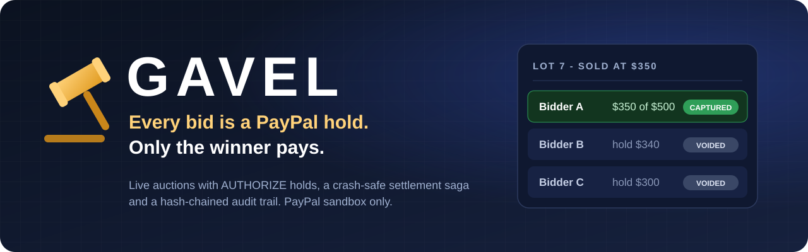
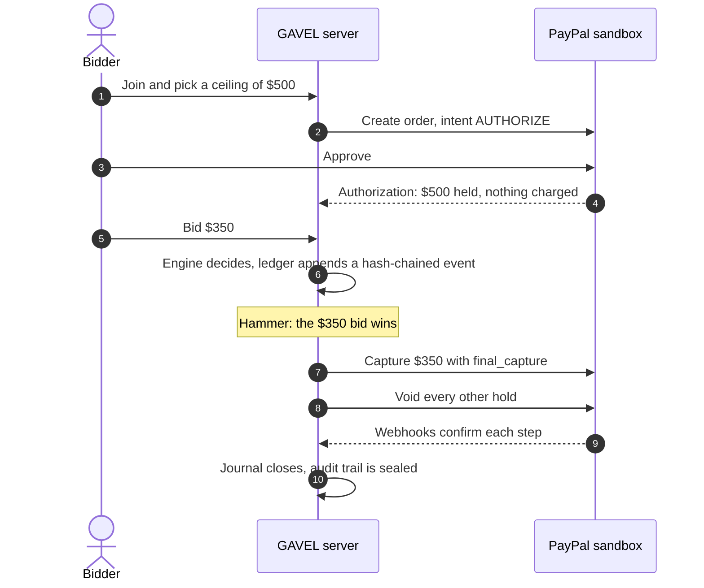
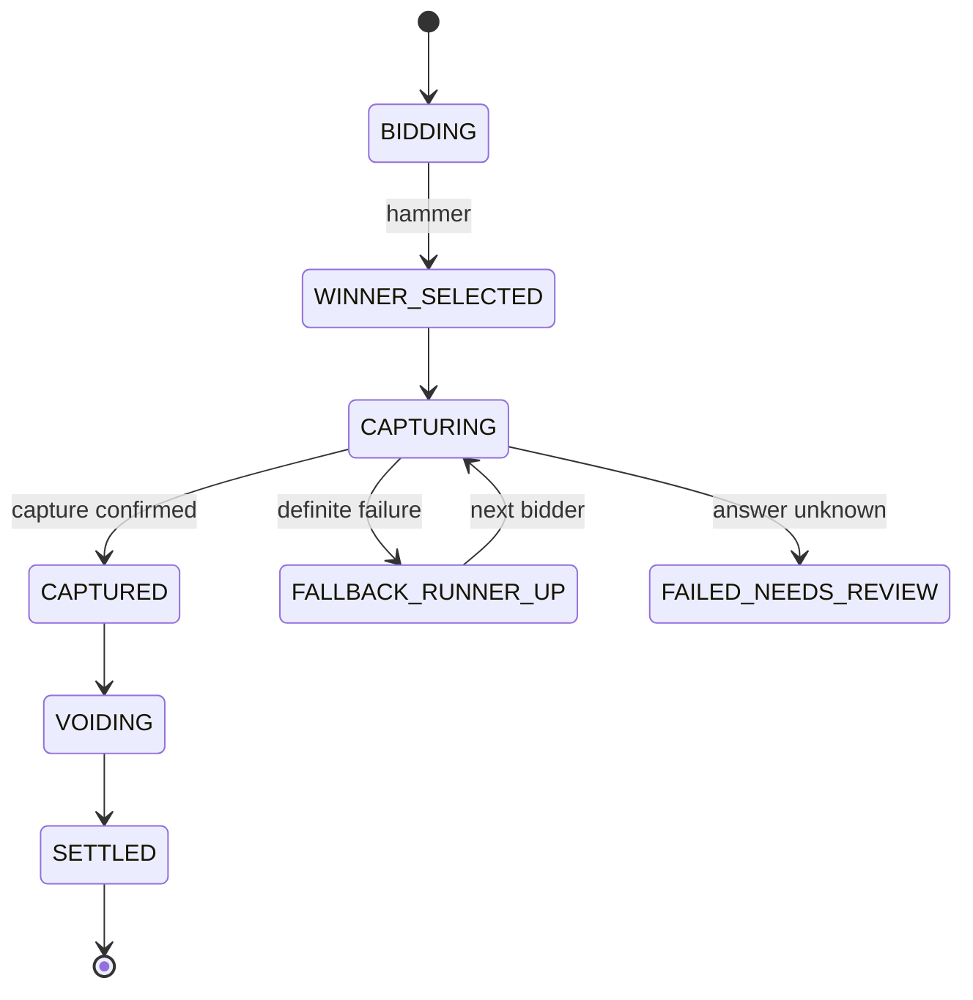
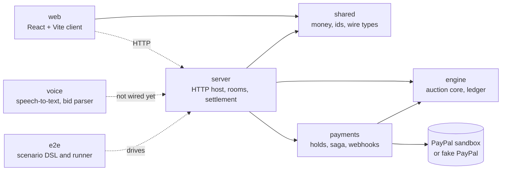

<div align="center">



<br>

[](https://github.com/harshbhx/gavel-auction/actions/workflows/ci.yml)
[](LICENSE)
[](package.json)
[](tsconfig.base.json)
[](#security-and-sandbox-notice)

**[How it works](#how-it-works)** &nbsp;|&nbsp; **[Features](#features)** &nbsp;|&nbsp; **[Run it](#run-it)** &nbsp;|&nbsp; **[Sandbox gates](#paypal-sandbox-gates)** &nbsp;|&nbsp; **[Docs](#documentation)**

</div>

<br>

> **A live auction where every bid is a PayPal AUTHORIZE hold.** Only the winning price is captured; every other hold is voided and released. A crash-safe settlement saga and a hash-chained audit trail keep the result provable.

Built for the PayPal Hackathon 2026. PayPal sandbox only: no real money moves.

<table>
  <tr>
    <td align="center" width="25%"><h3>7</h3>packages, one strict<br>TypeScript monorepo</td>
    <td align="center" width="25%"><h3>452</h3>test files: unit, property,<br>fixture and scenario</td>
    <td align="center" width="25%"><h3>10</h3>end-to-end scenarios,<br>from happy path to retries</td>
    <td align="center" width="25%"><h3>4 of 6</h3>PayPal sandbox gates<br>passed with recorded evidence</td>
  </tr>
</table>

## Why GAVEL

Online auctions have a trust problem at the hammer: the winner may never pay, and every losing bidder wonders what happened to their money. GAVEL moves the money question to the start.

|                         | A typical online auction           | GAVEL                                                        |
| ----------------------- | ---------------------------------- | ------------------------------------------------------------ |
| When a bidder commits   | After winning, if they pay at all  | Before the first bid: PayPal holds their ceiling             |
| What a losing bid costs | Nothing, but nothing guarantees it | Nothing: the hold is voided and released                     |
| What the winner pays    | Whatever the invoice says          | The winning price only, never the ceiling                    |
| If the server crashes   | Manual clean-up                    | The saga resumes from its journal and checks PayPal first    |
| Proof of the result     | Trust the operator                 | A hash-chained ledger anyone can verify from a public export |

## How it works

1. **Approve a ceiling.** A bidder approves the most they may bid. PayPal places an authorization hold for that amount. Nothing is charged.
2. **Bid.** A deterministic engine accepts or rejects each bid against the ceilings and writes every event to a hash-chained ledger.
3. **Hammer.** The settlement saga captures the winning price, voids every other hold, and records each step in a journal so a crash cannot double-charge anyone.



### Settlement that survives a crash

If the process dies mid-settlement, the saga journal lets it resume: it checks the truth at PayPal, then continues the capture and the voids instead of repeating them. When PayPal's answer is unknown, the settlement stops for review rather than guessing. Simplified:



## Features

<table>
  <tr>
    <td valign="top" width="50%">
      <h4>Auction engine</h4>
      English ascending auction with ceilings and soft close. A deterministic core (<code>decide</code>, <code>evolve</code>, <code>replay</code>) with no Node built-ins, so the same events always give the same result.
    </td>
    <td valign="top" width="50%">
      <h4>Hash-chained ledger</h4>
      Every event is linked to the one before it. A redacted public export and a verifier detect an edited chain. A cut tail shows as not closed, and is proven only against a head hash published elsewhere.
    </td>
  </tr>
  <tr>
    <td valign="top">
      <h4>Settlement saga</h4>
      Truth check, capture of the winning price with <code>final_capture</code>, bounded concurrent voids, a journal, and resume after a crash.
    </td>
    <td valign="top">
      <h4>PayPal holds and webhooks</h4>
      Hold creation and approval on PayPal Orders v2 and Payments v2. Webhooks are signature-verified and de-duplicated.
    </td>
  </tr>
  <tr>
    <td valign="top">
      <h4>Voice bidding</h4>
      Audio capture, a Groq speech-to-text client and a bid parser that asks for confirmation when an amount is ambiguous.
    </td>
    <td valign="top">
      <h4>Replay and testing</h4>
      A replay player and bundle format for recorded auctions, a built-in fake PayPal for offline tests, and a scenario DSL with property tests that print replayable seeds.
    </td>
  </tr>
</table>

## Run it

Needs Node 22 and npm. No PayPal account is needed for the default run.

```bash
npm ci
PUBLIC_URL=http://localhost:8080 TOKEN_SECRET=dev-token-secret ADMIN_KEY=dev-admin-key \
  PAYMENTS=fake PAYPAL_ENV=sandbox npm start -w @gavel/server
```

With `PAYMENTS=fake` the server uses the built-in fake PayPal and needs no network access. Production mode refuses fake payments. All server settings are listed in [packages/server/README.md](packages/server/README.md).

<details>
<summary><b>Use the real PayPal sandbox</b></summary>

<br>

Set `PAYMENTS=sandbox` and provide `PAYPAL_CLIENT_ID`, `PAYPAL_CLIENT_SECRET` and `PAYPAL_WEBHOOK_ID`. The names are in `.env.example`; keep the values in your local `.env` and never commit them. The gate runbook in [docs/RUNBOOK-GATES.md](docs/RUNBOOK-GATES.md) shows how each sandbox run is recorded.

</details>

<details>
<summary><b>Tests and quality checks</b></summary>

<br>

Every pull request runs tests, type checks, lint and the other quality checks in GitHub Actions ([ci.yml](.github/workflows/ci.yml)). The same commands work locally:

| Command                 | What it runs                                                                   |
| ----------------------- | ------------------------------------------------------------------------------ |
| `npm test`              | Unit tests for every package                                                   |
| `npm run test:property` | Property tests; each run prints its seed, `GAVEL_PROPERTY_SEED=<n>` replays it |
| `npm run typecheck`     | Strict TypeScript across the workspace                                         |
| `npm run lint`          | ESLint with zero warnings allowed                                              |

</details>

## What works today

The packages are built and tested separately, mostly against the fake PayPal. The booted server serves the ops, webhook, admin and auction HTTP routes (create, invites, join, read, control, auctioneer token) and a WebSocket gateway; the scripted `/api/demo/*` routes are not mounted yet, and no hosted demo is published. See [docs/DEMO.md](docs/DEMO.md) for the exact state.

| Area                      | Status                                                                                                                                                          |
| ------------------------- | --------------------------------------------------------------------------------------------------------------------------------------------------------------- |
| Auction engine and ledger |  Covered by unit, property and fixture tests                                              |
| Settlement saga and holds |  Against the fake PayPal; sandbox gates below                                             |
| Webhook verification      |  Against real sandbox events (gate G4)                                              |
| Server                    |  Ops, webhook, admin and auction HTTP routes and sockets; demo routes not mounted yet |
| Voice                     |  Groq speech-to-text only; not wired into a room yet                                  |
| Web client                | See [packages/web/README.md](packages/web/README.md)                                                                                                            |

## PayPal sandbox gates

Each gate is a recorded run against the real PayPal sandbox. Source of truth: [docs/GATES.md](docs/GATES.md); raw run logs are in [`docs/evidence/`](docs/evidence).

| Gate | Question                                      | Result                                                                       | Notes                                                             |
| ---- | --------------------------------------------- | ---------------------------------------------------------------------------- | ----------------------------------------------------------------- |
| G0   | Sandbox app and buyer accounts work           |          | Connectivity and order creation only                              |
| G1   | Partial capture and release of the remainder  |          | Wallet and card buyers; guest capture not covered                 |
| G2   | Card and guest AUTHORIZE                      |          | Wallet and guest card authorized, PayPal JS SDK v6                |
| G3   | Honor period, validity and reauthorize        |  |                                                                   |
| G4   | Webhook signature verification on real events |          | 6 real deliveries verified; tampered-event rejection is fake-only |
| G5   | Speech-to-text accuracy on noisy bids         |  |                                                                   |

Behaviour not covered by a passed gate is established only against the project's own fake PayPal.

## Architecture



| Package             | Purpose                                                                            |
| ------------------- | ---------------------------------------------------------------------------------- |
| `packages/shared`   | Money in integer cents, ids, wire types, replay bundle format                      |
| `packages/engine`   | Pure auction core and hash-chained ledger                                          |
| `packages/payments` | Hold service, settlement saga, webhook verification, fake PayPal, gate scripts     |
| `packages/voice`    | Audio capture, speech-to-text clients, bid parser, decision step                   |
| `packages/server`   | Single-process host: HTTP routes, room runtime, settlement scheduling, file stores |
| `packages/e2e`      | Scenario DSL, runner and end-to-end specs                                          |
| `packages/web`      | Browser client (React and Vite); see its own README for its state                  |

Full diagram and details: [docs/submission/ARCHITECTURE.md](docs/submission/ARCHITECTURE.md).

## Documentation

| Read this                                            | To learn                                       |
| ---------------------------------------------------- | ---------------------------------------------- |
| [Judge walkthrough](docs/JUDGES.md)                  | A short path through the code and the evidence |
| [Demo guide](docs/DEMO.md)                           | What you can try today and what to expect      |
| [Architecture](docs/submission/ARCHITECTURE.md)      | How the packages fit together                  |
| [Gate results](docs/GATES.md)                        | What each sandbox run proved                   |
| [Gate runbook](docs/RUNBOOK-GATES.md)                | How to run a gate yourself                     |
| [Decisions](docs/DECISIONS.md), [plan](docs/PLAN.md) | Why the design is the way it is                |
| [Deploy staging](docs/DEPLOY.md)                     | Hosting the server                             |

Package guides: [server](packages/server/README.md), [voice](packages/voice/README.md), [engine](packages/engine/README.md), [web](packages/web/README.md).

## Security and sandbox notice

GAVEL talks to the PayPal sandbox only. No live PayPal call is made and no real money moves. Do not put real card numbers, real accounts or personal data into the demo. Secrets are never committed; report vulnerabilities as described in [SECURITY.md](SECURITY.md).

## Contributing

Read [CONTRIBUTING.md](CONTRIBUTING.md) and the [code of conduct](CODE_OF_CONDUCT.md). Work goes through branches and pull requests, and the pull request template lists the checks.

## License

[MIT](LICENSE)
