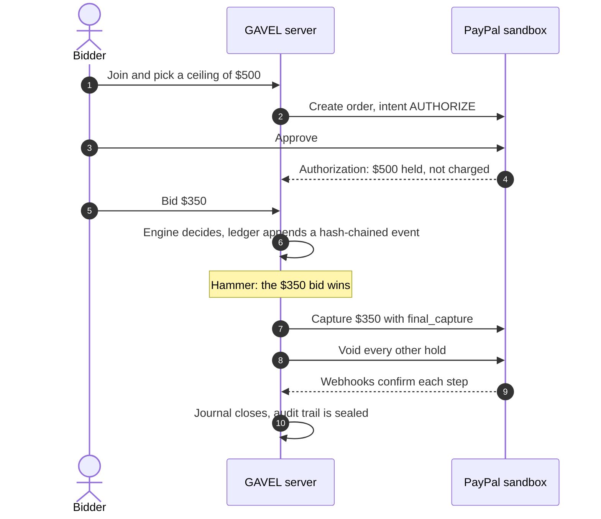
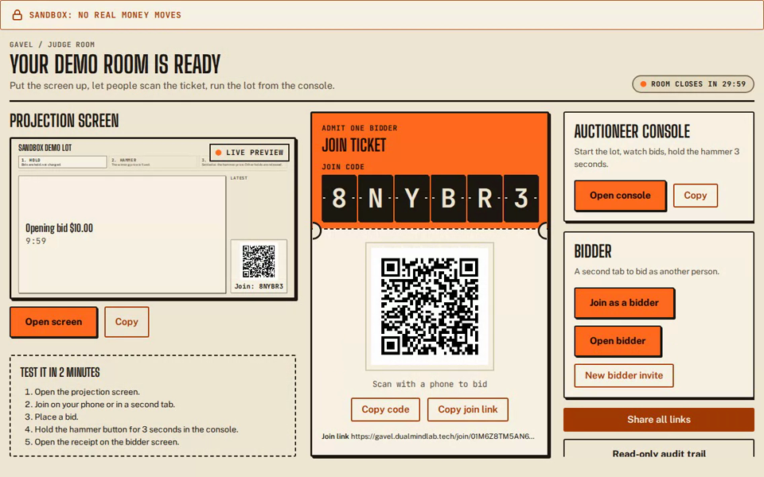
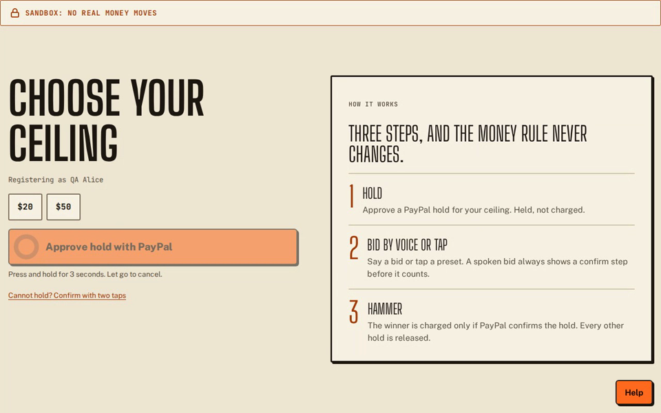
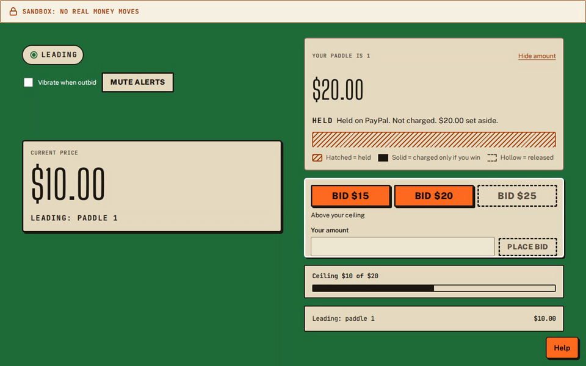
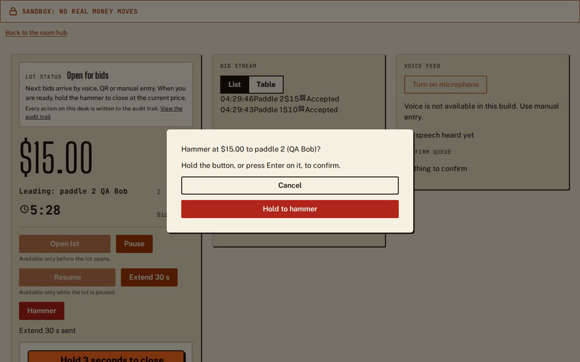
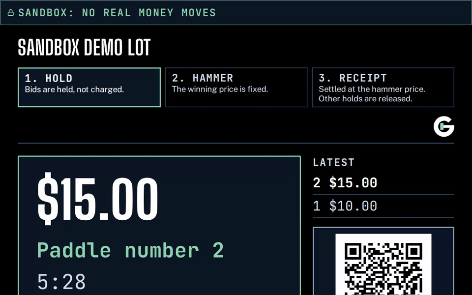
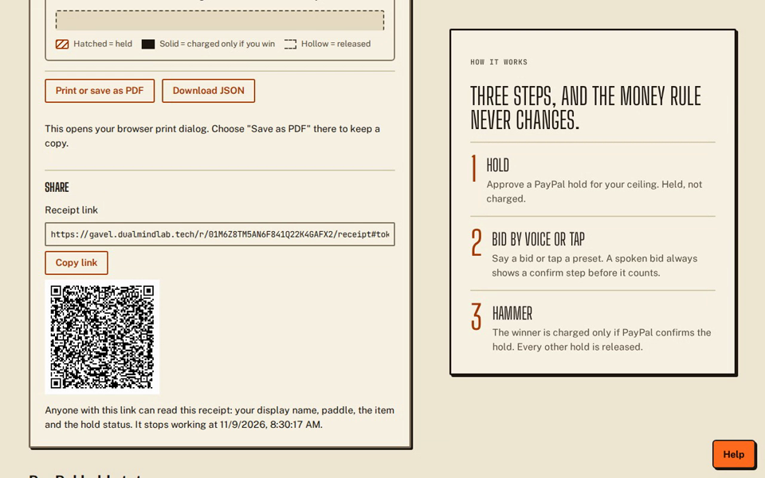
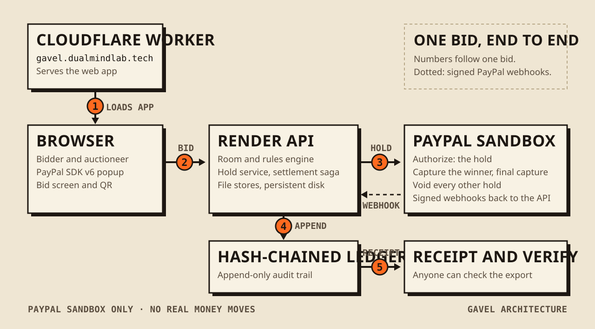
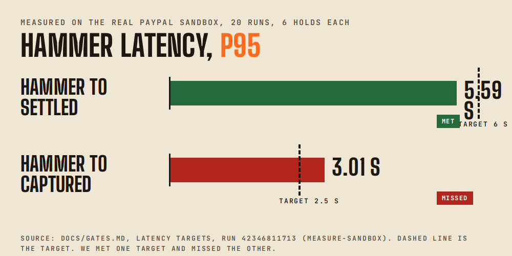

<div align="center">

**Every bid is a PayPal hold. Only the winner pays.**

<p align="center">
  <picture>
    <source media="(prefers-reduced-motion: reduce) and (prefers-color-scheme: dark)" srcset="docs/assets/readme/readme-banner-dark-poster.png">
    <source media="(prefers-reduced-motion: reduce)" srcset="docs/assets/readme/readme-banner-poster.png">
    <source media="(prefers-color-scheme: dark)" srcset="docs/assets/readme/readme-banner-dark.gif">
    
  </picture>
</p>

[](https://github.com/harshbhx/gavel-auction/actions/workflows/ci.yml)
[](LICENSE)
[](package.json)
[](tsconfig.base.json)
[](docs/evidence/perf/PAGESPEED.md)
[](#security-and-data-notes)
[](https://huggingface.co/collections/harshbhx/gavel-evidence-auction-holds-hammer-and-receipts-6af0afebebb37eb4c9184504)

**[Live demo](https://gavel.dualmindlab.tech)** &nbsp;|&nbsp; **[Judge panel](https://gavel.dualmindlab.tech/try)** &nbsp;|&nbsp; **[Docs](https://docs.gavel.dualmindlab.tech)** &nbsp;|&nbsp; **[API reference](https://docs.gavel.dualmindlab.tech/api-reference)** &nbsp;|&nbsp; **[Hugging Face](https://huggingface.co/collections/harshbhx/gavel-evidence-auction-holds-hammer-and-receipts-6af0afebebb37eb4c9184504)** &nbsp;|&nbsp; **[Limits](docs/LIMITATIONS.md)**

PayPal sandbox only: no real money moves.

</div>

<br>

> **GAVEL is a live auction where every bid is a PayPal authorization hold, and at the hammer only the winning price is captured.** Bidders approve a ceiling up front, a deterministic engine checks every bid against it, the winner pays the hammer price, every other hold is voided, and a hash-chained ledger lets anyone verify the result. Bids can be spoken, and a spoken bid never counts until the bidder confirms it.

Built for the PayPal Hackathon 2026 by Harsh Bhanushali and Dhairya Patel.

## Why GAVEL

Online auctions usually make a bidder pay first or trust the bidder to pay later. GAVEL uses a third way: a PayPal authorization hold. The bidder approves a ceiling, PayPal holds that amount without charging it, and when the hammer falls GAVEL captures only the winning price and releases every other hold. Nobody is charged for a lot they lost, and nobody can bid more than they have put on hold.

## At a glance

| Feature                           | What it does                                                                                                                                                                                                                                                                               |
| --------------------------------- | ------------------------------------------------------------------------------------------------------------------------------------------------------------------------------------------------------------------------------------------------------------------------------------------ |
| **Hold, not charge**              | Every bid is backed by a PayPal authorization hold. Only the winner pays, and only the hammer price.                                                                                                                                                                                       |
| **Crash-safe settlement**         | A real server process killed mid-capture: one capture, two losers voided, 0 differences between the journal and PayPal ([evidence](docs/evidence/server-kill)).                                                                                                                            |
| **Verifiable result**             | A hash-chained ledger and a public export: anyone can re-hash the chain and spot an edited entry.                                                                                                                                                                                          |
| **Voice bidding, with a confirm** | Deepgram and Groq speech-to-text with failover; a spoken bid never counts until the bidder confirms it. 24 of 24 synthetic clips answered on the live socket; Deepgram parsed 11 of 11 scripted bids and Groq 9 of 11 on synthetic clips.                                                  |
| **Fast landing page**             | PageSpeed Insights on `/`: **100 Performance, 100 Accessibility, 100 Best Practices, 100 SEO** on mobile and desktop (Lighthouse 13.6.0, lab data, measured by hand on 10 Nov 2026; the landing page only, not the whole app). [Details and screenshots](docs/evidence/perf/PAGESPEED.md). |
| **Open and documented**           | A docs site with a guided tour, an OpenAPI spec, five open datasets on Hugging Face and an honest [limits page](docs/LIMITATIONS.md).                                                                                                                                                      |

<p align="center">
  <picture>
    <source media="(prefers-reduced-motion: reduce) and (prefers-color-scheme: dark)" srcset="docs/assets/readme/readme-stats-dark-poster.png">
    <source media="(prefers-reduced-motion: reduce)" srcset="docs/assets/readme/readme-stats-poster.png">
    <source media="(prefers-color-scheme: dark)" srcset="docs/assets/readme/readme-stats-dark.gif">
    
  </picture>
</p>

<picture>
  <source media="(prefers-reduced-motion: reduce) and (prefers-color-scheme: dark)" srcset="docs/assets/readme/lifecycle-dark.svg">
  <source media="(prefers-reduced-motion: reduce)" srcset="docs/assets/readme/lifecycle-light.svg">
  <source media="(prefers-color-scheme: dark)" srcset="docs/assets/readme/how-it-works-dark.gif">
  
</picture>

## Contents

[Why GAVEL](#why-gavel) | [Live links](#live-links) | [Judge path](#judge-path-in-60-seconds) | [What is proven](#what-is-proven) | [How it works](#how-it-works) | [See it run](#see-it-run) | [Tech stack and sponsors](#tech-stack-and-sponsors) | [Evidence and gates](#evidence-and-gates) | [Run it locally](#run-it-locally) | [Call the API](#call-the-api) | [Security](#security-and-data-notes) | [Documentation](#documentation) | [Team](#team) | [License](#license)

## Live links

| What        | Where                                                                                                                                                                                                                              |
| ----------- | ---------------------------------------------------------------------------------------------------------------------------------------------------------------------------------------------------------------------------------- |
| Web app     | [gavel.dualmindlab.tech](https://gavel.dualmindlab.tech) (also [gavel-web.creharsh.workers.dev](https://gavel-web.creharsh.workers.dev))                                                                                           |
| Judge panel | [gavel.dualmindlab.tech/try](https://gavel.dualmindlab.tech/try): a live sandbox room, no operator key. It is not linked from the public landing page                                                                              |
| Docs        | [docs.gavel.dualmindlab.tech](https://docs.gavel.dualmindlab.tech), with a [guided tour](https://docs.gavel.dualmindlab.tech/docs/start/guided-tour) and a [glossary](https://docs.gavel.dualmindlab.tech/docs/reference/glossary) |
| API         | [api.gavel.dualmindlab.tech](https://api.gavel.dualmindlab.tech/healthz) on Render; [API reference](https://docs.gavel.dualmindlab.tech/api-reference) and the [OpenAPI spec](https://docs.gavel.dualmindlab.tech/openapi.yaml)    |
| Open data   | [Hugging Face collection](https://huggingface.co/collections/harshbhx/gavel-evidence-auction-holds-hammer-and-receipts-6af0afebebb37eb4c9184504): five datasets and an Evidence Explorer Space                                     |
| Source      | [github.com/harshbhx/gavel-auction](https://github.com/harshbhx/gavel-auction), MIT                                                                                                                                                |

## Judge path in 60 seconds

No login and no PayPal account needed. Do not use a personal PayPal account anywhere.

1. **Watch it (1 minute).** Open [/demo/scripted](https://gavel.dualmindlab.tech/demo/scripted). A recorded room plays in your browser, with no server and no PayPal calls.
2. **Run it (3 minutes).** Open [/try](https://gavel.dualmindlab.tech/try) and press "Start a demo auction". The hub shows a room code and a QR code. Join as a bidder, press and hold to approve the hold, bid from two bidders, then hold the hammer button on the console. The big screen shows the sale and the receipt shows what was captured and released.
3. **Verify it.** Open the audit trail of the room, or the [ledger lab](https://gavel.dualmindlab.tech/ledger): every entry is hashed with the one before it, and an edited entry is marked as such.
4. **Call it.** The same flow runs over plain HTTP with the shared judge key from the Devpost testing instructions (optional; the rooms above need no key): see [Call the API](#call-the-api).

Sandbox buyer logins are in the Devpost testing instructions, not in this repository ([placeholders](docs/judges/DEVPOST-TESTING.md)). The demo room uses demo holds unless you log in with a sandbox buyer. Whether a judge can start a key-less room depends on the host flag `JUDGE_ROOMS` (see [docs/DEPLOY.md](docs/DEPLOY.md)); [docs/DEMO.md](docs/DEMO.md) says what is verified. More paths, a rubric map and the evidence: [For judges](https://docs.gavel.dualmindlab.tech/docs/judges), [Trust and FAQ](https://docs.gavel.dualmindlab.tech/docs/judges/trust-and-faq) and the [judge walkthrough](docs/JUDGES.md).

## What is proven

Numbers are as recorded in [docs/GATES.md](docs/GATES.md). Every run link below opens the Actions run, and redacted evidence is committed under [docs/evidence](docs/evidence).

| Claim                                                                    | Result                                                                                                                                                                                                                                                  | Evidence                                                                                                                                                                         |
| ------------------------------------------------------------------------ | ------------------------------------------------------------------------------------------------------------------------------------------------------------------------------------------------------------------------------------------------------- | -------------------------------------------------------------------------------------------------------------------------------------------------------------------------------- |
| Sandbox app, partial capture, wallet and guest card holds, real webhooks | Gates G0, G1, G2 and G4 PASS on the real PayPal sandbox; six real webhooks verified                                                                                                                                                                     | [GATES.md](docs/GATES.md), [G0](docs/evidence/G0), [G1](docs/evidence/G1), [G2](docs/evidence/G2), [G4](docs/evidence/G4)                                                        |
| A server killed mid-capture does not double-charge                       | One kill after the capture request and before the response, restart on the same data folder: one capture of 12500 equal to the hammer price, two losers voided, journal equal to PayPal, ledger of 19 entries verifies                                  | [run 42558021614](https://github.com/harshbhx/gavel-auction/actions/runs/42558021614), [evidence](docs/evidence/server-kill)                                                     |
| Spoken bids never skip the confirm                                       | Live `/audio` socket: both providers answered 24 of 24 synthetic clips, 0 spoken bids accepted without a confirm                                                                                                                                        | [run 42575018866](https://github.com/harshbhx/gavel-auction/actions/runs/42575018866), [evidence](docs/evidence/voice-live-socket)                                               |
| The hosted judge flow works end to end                                   | Judge smoke on the live domains, 17 of 17 steps passed, from `/try` through join, bids, hammer and receipts                                                                                                                                             | [run 42584326641](https://github.com/harshbhx/gavel-auction/actions/runs/42584326641)                                                                                            |
| The hosted webhook route meets its target                                | Webhook route p95 112.03 ms against a 300 ms target (n=50, runner network included); warmup after 16 minutes idle at most 0.66 s (n=2); security headers on the three custom domains                                                                    | [run 42558107791](https://github.com/harshbhx/gavel-auction/actions/runs/42558107791), [hosted](docs/evidence/hosted), [headers](docs/evidence/security/live-checks-20261109.md) |
| Settlement speed on the sandbox                                          | Hammer to SETTLED p95 6927.43 ms against 6000 ms and hammer to CAPTURED p95 3766.67 ms against 2500 ms (50 settlements, 49 completed of 6 holds, run INCOMPLETE: 1 timeout, 3 failed capture calls). An earlier n=20 run read 5591.30 ms and 3010.04 ms | [run 42563147792](https://github.com/harshbhx/gavel-auction/actions/runs/42563147792), [latency](docs/evidence/latency)                                                          |
| Tested                                                                   | More than 4,500 test cases run in CI; all eight P0 items of the security review PASS                                                                                                                                                                    | [docs/SECURITY-REVIEW.md](docs/SECURITY-REVIEW.md)                                                                                                                               |

Still open, stated as of 9 Nov 2026:

- **G3, honor period and reauthorize: a real sandbox probe is running.** Day 0 was recorded on 7 Nov 2026 at 03:06 UTC and the final reading is about 12 Nov 06:17 UTC. Early readings on older authorizations at 3.24 and 3.5075 days accepted a partial capture of 1.00 (HTTP 201) ([evidence](docs/evidence/G3-early)). The 30-day auction run is a simulation on a fake clock ([SIM-MULTIDAY](docs/evidence/SIM/SIM-MULTIDAY.md)), not a sandbox result.
- **G5, voice accuracy: tested with synthetic voice clips, with a confirm step on every voice bid.** Voice bids were tested with synthetic speech clips. On two sets of 24 clips, Deepgram nova-3 and Groq whisper-large-v3-turbo score wrong accept 0.000 (tuned on those clips), and on a live run of 20 clips Deepgram parsed 11 of 11 scripted bids and Groq 9 of 11. A held-out noisy set of 120 synthetic clips, measured once against thresholds fixed beforehand, read wrong accept 0.058 for Groq and 0.092 for Deepgram against 0.05 ([result](docs/evidence/G5/HELDOUT-NOISY.md)). A spoken bid never counts until the bidder confirms it.
- **Latency targets:** both are missed on the larger run; keeping them, raising them with a reason or reducing latency is an owner decision that is still open.
- **Scope:** PayPal sandbox only. The server kill ran on a CI runner, not the deployed host. The live socket run used the fake PayPal and synthetic clips, and the web console microphone has been tested with a fake microphone and socket. A `final_capture` and a void on a guest-card authorization are not run, and the release of the remainder is inferred, not read from a buyer balance.

What is next, with owners and dates where known: [Limits and next steps](docs/LIMITATIONS.md). What changed and when: [changelog](CHANGELOG.md).

## How it works

1. **Approve a ceiling.** A bidder approves the most they may bid. PayPal places an authorization hold for that amount: held, not charged.
2. **Bid.** A deterministic engine accepts or rejects each bid against the ceilings and writes every event to a hash-chained ledger.
3. **Hammer.** The settlement saga captures the winning price with `final_capture`, voids every other hold, and records each step in a journal so a crash cannot double-charge anyone. If PayPal's answer is unknown, settlement stops for review instead of guessing.
4. **Receipt and verify.** The outcome is a receipt, and anyone can replay the audit trail and check the hash chain from the public export.



| Stage  | Page                                                                                                   |
| ------ | ------------------------------------------------------------------------------------------------------ |
| Hold   | [Registration and holds](https://docs.gavel.dualmindlab.tech/docs/how-it-works/registration-and-holds) |
| Bid    | [Bid lifecycle](https://docs.gavel.dualmindlab.tech/docs/how-it-works/bid-lifecycle)                   |
| Hammer | [Auction states](https://docs.gavel.dualmindlab.tech/docs/how-it-works/auction-states)                 |
| Settle | [Settlement saga](https://docs.gavel.dualmindlab.tech/docs/how-it-works/settlement-saga)               |
| Verify | [Engine and ledger](https://docs.gavel.dualmindlab.tech/docs/how-it-works/engine-and-ledger)           |

<table>
  <tr>
    <td valign="top" width="50%">
      <h4>Auction engine</h4>
      English ascending auction with ceilings and soft close. A deterministic core (<code>decide</code>, <code>evolve</code>, <code>replay</code>) with no Node built-ins, so the same events always give the same result.
    </td>
    <td valign="top" width="50%">
      <h4>Hash-chained ledger</h4>
      Every event is linked to the one before it. A redacted public export and a verifier detect an edited chain; a cut tail shows as not closed and is proven only against a head hash published elsewhere.
    </td>
  </tr>
  <tr>
    <td valign="top">
      <h4>Settlement saga</h4>
      Truth check at PayPal, capture of the winning price, bounded concurrent voids, a journal, and resume after a crash.
    </td>
    <td valign="top">
      <h4>PayPal holds and webhooks</h4>
      Holds on PayPal Orders v2 and Payments v2 with the JS SDK v6. Webhooks are signature-verified and de-duplicated.
    </td>
  </tr>
  <tr>
    <td valign="top">
      <h4>Voice bidding</h4>
      Deepgram and Groq speech-to-text with failover, a rule parser, and a confirm prompt for every spoken bid. Typed and QR bids work without it.
    </td>
    <td valign="top">
      <h4>Replay and testing</h4>
      A replay player for recorded auctions, a built-in fake PayPal for offline tests, and a scenario DSL with property tests that print replayable seeds.
    </td>
  </tr>
</table>

<details>
<summary><b>The Scoreboard interface, line by line</b></summary>

<br>

The web app (`packages/web`) uses the Scoreboard design: flat panels, hard shadows, big numerals ([docs/DESIGN.md](docs/DESIGN.md)). Each line is covered by unit, component or browser tests that run in CI.

- **Hold button.** Press and hold for 3 seconds to approve a ceiling, or to hammer a lot on the console; release cancels. Keyboard users hold Space or Enter. Approving a ceiling also has a two-tap alternative; the console hammer does not.
- **Price roll.** Prices are integer cents in tabular numerals, and only the changed digits roll. Reduced motion swaps the value at once.
- **Hold card.** Hatched means held, solid means charged, hollow means released, always with a text status and a hide-amount toggle.
- **Ceiling slider and join code input.** Snapping ticks and full keyboard control; one slot per character with paste that drops a `GVL-` prefix.
- **Alerts.** Outbid, win and sold alerts on the bidder phone and a gavel sound on the projector, with a mute toggle.
- **Hold explainer.** A help button opens a sheet that explains the hold. Nothing opens over the page by itself.
- **Fundraiser thermometer.** The projector screen shows a goal bar when the auctioneer sets a goal. Only captured money counts as raised.
- **Shareable receipt.** A receipt can mint a link with a QR code and a copy button, and has a print layout.
- **Judge rooms.** With `JUDGE_ROOMS=true`, "Start a demo auction" opens a key-less room on the PayPal sandbox (capped, rate limited, switchable off at runtime).

</details>

## See it run

Still screenshots of the live app at [gavel.dualmindlab.tech](https://gavel.dualmindlab.tech), taken from the nightly judge smoke run [42561627128](https://github.com/harshbhx/gavel-auction/actions/runs/42561627128) (9 Nov 2026). They show a sandbox demo room where the hold is a simulated demo hold, not a PayPal login, and the app's own sandbox banner is on screen. In that run one check failed (the console did not show the lot as closed), so the console image stops at the hammer confirmation.

<table>
  <tr>
    <td width="50%"><picture><source media="(prefers-reduced-motion: reduce)" srcset="docs/assets/readme/see-it-run-1-start-room.png"></picture><br><sub>Start a demo room: the hub opens with the room code and the QR to scan.</sub></td>
    <td width="50%"><picture><source media="(prefers-reduced-motion: reduce)" srcset="docs/assets/readme/see-it-run-2-hold.png"></picture><br><sub>A bidder approves a hold (the demo hold, simulated).</sub></td>
  </tr>
  <tr>
    <td width="50%"><picture><source media="(prefers-reduced-motion: reduce)" srcset="docs/assets/readme/see-it-run-3-bids.png"></picture><br><sub>Bids stream in: leading, then outbid.</sub></td>
    <td width="50%"><picture><source media="(prefers-reduced-motion: reduce)" srcset="docs/assets/readme/see-it-run-4-hammer.png"></picture><br><sub>The console: hold the button to hammer.</sub></td>
  </tr>
  <tr>
    <td width="50%"><picture><source media="(prefers-reduced-motion: reduce)" srcset="docs/assets/readme/see-it-run-5-sold.png"></picture><br><sub>The big screen: sold, with the other hold released.</sub></td>
    <td width="50%"><picture><source media="(prefers-reduced-motion: reduce)" srcset="docs/assets/readme/see-it-run-6-receipt.png"></picture><br><sub>The receipt, with a share link and QR.</sub></td>
  </tr>
</table>

## Tech stack and sponsors

| Layer            | What is used                                                                                                           |
| ---------------- | ---------------------------------------------------------------------------------------------------------------------- |
| Language         | TypeScript (strict) in an npm-workspaces monorepo on Node 22; a Python reference implementation for differential tests |
| Web app          | React and Vite, hosted on a Cloudflare Worker with static assets                                                       |
| API and realtime | One Node host with HTTP routes and a room WebSocket gateway, hosted on Render                                          |
| Payments         | PayPal Orders v2 and Payments v2, JS SDK v6, signature-verified webhooks; a built-in fake PayPal for offline tests     |
| Auction core     | Pure `decide`, `evolve` and `replay` functions and a hash-chained ledger                                               |
| Voice            | Deepgram and Groq speech-to-text with failover, a rule parser, and a confirm prompt for every spoken bid               |
| Tables           | AG Grid Community for the ledger, bids and holds                                                                       |
| Docs             | Fumadocs on a Next.js static export, hosted on Cloudflare, with a glossary and a guided tour                           |
| Checks           | GitHub Actions: tests, type checks, lint, scenario and property tests, sandbox gates, docs build                       |

<picture>
  <source media="(prefers-color-scheme: dark)" srcset="docs/assets/readme/architecture-dark.svg">
  
</picture>

| Partner      | How GAVEL uses it                                                                                                                                                                                                                                                                                                                                                                                                                                                     |
| ------------ | --------------------------------------------------------------------------------------------------------------------------------------------------------------------------------------------------------------------------------------------------------------------------------------------------------------------------------------------------------------------------------------------------------------------------------------------------------------------- |
| PayPal       | Orders v2 with intent AUTHORIZE, Payments v2 (authorize, capture, void, reauthorize), webhook signature verification and JS SDK v6, all on the sandbox. Gates G0, G1, G2 and G4 PASS                                                                                                                                                                                                                                                                                  |
| Cloudflare   | The web app runs as a Worker (`gavel-web`) and the docs site is deployed to Cloudflare; both serve the custom domains with security headers ([checked on 9 Nov](docs/evidence/security/live-checks-20261109.md))                                                                                                                                                                                                                                                      |
| Render       | One Node web service on the `starter` plan, always on, with a 1 GB persistent disk at `/var/data` for the ledger, room log, settlement journals and hold records; [`render.yaml`](render.yaml) is the blueprint ([hosting write-up](https://docs.gavel.dualmindlab.tech/docs/run/hosting-on-render))                                                                                                                                                                  |
| AG Grid      | Community edition (MIT): the audit ledger, console bid history and the holds tables, with sorting, filters kept in the page link, CSV export of what you see, and a Verify chain button that re-hashes the sealed ledger in the browser (a check of the public export; audit-page rows are not sealed, so they have no chain status); lazy-loaded, so the landing and bidder pages do not carry it ([docs/AG-GRID.md](docs/AG-GRID.md)). Try it on the `/ledger` page |
| APIMatic     | The OpenAPI 3.1 spec of the host API ([`openapi/gavel.yaml`](openapi/gavel.yaml)) is linted with Spectral in CI and checked against the server router; TypeScript, Python and C# SDKs (`gavel-sdk` 0.0.5, beta) generated from it are in [`sdks/`](sdks/README.md) and released on GitHub ([docs/API.md](docs/API.md))                                                                                                                                                |
| Hugging Face | Five small datasets and a read-only Evidence Explorer Space, each labelled real sandbox, simulated or synthetic ([collection](https://huggingface.co/collections/harshbhx/gavel-evidence-auction-holds-hammer-and-receipts-6af0afebebb37eb4c9184504))                                                                                                                                                                                                                 |

| Package             | Purpose                                                                            |
| ------------------- | ---------------------------------------------------------------------------------- |
| `packages/shared`   | Money in integer cents, ids, wire types, replay bundle format                      |
| `packages/engine`   | Pure auction core and hash-chained ledger                                          |
| `packages/payments` | Hold service, settlement saga, webhook verification, fake PayPal, gate scripts     |
| `packages/voice`    | Audio capture, speech-to-text clients, bid parser, decision step                   |
| `packages/server`   | Single-process host: HTTP routes, room runtime, settlement scheduling, file stores |
| `packages/e2e`      | Scenario DSL, runner and end-to-end specs                                          |
| `packages/web`      | Browser client (React and Vite)                                                    |

Other folders: `docs/` (gates, judge paths, evidence, submission), `docsite/` (the docs website), `openapi/`, `hf/` and `scripts/hf/` (Hugging Face Space and dataset builds), `reference/python/`, `infra/` and `render.yaml`, `etc/` (API reports). Diagram and details: [docs/submission/ARCHITECTURE.md](docs/submission/ARCHITECTURE.md) and the [system architecture page](https://docs.gavel.dualmindlab.tech/docs/how-it-works/system-architecture).

## Evidence and gates

A gate is a question answered by a recorded run. G0 to G4 ran against the real PayPal sandbox and G5 is measured on synthetic audio. Source of truth: [docs/GATES.md](docs/GATES.md), with redacted evidence in [`docs/evidence/`](docs/evidence). Behaviour no passed gate covers is exercised against the project's own fake PayPal.

| Gate | Question                                      | Result                                                                               | What it shows                                                                                                                                                                                                                                |
| ---- | --------------------------------------------- | ------------------------------------------------------------------------------------ | -------------------------------------------------------------------------------------------------------------------------------------------------------------------------------------------------------------------------------------------- |
| G0   | Sandbox app and buyer accounts work           |                  | Token, scopes and an AUTHORIZE order; re-run on 9 Nov ([G0](docs/evidence/G0))                                                                                                                                                               |
| G1   | Partial capture and release of the remainder  |                  | Authorize 500.00, capture 350.00 with `final_capture`: the authorization reads CAPTURED for two PayPal-account buyers, and a later void answers 422 `PREVIOUSLY_CAPTURED`. The release of the remainder is inferred, not read from a balance |
| G2   | Card and guest AUTHORIZE                      |                  | Wallet and guest card both authorized in PayPal JS SDK v6                                                                                                                                                                                    |
| G3   | Honor period, validity and reauthorize        |            | A real probe running since 7 Nov 03:06 UTC; final reading about 12 Nov 06:17 UTC. the gate is not marked passed until that reading is recorded                                                                                               |
| G4   | Webhook signature verification on real events |                  | 6 real deliveries verified by PayPal; rejection of a tampered event is covered against the fake PayPal                                                                                                                                       |
| G5   | Speech-to-text accuracy on noisy bids         |  | Wrong accept 0.000 on 24 clips in each of two synthetic sets (tuned on them); 0.058 (Groq) and 0.092 (Deepgram) on a held-out noisy set of 120 clips against 0.05. Every spoken bid goes through the confirm prompt                          |

<p align="center">
  <picture>
    <source media="(prefers-reduced-motion: reduce) and (prefers-color-scheme: dark)" srcset="docs/assets/readme/results-latency-dark-poster.png">
    <source media="(prefers-reduced-motion: reduce)" srcset="docs/assets/readme/results-latency-poster.png">
    <source media="(prefers-color-scheme: dark)" srcset="docs/assets/readme/results-latency-dark-poster.png">
    
  </picture>
  <br><sub>The earlier n=20 run. The larger run (49 of 50 completed) (p95 6.93 s settled, 3.77 s captured) is in <a href="#what-is-proven">What is proven</a>.</sub>
</p>

## Open data

Five small datasets and a read-only Evidence Explorer Space are on Hugging Face, each labelled for what it is. The speech, simulation and trace sets use synthetic audio, a fake clock and scripted auctions by design: GAVEL does not collect real people's data.

| Dataset                                                                       | Label                                     |
| ----------------------------------------------------------------------------- | ----------------------------------------- |
| [gavel-gates](https://huggingface.co/datasets/harshbhx/gavel-gates)           | real sandbox, synthetic audio, G3 running |
| [gavel-latency](https://huggingface.co/datasets/harshbhx/gavel-latency)       | real sandbox, small n                     |
| [gavel-sim-30d](https://huggingface.co/datasets/harshbhx/gavel-sim-30d)       | simulated, fake clock                     |
| [gavel-stt-bids](https://huggingface.co/datasets/harshbhx/gavel-stt-bids)     | synthetic audio                           |
| [gavel-audit-demo](https://huggingface.co/datasets/harshbhx/gavel-audit-demo) | synthetic, fake PayPal                    |

Space: [gavel-evidence-explorer](https://huggingface.co/spaces/harshbhx/gavel-evidence-explorer). How they are built: [docs/HF_COLLECTION.md](docs/HF_COLLECTION.md).

## Run it locally

Needs Node 22 and npm. No PayPal account is needed for the default run.

```bash
npm ci
PUBLIC_URL=http://localhost:8080 TOKEN_SECRET="$(openssl rand -hex 16)" ADMIN_KEY="$(openssl rand -hex 12)" \
  PAYMENTS=fake PAYPAL_ENV=sandbox npm start -w @gavel/server
```

The generated values are 32 and 24 hex characters, the minimum lengths the server accepts for `TOKEN_SECRET` and `ADMIN_KEY` (waived only when `NODE_ENV=test`). With `PAYMENTS=fake` the server uses the built-in fake PayPal and needs no network access; production mode refuses fake payments. All settings: [packages/server/README.md](packages/server/README.md).

To see the interface without a server, copy the web settings once and start the web dev server:

```bash
cp packages/web/.env.example packages/web/.env.local
npm run dev -w @gavel/web
```

Then open `/r/demo/screen?scripted=1`. The flag plays a recorded scenario in the browser and makes no PayPal calls; `/r/demo/bid?scripted=1&at=3000` and the console and receipt routes work the same way. Only development builds honour `scripted=1`; the hosted `/demo/scripted` page plays the recorded room in every build.

<details>
<summary><b>Use the real PayPal sandbox</b></summary>

<br>

Set `PAYMENTS=sandbox` and provide `PAYPAL_CLIENT_ID`, `PAYPAL_CLIENT_SECRET` and `PAYPAL_WEBHOOK_ID`. The names are in `.env.example`; keep the values in your local `.env` and never commit them. Nothing loads that file by itself: delete the lines you do not fill in (empty values count as unset), then run `set -a; source .env; set +a` before starting the server, or pass the variables inline. [docs/RUNBOOK-GATES.md](docs/RUNBOOK-GATES.md) shows how each sandbox run is recorded.

</details>

<details>
<summary><b>Tests and quality checks</b></summary>

<br>

Every pull request runs tests, type checks, lint and the other quality checks in GitHub Actions ([ci.yml](.github/workflows/ci.yml)). The same commands work locally:

| Command                 | What it runs                                                                   |
| ----------------------- | ------------------------------------------------------------------------------ |
| `npm test`              | Unit tests for every package                                                   |
| `npm run test:property` | Property tests; each run prints its seed, `GAVEL_PROPERTY_SEED=<n>` replays it |
| `npm run typecheck`     | Strict TypeScript across the workspace                                         |
| `npm run lint`          | ESLint with zero warnings allowed                                              |

</details>

## Call the API

With a judge key (`gvl_judge_<id>_<secret>`) you can open a sandbox room, bid, hammer and read the ledger with plain HTTP. The key opens judge rooms only, never an operator route, and PayPal stays in the sandbox. Each key has its own room cap, hourly cap and expiry. A personal key stops on 30 November 2026 by default; the one shared judging key does not expire, can be revoked, and is the one judges receive in the Devpost testing instructions (added there by hand; it is never in this repository). You do not need a key to try GAVEL: a keyless judge room on `/try` works without one.

```sh
API=https://api.gavel.dualmindlab.tech
curl -s -X POST $API/api/judge/rooms -H "x-judge-key: $JUDGE_KEY" -H 'content-type: application/json' -d '{"title":"My lot"}'
curl -s -X POST $API/api/judge/rooms/$ID/bids -H "authorization: Bearer $SESSION" -H 'content-type: application/json' -d '{"amount":1500}'
```

The whole path, with a "Try it" panel, is on the docs page [Call the API as a judge](https://docs.gavel.dualmindlab.tech/docs/judges/call-the-api). The operator makes keys with `node scripts/make-judge-key.mjs`. The spec is at [`openapi/gavel.yaml`](openapi/gavel.yaml) and rendered in the [API reference](https://docs.gavel.dualmindlab.tech/api-reference).

## Security and data notes

GAVEL talks to the PayPal sandbox only. No live PayPal call is made and no real money moves. Do not put real card numbers, real accounts or personal data into the demo. Secrets are never committed; report vulnerabilities as described in [SECURITY.md](SECURITY.md). The open datasets contain no real people's data, and a privacy and secret scan runs on every dataset build ([docs/PRIVACY.md](docs/PRIVACY.md)).

## Documentation

| Read this                                                                 | To learn                                       |
| ------------------------------------------------------------------------- | ---------------------------------------------- |
| [Docs site](https://docs.gavel.dualmindlab.tech)                          | Diagrams, proof pages and the judge paths      |
| [Guided tour](https://docs.gavel.dualmindlab.tech/docs/start/guided-tour) | Ten steps from what GAVEL is to its limits     |
| [Judge walkthrough](docs/JUDGES.md)                                       | A short path through the code and the evidence |
| [Gate results](docs/GATES.md)                                             | What each sandbox run proved                   |
| [Limits and next steps](docs/LIMITATIONS.md)                              | What is measured today and what comes next     |
| [Demo guide](docs/DEMO.md)                                                | What you can try today and what to expect      |
| [API reference](docs/API.md)                                              | The OpenAPI spec, auth, errors, rate limits    |
| [Architecture](docs/submission/ARCHITECTURE.md)                           | How the packages fit together                  |
| [Design system](docs/DESIGN.md), [AG Grid tables](docs/AG-GRID.md)        | The Scoreboard interface and its grids         |
| [Decisions](docs/DECISIONS.md), [plan](docs/PLAN.md)                      | Why the design is the way it is                |
| [Deploy](docs/DEPLOY.md), [gate runbook](docs/RUNBOOK-GATES.md)           | Hosting the server, running a gate yourself    |
| [Changelog](CHANGELOG.md)                                                 | What changed, day by day                       |

Package guides: [server](packages/server/README.md), [voice](packages/voice/README.md), [engine](packages/engine/README.md), [web](packages/web/README.md).

## Contributing

Read [CONTRIBUTING.md](CONTRIBUTING.md) and the [code of conduct](CODE_OF_CONDUCT.md). Work goes through branches and pull requests, and the pull request template lists the checks.

## Team

Built by [Harsh Bhanushali](https://github.com/harshbhx) and Dhairya Patel for the PayPal Hackathon 2026. Product, engine, payments, voice, web app, docs and evidence are all in this repository.

## License

[MIT](LICENSE)

<p align="center">
  <b><a href="https://gavel.dualmindlab.tech">Web app</a></b> &nbsp;|&nbsp;
  <b><a href="https://docs.gavel.dualmindlab.tech">Docs</a></b> &nbsp;|&nbsp;
  <b><a href="https://github.com/harshbhx/gavel-auction">Source</a></b> &nbsp;|&nbsp;
  <b><a href="https://huggingface.co/collections/harshbhx/gavel-evidence-auction-holds-hammer-and-receipts-6af0afebebb37eb4c9184504">Open data</a></b>
  <br><sub>PayPal sandbox only. Bids are held, not charged.</sub>
</p>
