<div align="center">

**Every bid is a PayPal hold. Only the winner pays.**

<p align="center">
  <picture>
    <source media="(prefers-reduced-motion: reduce) and (prefers-color-scheme: dark)" srcset="docs/assets/readme/readme-banner-dark-poster.png">
    <source media="(prefers-reduced-motion: reduce)" srcset="docs/assets/readme/readme-banner-poster.png">
    <source media="(prefers-color-scheme: dark)" srcset="docs/assets/readme/readme-banner-dark.gif">
    
  </picture>
</p>

[](https://github.com/harshbhx/gavel-auction/actions/workflows/ci.yml)
[](LICENSE)
[](package.json)
[](tsconfig.base.json)
[](#security-and-data-notes)
[](https://huggingface.co/collections/harshbhx/gavel-evidence-auction-holds-hammer-and-receipts-6af0afebebb37eb4c9184504)

**[Live demo](https://gavel.dualmindlab.tech)** &nbsp;|&nbsp; **[Docs](https://docs.gavel.dualmindlab.tech)** &nbsp;|&nbsp; **[API reference](https://docs.gavel.dualmindlab.tech/docs/reference/api-reference)** &nbsp;|&nbsp; **[Hugging Face](https://huggingface.co/collections/harshbhx/gavel-evidence-auction-holds-hammer-and-receipts-6af0afebebb37eb4c9184504)** &nbsp;|&nbsp; **[Changelog](CHANGELOG.md)** &nbsp;|&nbsp; **[Limits](docs/LIMITATIONS.md)**

Live demo: [gavel.dualmindlab.tech](https://gavel.dualmindlab.tech) or [gavel-web.creharsh.workers.dev](https://gavel-web.creharsh.workers.dev). PayPal sandbox only: no real money moves.

</div>

<br>

> Online auctions have a trust problem at the hammer: the winner may never pay. GAVEL fixes it at the start. Every bidder approves a PayPal hold as their ceiling, and every bid is checked against that hold. When the hammer falls, only the winning price is captured and every other hold is voided. A journaled settlement saga is built so that a crash mid-settlement cannot double-charge anyone, and a hash-chained ledger keeps the result checkable. Bids can also be spoken, but a spoken bid never counts until the bidder confirms it.

Built for the PayPal Hackathon 2026.

<p align="center">
  <picture>
    <source media="(prefers-reduced-motion: reduce)" srcset="docs/assets/readme/reel-poster.png">
    
  </picture>
  <br><sub><b>In 20 seconds.</b> The lot in scenes two and three is a simulated example. The live app is below under <a href="#see-it-run">See it run</a>.</sub>
</p>

<p align="center">
  <picture>
    <source media="(prefers-reduced-motion: reduce) and (prefers-color-scheme: dark)" srcset="docs/assets/readme/readme-stats-dark-poster.png">
    <source media="(prefers-reduced-motion: reduce)" srcset="docs/assets/readme/readme-stats-poster.png">
    <source media="(prefers-color-scheme: dark)" srcset="docs/assets/readme/readme-stats-dark.gif">
    
  </picture>
</p>

<picture>
  <source media="(prefers-reduced-motion: reduce) and (prefers-color-scheme: dark)" srcset="docs/assets/readme/lifecycle-dark.svg">
  <source media="(prefers-reduced-motion: reduce)" srcset="docs/assets/readme/lifecycle-light.svg">
  <source media="(prefers-color-scheme: dark)" srcset="docs/assets/readme/how-it-works-dark.gif">
  
</picture>

## Contents

[For judges](#for-judges) | [How it works](#how-it-works) | [See it run](#see-it-run) | [Screens](#screens) | [Tech and architecture](#tech-and-architecture) | [Sponsors](#sponsors) | [Evidence and gates](#evidence-and-gates) | [Open data](#open-data) | [Repo map](#repo-map) | [Quick start](#quick-start) | [Security and data notes](#security-and-data-notes) | [Documentation](#documentation)

## For judges

A separate entry point for judges, with a live sandbox room and no operator key: **https://gavel-web.creharsh.workers.dev/try**. It is deliberately not linked from the public landing page.

| What you get                               | Where                                                                                                                                                                                          |
| ------------------------------------------ | ---------------------------------------------------------------------------------------------------------------------------------------------------------------------------------------------- |
| Judge panel with a demo room, in one click | [gavel-web.creharsh.workers.dev/try](https://gavel-web.creharsh.workers.dev/try)                                                                                                               |
| No-login scripted demo (about 1 minute)    | [gavel-web.creharsh.workers.dev/demo/scripted](https://gavel-web.creharsh.workers.dev/demo/scripted): a recorded room in your browser, no server, no PayPal calls                              |
| Demo room (about 3 minutes)                | [gavel-web.creharsh.workers.dev/demo](https://gavel-web.creharsh.workers.dev/demo): start a room, open the hub, join as a bidder, hold, bid, hammer, receipt                                   |
| Guided tour of the docs (ten steps)        | [docs.gavel.dualmindlab.tech/docs/start/guided-tour](https://docs.gavel.dualmindlab.tech/docs/start/guided-tour), with a glossary on hover                                                     |
| Trust and FAQ                              | [Trust and FAQ](https://docs.gavel.dualmindlab.tech/docs/judges/trust-and-faq), also in the repo at [docs/judges/TRUST-FAQ.md](docs/judges/TRUST-FAQ.md)                                       |
| Judge paths, rubric map, evidence          | [Docs site, For judges](https://docs.gavel.dualmindlab.tech/docs/judges) and the [judge walkthrough](docs/JUDGES.md)                                                                           |
| Open data                                  | [Hugging Face collection](https://huggingface.co/collections/harshbhx/gavel-evidence-auction-holds-hammer-and-receipts-6af0afebebb37eb4c9184504): five datasets and an Evidence Explorer Space |
| Sandbox buyer logins                       | Placeholders only here: see [docs/judges/DEVPOST-TESTING.md](docs/judges/DEVPOST-TESTING.md). The Devpost testing field carries the real sandbox test accounts                                 |

PayPal sandbox only: no real money moves, and nobody should use a personal PayPal account. Whether a judge can start a key-less room depends on the host flag `JUDGE_ROOMS` (see [docs/DEPLOY.md](docs/DEPLOY.md)); [docs/DEMO.md](docs/DEMO.md) says what is verified and what is not.

### Where things are hosted (sandbox mode)

| What          | Link                                                                                                                                                                                                                                                                                                                       |
| ------------- | -------------------------------------------------------------------------------------------------------------------------------------------------------------------------------------------------------------------------------------------------------------------------------------------------------------------------- |
| Web app       | [gavel.dualmindlab.tech](https://gavel.dualmindlab.tech) and [gavel-web.creharsh.workers.dev](https://gavel-web.creharsh.workers.dev), judge page at `/try`                                                                                                                                                                |
| Documentation | [docs.gavel.dualmindlab.tech](https://docs.gavel.dualmindlab.tech)                                                                                                                                                                                                                                                         |
| API           | Render, served at api.gavel.dualmindlab.tech, [`/healthz`](https://api.gavel.dualmindlab.tech/healthz); a request after a long idle can be slow while the service wakes (one measurement after 16 minutes idle took at most 0.66 s, n=2, and the host may never go cold; see [docs/evidence/hosted](docs/evidence/hosted)) |

The API runs on Render and is served at `api.gavel.dualmindlab.tech`. The hosted API runs in sandbox mode on one Render service with a 1 GB persistent disk (see [Sponsors](#sponsors)).

### Built and proved so far

- **Proven on the real PayPal sandbox:** gates G0, G1, G2 and G4 passed: app and buyers, partial capture with `final_capture`, wallet and guest card holds, and six real webhooks verified.
- **Real server kill passed.** A real server process was killed once on a CI runner after the capture request and before the response, restarted on the same data folder, and settled with one capture equal to the hammer price, two losers voided, a journal equal to PayPal and a verifying ledger ([evidence](docs/evidence/server-kill)).
- **Settlement on the sandbox:** one lot of three holds settled, and one in-process crash recovered with a single capture on the winner (nightly specs R7, R8 and R10).
- **Live speech through the `/audio` socket:** both providers answered 24 of 24 synthetic clips, with 0 bids accepted without a confirm ([evidence](docs/evidence/voice-live-socket)).
- **Ledger:** the hash chain verifies in the real server kill run (19 entries), and the public export verifier is covered by tests.
- **Hosted API checks:** the webhook route answered at p95 112.03 ms from a GitHub runner against a 300 ms target (n=50), warmup after 16 minutes idle took at most 0.66 s (n=2), and the custom domains send their security headers ([hosted evidence](docs/evidence/hosted), [header checks](docs/evidence/security/live-checks-20261109.md)).
- **Judge flow live:** the walkthrough of the hosted site passed steps 1 to 15 and 17 on 9 Nov (judge smoke run 42561627128); step 16, the hammer, is the open item and a fix has merged.
- **Tests and review:** more than 4,500 test cases are declared across the packages and run in CI, and all eight P0 items of the security review PASS.

#### Scope and limits

- **Latency** is measured on the sandbox at p95 6.93 s from hammer to settled against a 6 s target and 3.77 s from hammer to captured against 2.5 s (run 42563147792, n=49 settlements of 6 holds, INCOMPLETE: 1 timeout and 3 failed capture calls). An earlier n=20 run measured 5.59 s and 3.01 s. Owner decision open: keep the targets, raise them with a reason, or reduce latency.
- **Voice (G5, PARTIAL)** is measured on synthetic audio. Two 24-clip sets, tuned on those clips, give wrong accept 0.000. A held-out noisy set (120 clips, measured once, thresholds fixed beforehand) measured wrong accept 0.058 for Groq and 0.092 for Deepgram against the pre-registered 0.05 ([result](docs/evidence/G5/HELDOUT-NOISY.md)). Every spoken bid stays behind a confirm prompt; the next step is a live room.
- **Honor period (G3)** is in progress: day 0 was recorded on 7 Nov and the final reading is about 12 Nov.
- **Scope of the runs:** PayPal sandbox only. The server kill ran on a CI runner, not the deployed host. The live socket run used the fake PayPal and synthetic clips, and the web console has no audio sender yet. A `final_capture` and a void on a guest-card authorization are not yet run, and the release of the remainder is inferred, not read from a buyer balance.

What is next, with owners and dates, is on [Limits and next steps](docs/LIMITATIONS.md). What changed and when is in the [changelog](CHANGELOG.md).

### Call the API with a judge key

If you were given a key (`gvl_judge_<id>_<secret>`), you can open a sandbox room, bid, hammer and read the ledger with plain HTTP. The key opens judge rooms only, never an operator route, and PayPal stays in the sandbox. Each key has its own room cap, hourly cap and expiry (30 November 2026 by default).

```sh
API=https://api.gavel.dualmindlab.tech
curl -s -X POST $API/api/judge/rooms -H "x-judge-key: $JUDGE_KEY" -H 'content-type: application/json' -d '{"title":"My lot"}'
curl -s -X POST $API/api/judge/rooms/$ID/bids -H "authorization: Bearer $SESSION" -H 'content-type: application/json' -d '{"amount":1500}'
```

The whole path, with a "Try it" panel, is on the docs page [Call the API as a judge](https://docs.gavel.dualmindlab.tech/docs/judges/call-the-api). The operator makes keys with `node scripts/make-judge-key.mjs`.

## How it works

1. **Approve a ceiling.** A bidder approves the most they may bid. PayPal places an authorization hold for that amount. The money is held, not charged.
2. **Bid.** A deterministic engine accepts or rejects each bid against the ceilings and writes every event to a hash-chained ledger.
3. **Hammer.** The settlement saga captures the winning price, voids every other hold, and records each step in a journal so a crash cannot double-charge anyone.
4. **Receipt and verify.** The outcome is shown as a receipt, and anyone can replay the audit trail and check the hash chain from the export.

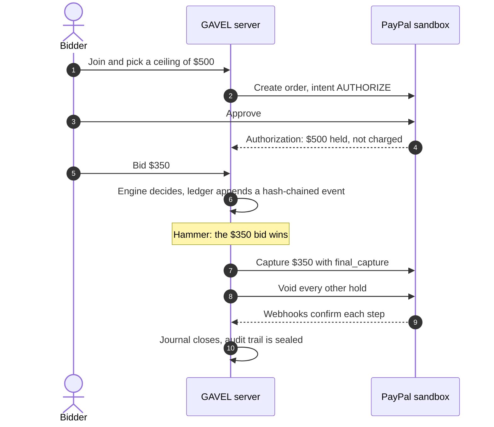

Follow the same process through the docs, stage by stage: the [guided tour](https://docs.gavel.dualmindlab.tech/docs/start/guided-tour) has a process diagram, and these pages cover each stage.

| Stage  | Page                                                                                                   |
| ------ | ------------------------------------------------------------------------------------------------------ |
| Hold   | [Registration and holds](https://docs.gavel.dualmindlab.tech/docs/how-it-works/registration-and-holds) |
| Bid    | [Bid lifecycle](https://docs.gavel.dualmindlab.tech/docs/how-it-works/bid-lifecycle)                   |
| Hammer | [Auction states](https://docs.gavel.dualmindlab.tech/docs/how-it-works/auction-states)                 |
| Settle | [Settlement saga](https://docs.gavel.dualmindlab.tech/docs/how-it-works/settlement-saga)               |
| Verify | [Engine and ledger](https://docs.gavel.dualmindlab.tech/docs/how-it-works/engine-and-ledger)           |
| Words  | [Glossary](https://docs.gavel.dualmindlab.tech/docs/reference/glossary)                                |

### Why GAVEL

Online auctions have a trust problem at the hammer: the winner may never pay, and every losing bidder wonders what happened to their money. GAVEL moves the money question to the start.

|                         | A typical online auction           | GAVEL                                                                                                                                                                                                                                 |
| ----------------------- | ---------------------------------- | ------------------------------------------------------------------------------------------------------------------------------------------------------------------------------------------------------------------------------------- |
| When a bidder commits   | After winning, if they pay at all  | Before the first bid: PayPal holds their ceiling                                                                                                                                                                                      |
| What a losing bid costs | Nothing, but nothing guarantees it | Nothing: the hold is voided, never captured                                                                                                                                                                                           |
| What the winner pays    | Whatever the invoice says          | The winning price only, never the ceiling                                                                                                                                                                                             |
| If the server crashes   | Manual clean-up                    | The saga resumes from its journal and checks PayPal first (injected crashes against the fake PayPal, one in-process crash on the sandbox, and one real process kill on a CI runner against the sandbox; not yet on the deployed host) |
| Proof of the result     | Trust the operator                 | A hash-chained ledger anyone can verify from a public export                                                                                                                                                                          |

### Settlement that is designed to survive a crash

Crash recovery is verified with injected crashes against the project's fake PayPal and on the real sandbox. On the PayPal sandbox the nightly run (specs R7, R8 and R10; runs [42200708552](https://github.com/harshbhx/gavel-auction/actions/runs/42200708552) on 6 Nov 2026 and [42317068784](https://github.com/harshbhx/gavel-auction/actions/runs/42317068784) on 7 Nov 2026; redacted reports in [docs/evidence/nightly](docs/evidence/nightly)) settled one lot of three holds with the real saga and recovered from one in-process crash with one capture on the winner. A real server process was killed once on a CI runner against the real sandbox (run [42558021614](https://github.com/harshbhx/gavel-auction/actions/runs/42558021614): one kill after the capture request and before the response, restart on the same data folder, journal SETTLED, one capture of 12500 equal to the hammer price, two losers voided, journal equals PayPal, ledger verifies; [evidence](docs/evidence/server-kill)). It is one run with one kill point and not the deployed host; driving a whole auction through the deployed server and killing that process are the next sandbox runs (see [docs/GATES.md](docs/GATES.md)). If the process dies mid-settlement, the saga journal lets it resume: it checks the truth at PayPal, then continues the capture and the voids instead of repeating them. When PayPal's answer is unknown, the settlement stops for review rather than guessing. Simplified:

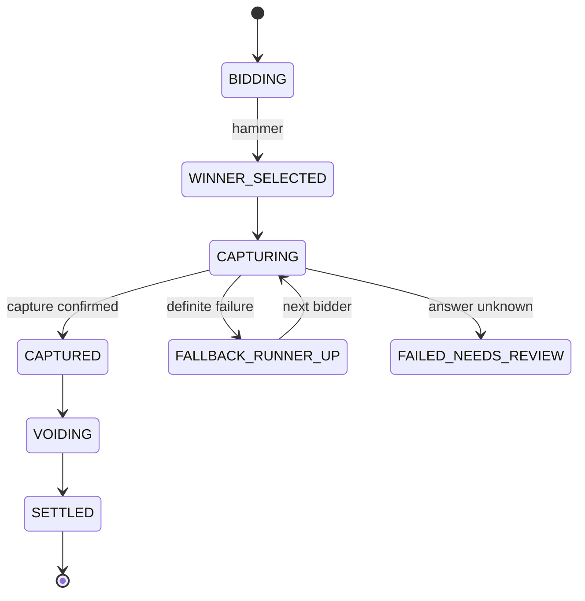

### Features

<table>
  <tr>
    <td valign="top" width="50%">
      <h4>Auction engine</h4>
      English ascending auction with ceilings and soft close. A deterministic core (<code>decide</code>, <code>evolve</code>, <code>replay</code>) with no Node built-ins, so the same events always give the same result.
    </td>
    <td valign="top" width="50%">
      <h4>Hash-chained ledger</h4>
      Every event is linked to the one before it. A redacted public export and a verifier detect an edited chain. A cut tail shows as not closed, and is proven only against a head hash published elsewhere.
    </td>
  </tr>
  <tr>
    <td valign="top">
      <h4>Settlement saga</h4>
      Truth check, capture of the winning price with <code>final_capture</code>, bounded concurrent voids, a journal, and resume after a crash.
    </td>
    <td valign="top">
      <h4>PayPal holds and webhooks</h4>
      Hold creation and approval on PayPal Orders v2 and Payments v2. Webhooks are signature-verified and de-duplicated.
    </td>
  </tr>
  <tr>
    <td valign="top">
      <h4>Voice bidding</h4>
      Audio capture, Deepgram and Groq speech-to-text clients with failover (Deepgram, then Groq, then cached transcripts) and a bid parser. Spoken bids always go through a confirm prompt.
    </td>
    <td valign="top">
      <h4>Replay and testing</h4>
      A replay player and bundle format for recorded auctions (controls, ladder and big screen views; no hosted recording yet), a built-in fake PayPal for offline tests, and a scenario DSL with property tests that print replayable seeds.
    </td>
  </tr>
</table>

<details>
<summary><b>The Scoreboard interface, line by line</b></summary>

<br>

The web app (`packages/web`) was redesigned on 7 Nov 2026 in the Scoreboard design: flat panels, hard shadows, big numerals. Details in [docs/DESIGN.md](docs/DESIGN.md). Each line below is something the code does, covered by unit, component or browser tests that run in CI.

- **Hold button.** Press and hold for 3 seconds to approve a ceiling, or to hammer a lot on the console; release cancels. Keyboard users hold Space or Enter. The ceiling approval also offers a two-tap alternative for people who cannot hold; the console hammer does not.
- **Price roll.** Prices are integer cents in tabular numerals, and only the changed digits roll. Reduced motion swaps the value at once.
- **Hold card.** Hatched means held, solid means charged, hollow means released, always with a text status and a hide-amount toggle.
- **Ceiling slider.** Ticks at every step, snapping, and full keyboard control (arrows, PageUp, PageDown, Home, End).
- **Join code input.** One slot per character, auto-advance, paste that drops a `GVL-` prefix.
- **One look.** Newsprint and Signal is the only palette, checked against contrast pairs in a unit test. There is no colour or theme switch; Night Board and Salon stay in the design-preview rounds only.
- **Alerts.** Outbid, win and sold alerts on the bidder phone and a gavel sound on the projector, with a mute toggle on the bidder screen.
- **Hold explainer and guided tour.** A help button on the landing, join, register, bid and receipt screens opens a sheet that explains the hold, or replays a six-step tour that opens by itself on a first visit.
- **Fundraiser thermometer.** The projector screen shows a goal bar when the auctioneer sets a goal. Only captured money counts as raised; money reserved for the winner is shown apart.
- **Shareable receipt.** A receipt can mint a link with a QR code and a copy button, and a print layout.
- **Judge rooms.** With the host flag `JUDGE_ROOMS=true`, "Start a demo auction" opens a key-less room on the PayPal sandbox (capped, rate limited, switchable off at runtime). The `/try` page gives the steps. Without the flag the button falls back to the operator-key demo route.

</details>

## See it run

Real recordings of the live app at [gavel.dualmindlab.tech](https://gavel.dualmindlab.tech), cut from the nightly judge smoke run [42561627128](https://github.com/harshbhx/gavel-auction/actions/runs/42561627128) (9 Nov 2026). Nothing is mocked: a sandbox demo room with simulated demo holds, and the app's own sandbox banner is on screen. In that run one check failed (the console did not show the lot as closed), so the console clip stops at the hammer confirmation. Each clip is 9 to 10 seconds.

<table>
  <tr>
    <td width="50%"><picture><source media="(prefers-reduced-motion: reduce)" srcset="docs/assets/readme/see-it-run-1-start-room.png">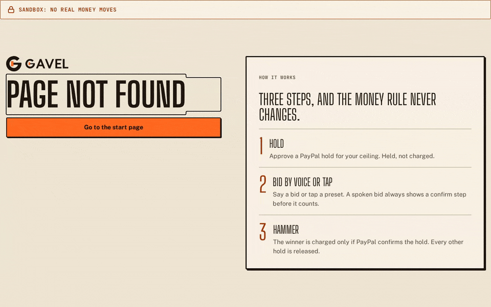</picture><br><sub>Start a demo room: the hub opens with the room code and the QR to scan.</sub></td>
    <td width="50%"><picture><source media="(prefers-reduced-motion: reduce)" srcset="docs/assets/readme/see-it-run-2-hold.png">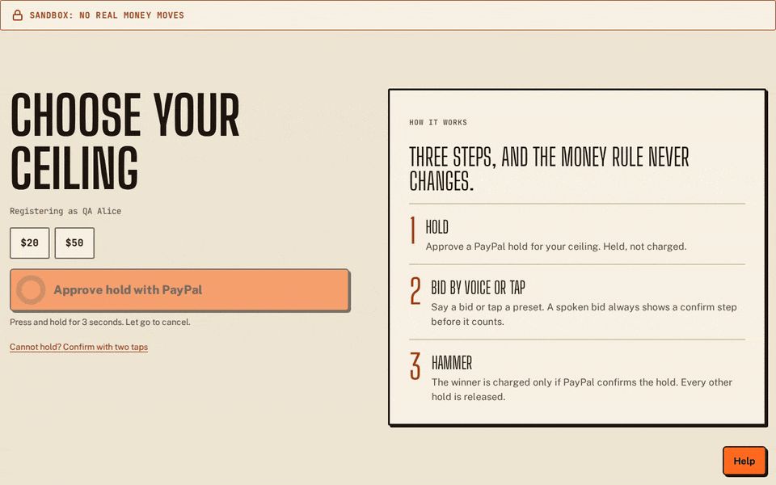</picture><br><sub>A bidder approves a hold (the demo hold, simulated).</sub></td>
  </tr>
  <tr>
    <td width="50%"><picture><source media="(prefers-reduced-motion: reduce)" srcset="docs/assets/readme/see-it-run-3-bids.png">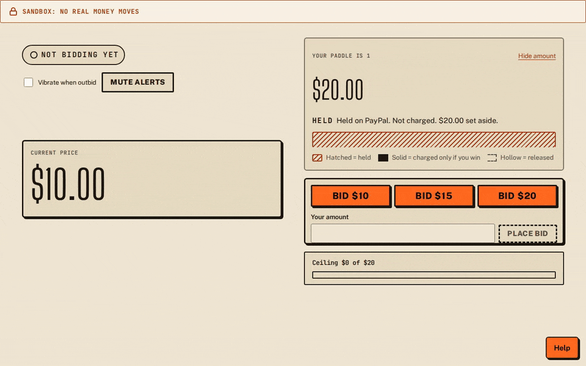</picture><br><sub>Bids stream in: leading, then outbid.</sub></td>
    <td width="50%"><picture><source media="(prefers-reduced-motion: reduce)" srcset="docs/assets/readme/see-it-run-4-hammer.png">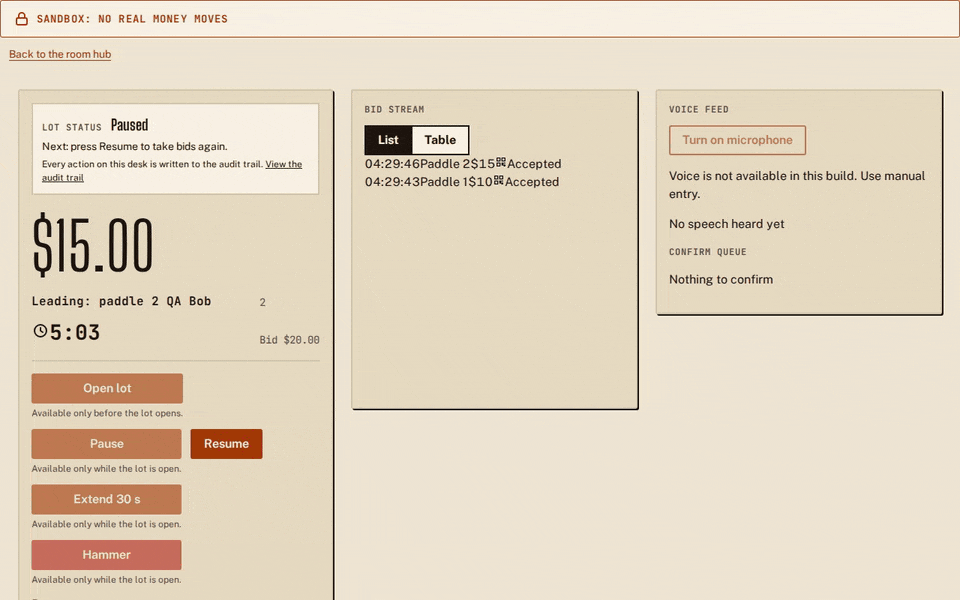</picture><br><sub>The console: hold the button to hammer.</sub></td>
  </tr>
  <tr>
    <td width="50%"><picture><source media="(prefers-reduced-motion: reduce)" srcset="docs/assets/readme/see-it-run-5-sold.png">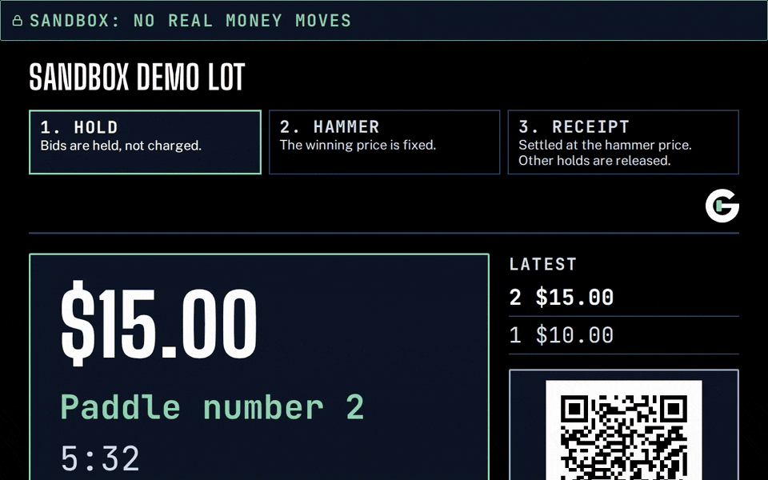</picture><br><sub>The big screen: sold, with the other hold released.</sub></td>
    <td width="50%"><picture><source media="(prefers-reduced-motion: reduce)" srcset="docs/assets/readme/see-it-run-6-receipt.png">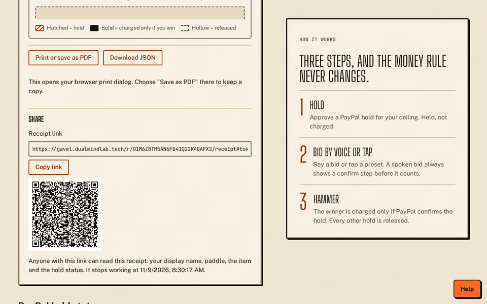</picture><br><sub>The receipt, with a share link and QR.</sub></td>
  </tr>
</table>

## Screens

Pictures from the committed browser-test baselines (scripted data, not a live auction).

<table>
  <tr>
    <td width="50%">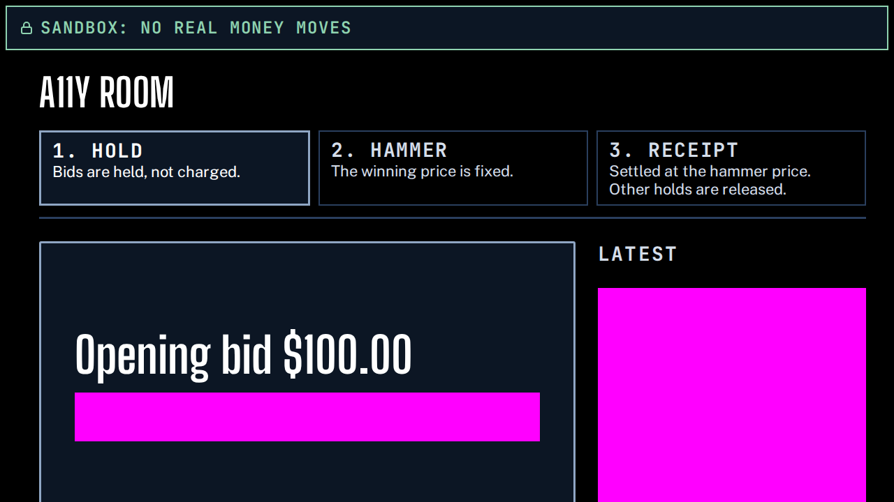<br><sub>The big screen, lot open</sub></td>
    <td width="50%">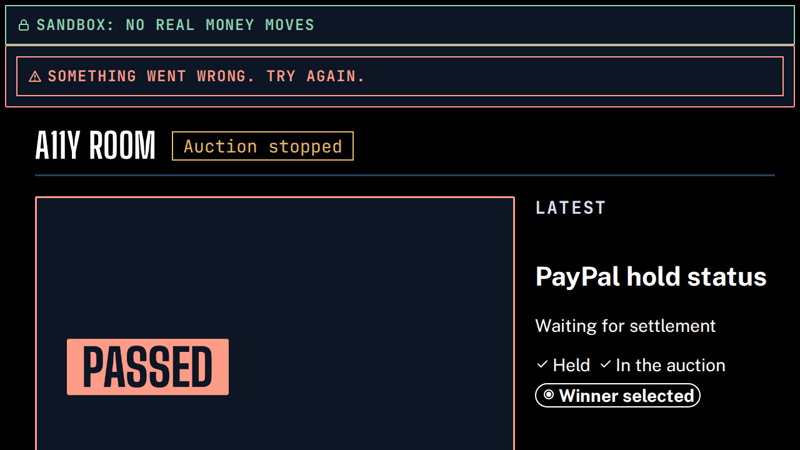<br><sub>The big screen, after the hammer</sub></td>
  </tr>
</table>

## Tech and architecture

| Layer            | What is used                                                                                                           |
| ---------------- | ---------------------------------------------------------------------------------------------------------------------- |
| Language         | TypeScript (strict) in an npm-workspaces monorepo on Node 22; a Python reference implementation for differential tests |
| Web app          | React and Vite, hosted on Cloudflare Workers with static assets                                                        |
| API and realtime | One Node host with HTTP routes and a room WebSocket gateway, hosted on Render                                          |
| Payments         | PayPal Orders v2 and Payments v2, JS SDK v6, signature-verified webhooks; a built-in fake PayPal for offline tests     |
| Auction core     | Pure `decide`, `evolve` and `replay` functions and a hash-chained ledger                                               |
| Voice            | Deepgram and Groq speech-to-text with failover, a rule parser, and a confirm prompt for every spoken bid               |
| Docs             | Fumadocs on a Next.js static export, with a glossary and a guided tour                                                 |
| Checks           | GitHub Actions: tests, type checks, lint, scenario and property tests, sandbox gates, docs build                       |

<picture>
  <source media="(prefers-color-scheme: dark)" srcset="docs/assets/readme/architecture-dark.svg">
  
</picture>


| Package             | Purpose                                                                            |
| ------------------- | ---------------------------------------------------------------------------------- |
| `packages/shared`   | Money in integer cents, ids, wire types, replay bundle format                      |
| `packages/engine`   | Pure auction core and hash-chained ledger                                          |
| `packages/payments` | Hold service, settlement saga, webhook verification, fake PayPal, gate scripts     |
| `packages/voice`    | Audio capture, speech-to-text clients, bid parser, decision step                   |
| `packages/server`   | Single-process host: HTTP routes, room runtime, settlement scheduling, file stores |
| `packages/e2e`      | Scenario DSL, runner and end-to-end specs                                          |
| `packages/web`      | Browser client (React and Vite); see its own README for its state                  |

Full diagram and details: [docs/submission/ARCHITECTURE.md](docs/submission/ARCHITECTURE.md), and the [system architecture page](https://docs.gavel.dualmindlab.tech/docs/how-it-works/system-architecture) of the docs site.

## Sponsors

| Sponsor  | How GAVEL uses it                                  | Status                                                                                            |
| -------- | -------------------------------------------------- | ------------------------------------------------------------------------------------------------- |
| Render   | Hosts the API and WebSocket host                   | In use: one service with a 1 GB persistent disk, see below                                        |
| APIMatic | SDK and developer portal from the OpenAPI 3.1 spec | The spec is ready; APIMatic generation is pending (needs an account), so nothing is generated yet |
| AG Grid  | Ledger, bids and holds tables in the web app       | Merged on 9 Nov 2026: [pull request #2046](https://github.com/harshbhx/gavel-auction/pull/2046)   |

**Render.** The GAVEL API and WebSocket host runs on [Render](https://render.com) as one Node web service (`starter` plan, always on) at [api.gavel.dualmindlab.tech](https://api.gavel.dualmindlab.tech/healthz), with a 1 GB persistent disk at `/var/data` that holds the hash-chained ledger, room log, settlement journals and hold records. [`render.yaml`](render.yaml) is the blueprint; deploys start from GitHub Actions through a Render deploy hook and are followed by `/version` and smoke checks. We do not use Render Postgres, cron jobs or preview environments yet. Details, the reasons for one instance, and the next steps: [Hosting on Render](https://docs.gavel.dualmindlab.tech/docs/run/hosting-on-render).

**APIMatic.** Best Use of APIMatic. The OpenAPI 3.1 spec of the host API is ready ([`openapi/gavel.yaml`](openapi/gavel.yaml), linted in CI and checked against the server router, also served at https://docs.gavel.dualmindlab.tech/openapi.yaml). SDK and developer portal generation by APIMatic is pending: it needs an APIMatic account, so nothing is generated yet. Details in [docs/API.md](docs/API.md).

**AG Grid.** [AG Grid](https://www.ag-grid.com/) Community edition (MIT): the audit ledger, the console bid history and the holds and settlement tables are AG Grid tables, themed to the Newsprint look. They sort, filter, resize, select, export to CSV and stay smooth on a few thousand rows. The grids load on demand, so the landing and bidder pages do not carry the library. See [docs/AG-GRID.md](docs/AG-GRID.md), and try the grids on the `/ledger` page of the web app (a 30-day simulated run).

## Evidence and gates

Gates G0 to G4 are runs against the real PayPal sandbox; G5 is measured on synthetic audio. Source of truth: [docs/GATES.md](docs/GATES.md). Committed redacted evidence ([`docs/evidence/`](docs/evidence)) exists for G0, G1, G2 and G4, and for the early G3 readings, the real server kill, the hosted run, the SEC-15 log scan and the G5 held-out set.

| Gate | Question                                      | Result                                                                       | Notes                                                                                                                                                                                                                                                                                                                                                                                                                                                                                                                          |
| ---- | --------------------------------------------- | ---------------------------------------------------------------------------- | ------------------------------------------------------------------------------------------------------------------------------------------------------------------------------------------------------------------------------------------------------------------------------------------------------------------------------------------------------------------------------------------------------------------------------------------------------------------------------------------------------------------------------ |
| G0   | Sandbox app and buyer accounts work           |          | Connectivity and order creation only; redacted evidence committed from a re-run on 9 Nov ([docs/evidence/G0](docs/evidence/G0))                                                                                                                                                                                                                                                                                                                                                                                                |
| G1   | Partial capture and release of the remainder  |          | PayPal-account orders for both buyers (the "card" buyer is a PayPal account funded by a card); no `final_capture` or void on a guest-card authorization (a later early G3 probe captured 1.00 on one). Release of the remainder is inferred from the authorization reading CAPTURED and the 422 on a void, not from a buyer balance; a 9 Nov attempt to read the buyer balance was blocked by a sign-in prompt                                                                                                                 |
| G2   | Card and guest AUTHORIZE                      |          | Wallet and guest card authorized, PayPal JS SDK v6                                                                                                                                                                                                                                                                                                                                                                                                                                                                             |
| G3   | Honor period, validity and reauthorize        |  | Real probe in progress: day 0 7 Nov 2026 03:06 UTC, checkpoints at 3.5, 4 and 5 days, final reading about 12 Nov 06:17 UTC, so the result comes then. The simulated 30-day fake-clock tests ([SIM-MULTIDAY](docs/evidence/SIM/SIM-MULTIDAY.md)) are a simulation, not a real PayPal sandbox result                                                                                                                                                                                                                             |
| G4   | Webhook signature verification on real events |          | 6 real deliveries verified; tampered-event rejection is fake-only                                                                                                                                                                                                                                                                                                                                                                                                                                                              |
| G5   | Speech-to-text accuracy on noisy bids         |    | synthetic eSpeak clips, 24: Deepgram nova-3 wrong-accept 0.000 (was 0.125 on nova-2), Groq whisper-large-v3-turbo with a bid prompt 0.000 (was 0.083); fixes were chosen on the same clips, nine of eleven earlier wrong accepts were an eval label defect; voice bids still use the confirm prompt; a synthetic held-out noisy set (120 clips) was measured once at wrong accept 0.058 (Groq) and 0.092 (Deepgram) against 0.05 ([result](docs/evidence/G5/HELDOUT-NOISY.md)); scope: synthetic audio, next step: a real room |
| G5   | Speech-to-text accuracy, second clip set      |    | human-like synthetic voice, noise-free, 24 clips (still not a real-room test): Deepgram nova-3 wrong-accept 0.000 (was 0.083), Groq 0.000 (was 0.167); auto-accepted bids at system level: 0 on the room microphone by construction; this set is in sample, the held-out result is in the row above                                                                                                                                                                                                                            |

Behaviour not covered by a passed gate is exercised against the project's own fake PayPal, and the next sandbox runs are listed on [Limits and next steps](docs/LIMITATIONS.md).

<p align="center">
  <picture>
    <source media="(prefers-reduced-motion: reduce) and (prefers-color-scheme: dark)" srcset="docs/assets/readme/results-latency-dark-poster.png">
    <source media="(prefers-reduced-motion: reduce)" srcset="docs/assets/readme/results-latency-poster.png">
    <source media="(prefers-color-scheme: dark)" srcset="docs/assets/readme/results-latency-dark.gif">
    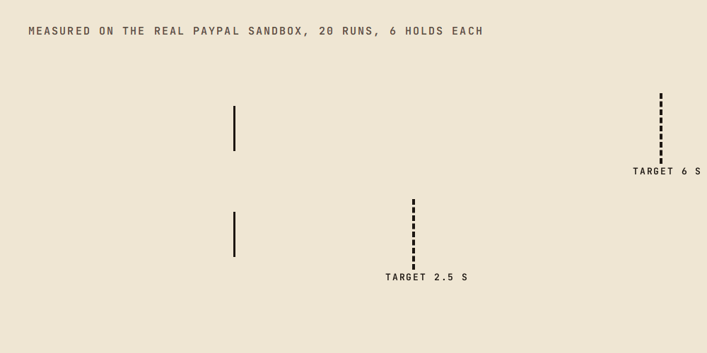
  </picture>
</p>

**G3 progress.** The timed probe started on 7 Nov at 03:06 UTC. Day 0 is recorded: an immediate reauthorize was refused with `REAUTHORIZATION_TOO_SOON`, and three authorizations were approved to be read at day 3.5, 4 and 5 ([run 42332377547](https://github.com/harshbhx/gavel-auction/actions/runs/42332377547)). An early reading on an older G2 wallet authorization (8 Nov 17:36 UTC, age 3.24 days) accepted a partial capture of 1.00 (HTTP 201) and answered a reauthorize call with 422 `UNPROCESSABLE_ENTITY`, issue `PAYER_CANNOT_PAY` ([run 42505780514](https://github.com/harshbhx/gavel-auction/actions/runs/42505780514)); the older guest-card authorization was probed on 9 Nov at 00:09 UTC, age 3.5075 days: still CREATED, a partial capture of 1.00 accepted (HTTP 201), reauthorize 422 `PAYER_CANNOT_PAY` ([run 42538613566](https://github.com/harshbhx/gavel-auction/actions/runs/42538613566); [evidence](docs/evidence/G3-early)). A `final_capture` and a void on a guest-card authorization were not run. These are early readings, not the G3 result. The final reading is about 12 Nov 06:17 UTC.

The docs read gate status from `docs/GATES.md` when the site is built: [Evidence and gates](https://docs.gavel.dualmindlab.tech/docs/proof/gates), [evidence map](https://docs.gavel.dualmindlab.tech/docs/proof/evidence-map), [simulation](https://docs.gavel.dualmindlab.tech/docs/proof/simulation).

### What works today

The packages are built and tested separately, mostly against the fake PayPal. The booted server serves the ops, webhook, admin and auction HTTP routes (create, invites, join, read, control, auctioneer token), the room WebSocket gateway and the `/audio` voice socket. The scripted `/api/demo/*` routes are mounted only with `DEMO_MODE=1` and `PAYMENTS=fake`, which config refuses under production-like settings, so no hosted server has them. The web app and API are hosted in sandbox mode, and a live walkthrough of the hosted site (judge smoke, run [42561627128](https://github.com/harshbhx/gavel-auction/actions/runs/42561627128), 9 Nov) passed steps 1 to 15 and 17; step 16 (hammer) is the open item and a fix has merged. See [docs/DEMO.md](docs/DEMO.md) for the exact state.

Latency, measured end to end. On the real PayPal sandbox, the earlier run (`measure-sandbox` run 42346811713, 20 settlements of 6 holds each, [redacted evidence](docs/evidence/measure)), hammer to SETTLED has p95 5591 ms and hammer to CAPTURED p95 3010 ms. A later, larger run (`evidence-latency` run 42563147792, n=49 settlements, INCOMPLETE with 1 timeout and 3 failed capture calls, [evidence](docs/evidence/latency)) measures hammer to SETTLED at p95 6.93 s against 6 s and hammer to CAPTURED at p95 3.77 s against 2.5 s; the n=20 run is the smaller sample. Owner decision open: keep the targets, raise them with a reason, or reduce latency. The webhook route on the hosted API had p95 112.03 ms from a GitHub runner (n=50, network included) against 300 ms, and the handler alone 1.07 ms on loopback ([evidence](docs/evidence/hosted)). See [docs/GATES.md](docs/GATES.md).

| Area                      | Status                                                                                                                                                                                                                                                                                                                                                                                                                                                                                                                                                                                                                   |
| ------------------------- | ------------------------------------------------------------------------------------------------------------------------------------------------------------------------------------------------------------------------------------------------------------------------------------------------------------------------------------------------------------------------------------------------------------------------------------------------------------------------------------------------------------------------------------------------------------------------------------------------------------------------ |
| Auction engine and ledger |  Covered by unit, property and fixture tests                                                                                                                                                                                                                                                                                                                                                                                                                                                                                                       |
| Settlement saga and holds |  Fake PayPal, plus nightly sandbox specs R7, R8, R10; gates below                                                                                                                                                                                                                                                                                                                                                                                                                                                                                  |
| Webhook verification      |  Against real sandbox events (gate G4)                                                                                                                                                                                                                                                                                                                                                                                                                                                                                                       |
| Server                    |  Ops, webhook, admin and auction HTTP routes, room WebSocket gateway and `/audio` socket mounted; scripted demo routes only with `DEMO_MODE=1` and fake payments                                                                                                                                                                                                                                                                                                                                                                               |
| Voice                     |  `/audio` socket feeds decisions into the room. Speech is cached transcripts by default, Groq only with `VOICE_STT=groq` and `GROQ_API_KEY`; one live run of the socket is recorded (24 synthetic clips, both providers, fake PayPal, no bid accepted without a confirm; [evidence](docs/evidence/voice-live-socket)) (G5: PARTIAL, wrong accept 0.000 on 24 synthetic clips tuned on, but 0.058 and 0.092 on a held-out noisy synthetic set measured once, so spoken bids use the confirm prompt and live-room confirmation is the next step) |
| Web client                |  Scoreboard interface on every route, tested in CI; hosted in sandbox mode on a persistent disk; a recorded click-through of the hosted site is next. See [packages/web/README.md](packages/web/README.md) and [docs/DESIGN.md](docs/DESIGN.md)                                                                                                                                                                                                                                                                                                |

## Open data

Five small datasets and a read-only Evidence Explorer Space are published on Hugging Face, each labelled for what it is. The speech, simulation and trace sets use synthetic audio, a fake clock and scripted auctions by design (privacy by design: GAVEL does not collect real people's data).

| Dataset                                                                       | Label                                         |
| ----------------------------------------------------------------------------- | --------------------------------------------- |
| [gavel-gates](https://huggingface.co/datasets/harshbhx/gavel-gates)           | real sandbox, synthetic audio, G3 in progress |
| [gavel-latency](https://huggingface.co/datasets/harshbhx/gavel-latency)       | real sandbox, small n                         |
| [gavel-sim-30d](https://huggingface.co/datasets/harshbhx/gavel-sim-30d)       | simulated, fake clock                         |
| [gavel-stt-bids](https://huggingface.co/datasets/harshbhx/gavel-stt-bids)     | synthetic audio                               |
| [gavel-audit-demo](https://huggingface.co/datasets/harshbhx/gavel-audit-demo) | synthetic, fake PayPal                        |

Space: [gavel-evidence-explorer](https://huggingface.co/spaces/harshbhx/gavel-evidence-explorer). Collection: [GAVEL Evidence](https://huggingface.co/collections/harshbhx/gavel-evidence-auction-holds-hammer-and-receipts-6af0afebebb37eb4c9184504). How they are built: [docs/HF_COLLECTION.md](docs/HF_COLLECTION.md) and [Open data](https://docs.gavel.dualmindlab.tech/docs/judges/open-data) in the docs.

## Repo map

| Path                    | What is there                                                                                 |
| ----------------------- | --------------------------------------------------------------------------------------------- |
| `packages/`             | The seven packages (`shared`, `engine`, `payments`, `voice`, `server`, `e2e`, `web`)          |
| `docs/`                 | Gates, judge paths, demo guide, design, decisions, evidence, submission draft                 |
| `docs/evidence/`        | Committed, redacted run logs and reports                                                      |
| `docsite/`              | The documentation website (Fumadocs, Next.js static export)                                   |
| `openapi/`              | The OpenAPI 3.1 spec of the host API                                                          |
| `hf/`, `scripts/hf/`    | The Hugging Face Space and the dataset build scripts                                          |
| `reference/python/`     | Python reference implementation for differential tests                                        |
| `infra/`, `render.yaml` | Hosting notes and the Render blueprint                                                        |
| `scripts/`, `tools/`    | Repository checks and helper scripts; `tools/g4-receiver` is the webhook receiver for gate G4 |
| `etc/`                  | API extractor reports of each package's public surface                                        |

## Quick start

Needs Node 22 and npm. No PayPal account is needed for the default run.

```bash
npm ci
PUBLIC_URL=http://localhost:8080 TOKEN_SECRET="$(openssl rand -hex 16)" ADMIN_KEY="$(openssl rand -hex 12)" \
  PAYMENTS=fake PAYPAL_ENV=sandbox npm start -w @gavel/server
```

The two generated values are 32 and 24 hex characters, the minimum lengths the server accepts for `TOKEN_SECRET` and `ADMIN_KEY` (the minimums are waived only when `NODE_ENV=test`). With `PAYMENTS=fake` the server uses the built-in fake PayPal and needs no network access. Production mode refuses fake payments. All server settings are listed in [packages/server/README.md](packages/server/README.md).

To see the interface without a server, copy the web settings once and start the web dev server:

```bash
cp packages/web/.env.example packages/web/.env.local
npm run dev -w @gavel/web
```

Then open `/r/demo/screen?scripted=1`. The flag plays a recorded scenario in the browser and makes no PayPal calls; `/r/demo/bid?scripted=1&at=3000` and the console and receipt routes work the same way. Only development builds honour the `scripted=1` flag: a production build, including the hosted site, ignores it. The `/demo/scripted` page plays the recorded room in every build, the hosted site included.

<details>
<summary><b>Use the real PayPal sandbox</b></summary>

<br>

Set `PAYMENTS=sandbox` and provide `PAYPAL_CLIENT_ID`, `PAYPAL_CLIENT_SECRET` and `PAYPAL_WEBHOOK_ID`. The names are in `.env.example`; keep the values in your local `.env` and never commit them. Nothing loads that file by itself: delete the lines you do not fill in (empty values count as unset), then run `set -a; source .env; set +a` before starting the server, or pass the variables inline. The gate runbook in [docs/RUNBOOK-GATES.md](docs/RUNBOOK-GATES.md) shows how each sandbox run is recorded.

</details>

<details>
<summary><b>Tests and quality checks</b></summary>

<br>

Every pull request runs tests, type checks, lint and the other quality checks in GitHub Actions ([ci.yml](.github/workflows/ci.yml)). The same commands work locally:

| Command                 | What it runs                                                                   |
| ----------------------- | ------------------------------------------------------------------------------ |
| `npm test`              | Unit tests for every package                                                   |
| `npm run test:property` | Property tests; each run prints its seed, `GAVEL_PROPERTY_SEED=<n>` replays it |
| `npm run typecheck`     | Strict TypeScript across the workspace                                         |
| `npm run lint`          | ESLint with zero warnings allowed                                              |

</details>

## Security and data notes

GAVEL talks to the PayPal sandbox only. No live PayPal call is made and no real money moves. Do not put real card numbers, real accounts or personal data into the demo. Secrets are never committed; report vulnerabilities as described in [SECURITY.md](SECURITY.md). The open datasets contain no real people's data, and a privacy and secret scan runs on every dataset build ([docs/PRIVACY.md](docs/PRIVACY.md)).

## Documentation

| Read this                                                                 | To learn                                       |
| ------------------------------------------------------------------------- | ---------------------------------------------- |
| [Docs site](https://docs.gavel.dualmindlab.tech)                          | Diagrams, proof pages and the judge paths      |
| [Guided tour](https://docs.gavel.dualmindlab.tech/docs/start/guided-tour) | Ten steps from what GAVEL is to its limits     |
| [Glossary](https://docs.gavel.dualmindlab.tech/docs/reference/glossary)   | Every term, with the pages that use it         |
| [Judge walkthrough](docs/JUDGES.md)                                       | A short path through the code and the evidence |
| [Design system](docs/DESIGN.md)                                           | The Scoreboard interface and its components    |
| [AG Grid tables](docs/AG-GRID.md)                                         | How the ledger, bids and holds grids are built |
| [Demo guide](docs/DEMO.md)                                                | What you can try today and what to expect      |
| [API reference](docs/API.md)                                              | The OpenAPI spec, auth, errors, rate limits    |
| [Architecture](docs/submission/ARCHITECTURE.md)                           | How the packages fit together                  |
| [Gate results](docs/GATES.md)                                             | What each sandbox run proved                   |
| [Limits and next steps](docs/LIMITATIONS.md)                              | What is measured today and what comes next     |
| [Changelog](CHANGELOG.md)                                                 | What changed, day by day                       |
| [Gate runbook](docs/RUNBOOK-GATES.md)                                     | How to run a gate yourself                     |
| [Decisions](docs/DECISIONS.md), [plan](docs/PLAN.md)                      | Why the design is the way it is                |
| [Deploy staging](docs/DEPLOY.md)                                          | Hosting the server                             |

Package guides: [server](packages/server/README.md), [voice](packages/voice/README.md), [engine](packages/engine/README.md), [web](packages/web/README.md).

## Contributing

Read [CONTRIBUTING.md](CONTRIBUTING.md) and the [code of conduct](CODE_OF_CONDUCT.md). Work goes through branches and pull requests, and the pull request template lists the checks.

## License

[MIT](LICENSE)

<p align="center">
  <picture>
    <source media="(prefers-reduced-motion: reduce) and (prefers-color-scheme: dark)" srcset="docs/assets/readme/readme-footer-dark-poster.png">
    <source media="(prefers-reduced-motion: reduce)" srcset="docs/assets/readme/readme-footer-poster.png">
    <source media="(prefers-color-scheme: dark)" srcset="docs/assets/readme/readme-footer-dark.gif">
    
  </picture>
</p>
