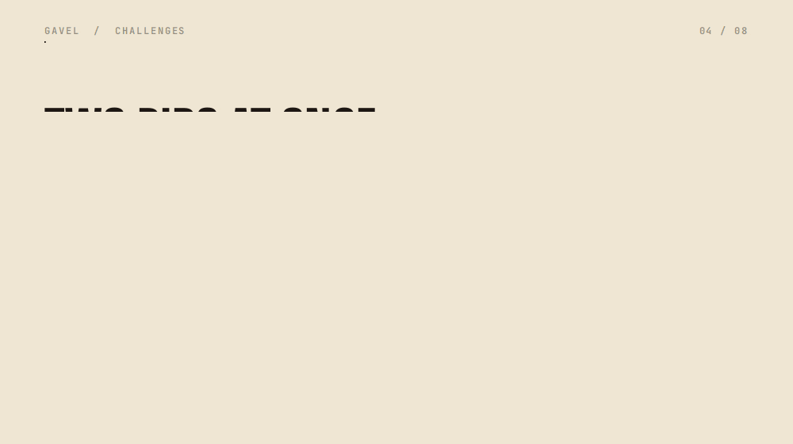
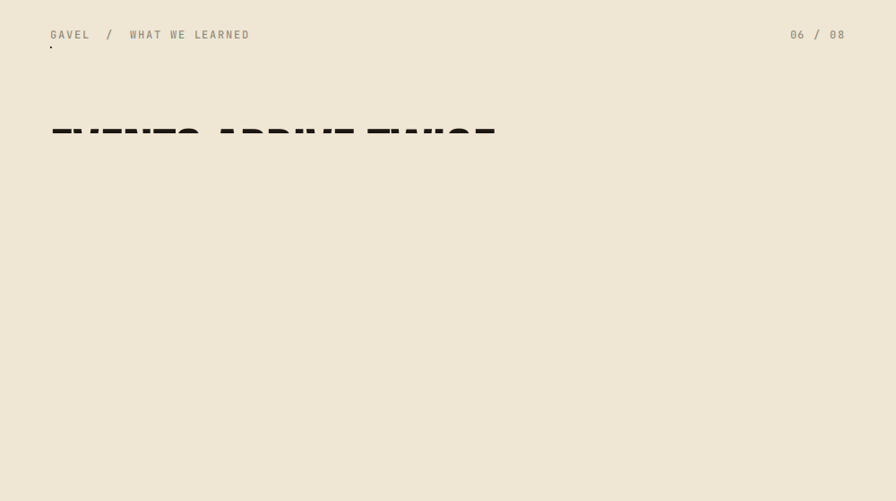

## Inspiration

At a live auction or a fundraiser, bidders hesitate when a card is charged up front, so they bid less or not at all. The other way round, bids are unsecured: a winner can walk away after the hammer and the organizer chases payment afterwards. Paper sheets and shouted bids make the record hard to trust.

PayPal already separates authorizing money from capturing it, and that is the shape of an auction: hold a ceiling, bid under it, capture only the winning price at the hammer.

## What it does

GAVEL makes each bid a PayPal AUTHORIZE hold. Everything runs in the PayPal sandbox, so no real money moves.

- **Hold.** A bidder approves a ceiling, the most they may bid, as an authorization hold. It is held, not charged.
- **Bid.** A deterministic engine runs an ascending English auction with a minimum increment and a soft close. A bid above a bidder's ceiling is refused. Bids come from phones, a QR code, the console or, with a confirm step, by voice.
- **Hammer.** The auctioneer holds a button to close the lot. GAVEL captures only the winning price from the winner's hold and voids every other hold. Until the capture, money is held, not charged.
- **Receipt and verify.** Every accepted bid goes into a hash-chained ledger. Anyone can replay the public export and check the chain; an edited entry is marked as edited.
- **Voice bids.** A spoken bid is turned into a structured bid by a parser with a deterministic validator. Every spoken bid goes through a confirm prompt ("Did you mean 350 for paddle 12?"). The parser never decides a winner and never moves money.

A judge can run the whole thing without an account: open the [judge panel](https://gavel.dualmindlab.tech/try), start a demo room, join as a bidder, bid, hammer, and read the receipt. A recorded tour of about one minute plays at [the scripted demo](https://gavel.dualmindlab.tech/demo/scripted).

## How we built it

GAVEL was built during the hackathon period, from the initial commit on 4 Nov 2026. It is a TypeScript monorepo (npm workspaces, Node 22) with a Python reference implementation used for differential tests of the engine and the parser.

- `packages/engine`: auction rules, commands and events, the hash-chained ledger and replay, with no Node built-ins so the same events always give the same result.
- `packages/payments`: PayPal Orders v2 (intent AUTHORIZE) and Payments v2 (authorize, capture, void, reauthorize), JS SDK v6, signature-verified webhooks, the hold service, the settlement saga and a built-in fake PayPal for offline tests.
- `packages/server`: one Node host with HTTP routes, a room WebSocket gateway and file stores.
- `packages/voice`: audio capture, Deepgram and Groq speech-to-text with failover, and the bid parser.
- `packages/web`: bidder phone, auctioneer console, big screen, receipt, audit and replay screens, in React and Vite.
- `packages/shared` and `packages/e2e`: money in integer cents, wire types, and the scenario DSL and sandbox specs.

The settlement saga is journaled. If the process dies mid-settlement, it checks the truth at PayPal, then continues the capture and the voids instead of repeating them. If PayPal's answer is unknown, settlement stops for review rather than guessing.

### Where the partners fit

- **PayPal:** all payments run on the sandbox: Orders v2, Payments v2, webhook signature verification and JS SDK v6.
- **Cloudflare:** the web app runs as a Worker with static assets, and the docs site is deployed to Cloudflare, both on custom domains with security headers.
- **Render:** the API and WebSocket host is one Node web service on the starter plan, always on, with a 1 GB persistent disk for the ledger, room log, settlement journals and hold records.
- **AG Grid:** the audit ledger, the console bid history and the holds table are AG Grid Community tables, with sorting, filters, CSV export and an in-browser chain check.
- **APIMatic:** the OpenAPI 3.1 spec of the host API is linted in CI and checked against the server router; SDK and portal generation from it is in progress.
- **Hugging Face:** five small datasets and a read-only Evidence Explorer Space, each labelled real sandbox, simulated or synthetic.

### AI in the product

AI is used for voice bidding. Audio from the auctioneer's microphone goes to speech-to-text: Deepgram (model nova-3) with Groq (model whisper-large-v3-turbo) as failover. A rule-based parser turns the transcript into a structured bid, and a deterministic validator checks it against the auction rules. The model never decides a winner and never moves money, and every spoken bid waits for a confirm. The code also has an optional language-model second reading, but it is not wired into the running pipeline.

## Challenges we ran into

- **Sandbox account region.** The sandbox accounts must be US accounts. PayPal rejects INR orders for sandbox buyers with 422 CURRENCY_NOT_SUPPORTED, so every gate sends USD.
- **Authorization validity.** PayPal documents an honor period and a validity window that disagree across pages (3 days versus 29 days, with one reauthorization). A real timed probe has been running since 7 Nov 2026 03:06 UTC (gate G3, final reading about 12 Nov 06:17 UTC). The 29-day figure is not yet verified in the real sandbox. Until it reports, the demo creates holds minutes before the capture and the saga flags holds older than two hours as stale.
- **Remainder release.** After a final capture, a follow-up void answers 422 PREVIOUSLY_CAPTURED and the authorization reads CAPTURED, which we read as the remainder being released. That is inferred, not read from a buyer balance, and the saga treats the answer as released instead of an error.
- **Webhooks arrive twice or out of order.** Handlers de-duplicate and the saga never trusts an event alone. Real events carry fields our simulator lacked, so we committed six sanitized real fixtures and test against them.
- **SDK v6 details.** A client token request with domains answers 401 invalid_domain on localhost, and isEligible for basic_card throws; guest card needs no eligibility key.
- **Speed.** On the sandbox, hammer to settled for 6 holds has p95 6927.43 ms against a 6000 ms target, and hammer to captured p95 3766.67 ms against 2500 ms (n=49, run incomplete). Both targets are missed, and PayPal call latency is most of it.
- **Voice in noise.** A held-out noisy set of 120 synthetic clips, measured once against thresholds fixed beforehand, read wrong accept 0.058 for Groq and 0.092 for Deepgram against 0.05. That is why every spoken bid stays behind a confirm prompt.

## Accomplishments that we're proud of

- Gates G0, G1, G2 and G4 pass on the real PayPal sandbox: app and buyers, partial capture with final_capture, wallet and guest card holds, and six real webhooks verified.
- A real server process was killed once, after the capture request and before the response. After restart on the same data folder it settled with one capture of 12500 equal to the hammer price, two losers voided, a journal equal to PayPal and a ledger of 19 entries that verifies. That ran on a CI runner, not on the deployed host.
- Live speech through the audio socket: both providers answered 24 of 24 synthetic clips, and no spoken bid was accepted without a confirm.
- The hosted judge flow passed all 17 steps on the live domains, from the judge panel through join, bids, hammer and receipts.
- The hosted webhook route answered at p95 112.03 ms against a 300 ms target (n=50, runner network included).
- Per-judge API keys: with a key, a judge can open a sandbox room, bid, hammer and read the ledger over HTTP, with a Try it panel in the docs.
- More than 4,500 test cases run in CI, and all eight P0 items of the security review pass.
- The evidence is open: five datasets with sha256 manifests, each labelled for what it is.

## What we learned

- A hold is a better auction primitive than a charge: the ceiling is backed by an actual hold, so a refused bid is a fact, not a guess.
- Do not trust one source of truth during settlement. Ask PayPal what happened before acting, journal every step, and treat an unknown answer as a stop, not a retry.
- Real services differ from their simulators in small ways, and fixtures from real runs found those differences faster than reading documentation did.
- Label every number with what it measured. We kept real sandbox, simulated and synthetic results apart, and kept the misses on the page.

## What's next for GAVEL

- Record the G3 result and set the reauthorize behaviour from it.
- Run G5 with a person in a real room and in recorded noise, and add an audio sender to the console.
- Decide the latency targets: keep, raise with a reason, or reduce latency.
- Drive a whole auction through the deployed server and repeat the process kill and resume there.
- Host recorded auctions for replay, and finish SDK and portal generation from the OpenAPI spec.

## Try it

- [Judge panel](https://gavel.dualmindlab.tech/try): a live sandbox room, no login
- [Scripted demo](https://gavel.dualmindlab.tech/demo/scripted): about one minute, recorded
- [Docs](https://docs.gavel.dualmindlab.tech) and [API reference](https://docs.gavel.dualmindlab.tech/api-reference)
- [Source, MIT licence](https://github.com/harshbhx/gavel-auction)

PayPal sandbox only. Bids are held, not charged, and no real money moves anywhere in this project.
