_GAVEL: every bid is a hold, the hammer is the payment._

**An auction where the bid is a PayPal hold, the hammer is the payment, and the record can be checked by anyone.**

## Inspiration

Picture a charity night. The auctioneer calls 200 dollars for a signed print. A woman near the back has her hand half raised, and she lowers it. Her card would be charged the moment she bids, and she is not sure she wants the print that much. Across the room, a man bids 400 with a grin, wins, and is never heard from again. The organizer spends a week chasing an invoice, with a paper sheet as the only record.

PayPal already has the answer in its payments model. You can authorize an amount, which holds it, and capture later, which takes it. That is the shape of an auction. Hold a ceiling when a bidder joins, let them bid anywhere under it, and at the hammer capture only the winning price while the other holds go back untouched.

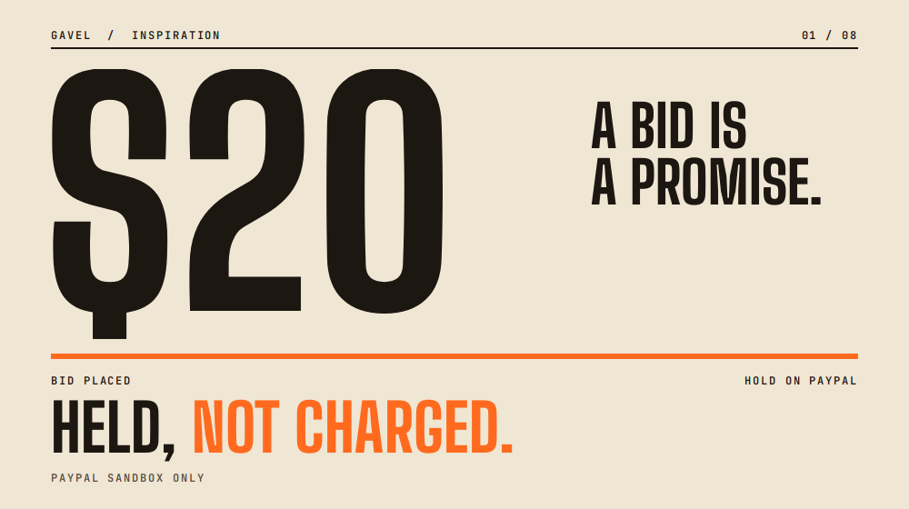

_A price counts up to $20, then the line "Held, not charged" sweeps across it._

## What it does

GAVEL turns that idea into a working room. Everything runs in the PayPal sandbox; no real money moves.

- **Hold.** A bidder approves a ceiling as a PayPal authorization. It is held, not charged.
- **Bid.** A deterministic engine runs an ascending English auction with a minimum increment and a soft close. A bid above the ceiling is refused. Bids come from phones, a QR code or the console. Voice bids go through the server audio socket with a confirm step; the web console microphone is not connected yet.
- **Hammer.** The auctioneer holds a button to close the lot. GAVEL captures only the winning price from the winner's hold and voids every other hold. Until that capture, money is held, not charged.
- **Receipt and verify.** Every accepted bid goes into a hash-chained ledger that anyone can check in the browser.
- **Voice.** A spoken bid sent to the server audio socket is parsed, validated and then waits for a confirm ("Did you mean 350 for paddle 12?"). This is proven on synthetic clips; the web console microphone is not connected yet, so a judge bids by tap, QR or typed entry.

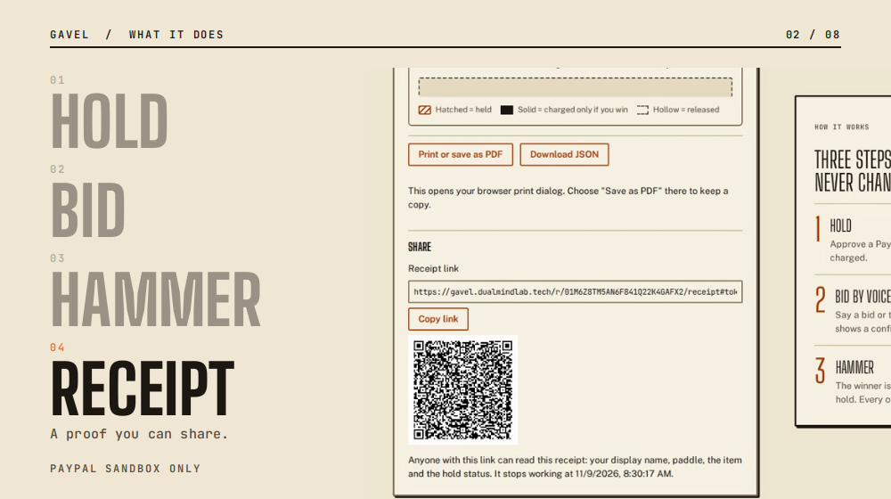

_Hold, bid, hammer, receipt: the four steps, with the real screen for each._

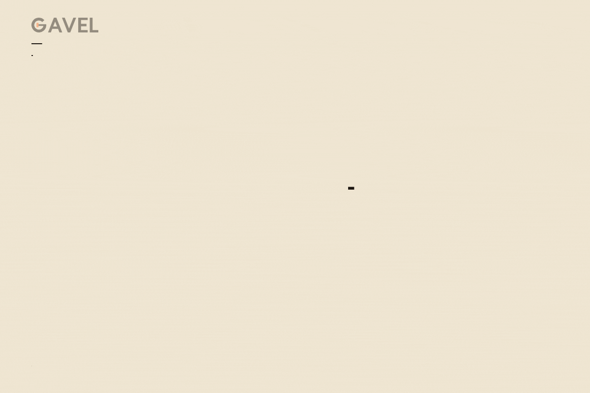

_How it works: a ceiling is held, bids come in under it, the hammer captures the winning price, and the receipt closes the lot._

### Try it in 60 seconds, no account

1. Open the [judge panel](https://gavel.dualmindlab.tech/try) and start a demo room.
2. Join the room as a bidder from the hub and register a sandbox hold.
3. Bid, then press and hold the hammer on the console.
4. Read the receipt, then open the audit page and verify the ledger chain in your browser.
5. The [scripted demo](https://gavel.dualmindlab.tech/demo/scripted) plays a recorded room in about a minute.
6. Prefer HTTP? Use the shared judge key in the Devpost testing instructions (optional, the steps above need no key) and follow [Call the API as a judge](https://docs.gavel.dualmindlab.tech/docs/judges/call-the-api): open a room, bid, hammer and read the ledger with curl. The [API reference](https://docs.gavel.dualmindlab.tech/api-reference) has a Try it panel, and the [docs](https://docs.gavel.dualmindlab.tech) cover the rest.

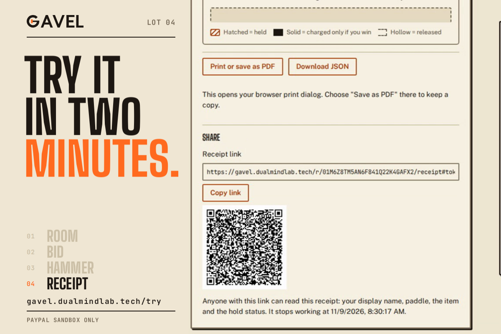

_Two ways in for a judge, no login._

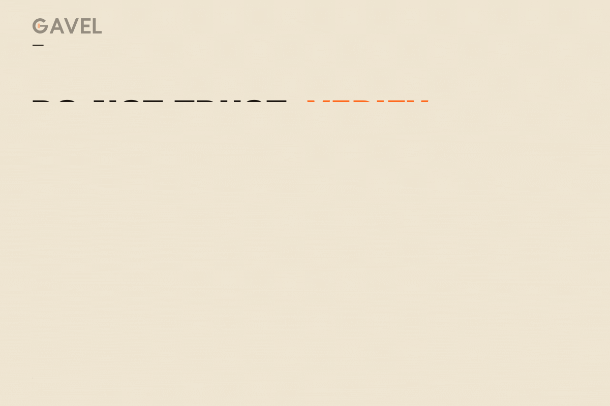

_Do not trust, verify: every accepted bid goes into a hash-chained ledger, and anyone can re-check the public export. Hashes shown are shortened examples._

## How we built it

GAVEL is a TypeScript monorepo (Node 22, npm workspaces) started on 4 Nov 2026, with a Python reference implementation used for differential tests of the engine and the parser.

- **A deterministic engine.** `packages/engine` holds the rules, commands, events and the ledger, with no Node built-ins, so the same events always give the same result. Money is integer cents.
- **A tamper-evident ledger.** Each entry carries the hash of the one before it; an edited entry is marked as edited.
- **PayPal holds with a journaled settlement.** `packages/payments` uses Orders v2 with intent AUTHORIZE and Payments v2 for authorize, capture, void and reauthorize, JS SDK v6 and signature-verified webhooks. The settlement saga writes a journal. If the process dies mid-settlement, it asks PayPal what is true and continues instead of repeating. An unknown answer stops for review.
- **Voice with a confirm step.** Audio goes to Deepgram (nova-3) with Groq (whisper-large-v3-turbo) as failover, then a rule-based parser and a validator.
- **Cloudflare Workers and Render.** The web app and docs site run on Cloudflare with security headers. The API and WebSocket host is one always-on Node service on Render with a 1 GB disk for the ledger and settlement journals.
- **An AG Grid ledger lab.** The audit ledger, console bid history and holds are AG Grid Community tables with filters, CSV export and an in-browser chain check.
- **A judge API.** Per-judge keys open a sandbox room over HTTP. The OpenAPI 3.1 spec is linted in CI and checked against the router. The APIMatic portal and SDKs are not live yet, so we do not claim them.
- **Open evidence.** Five Hugging Face datasets and a read-only Evidence Explorer, each labelled real sandbox, simulated or synthetic, with sha256 manifests.
- **Hardening.** A 24-item security review (all eight P0 items pass, residuals named for the rest) and red team and blue team rounds.

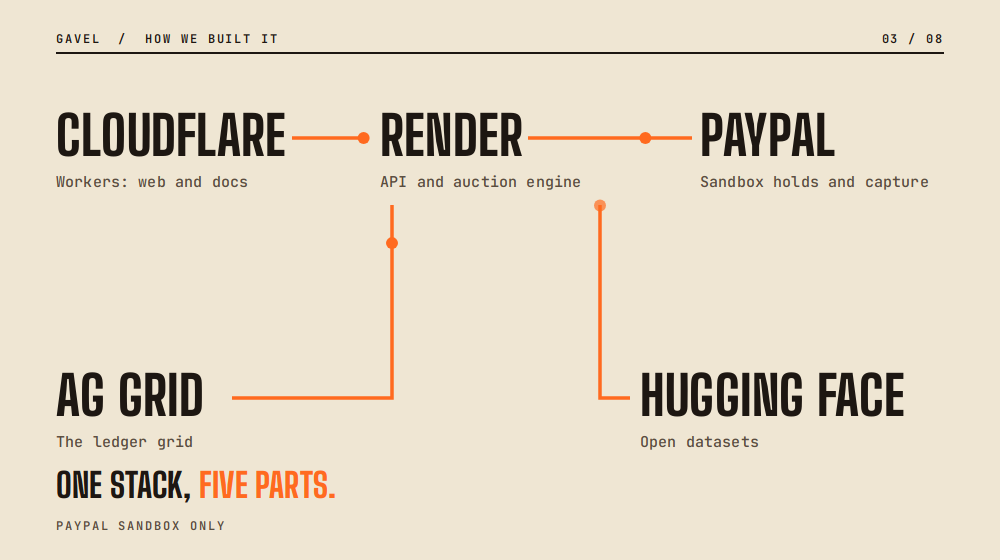

_The stack: Cloudflare Workers, Render, PayPal sandbox, AG Grid and Hugging Face._

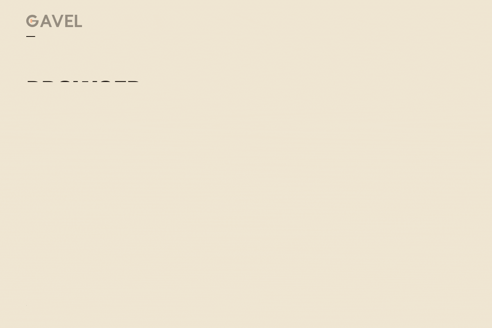

_One bid, four hops through the stack._

### Evidence before claims

We kept a gate file (`docs/GATES.md`) and let nothing count until a real run backed it. Status today:

- **G0, G1, G2 and G4 pass** on the real PayPal sandbox: app and buyers, partial capture with final_capture, wallet and guest-card holds, and six real webhooks verified.
- **G3 is a timed probe in progress.** It started 7 Nov 2026 03:06 UTC and reads out at about 12 Nov 06:17 UTC.
- **G5 is PARTIAL.** Voice accuracy is measured on synthetic audio; the next step is a real room.
- The 30-day settlement run on a fake clock is labelled simulated.

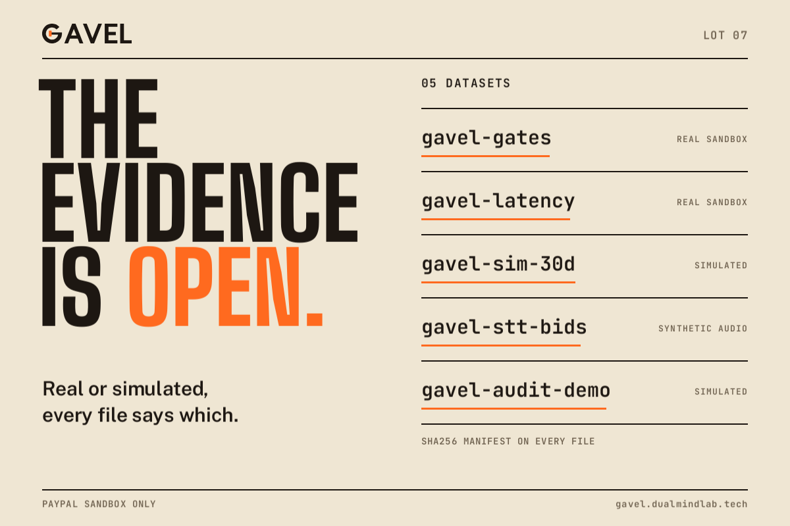

_Open data and the gate status._

### AI in the product

**Runtime AI.** AI is used for voice bidding. Audio sent to the server's audio socket goes to speech-to-text: Deepgram (model nova-3) with Groq (model whisper-large-v3-turbo) as failover. A rule-based parser turns the transcript into a structured bid, and a deterministic validator checks it against the auction rules. The model never decides a winner and never moves money, and every spoken bid waits for a confirm.

**AI tools used while building.** An AI coding assistant (name added by hand on Devpost), for coding assistance and documentation drafts.

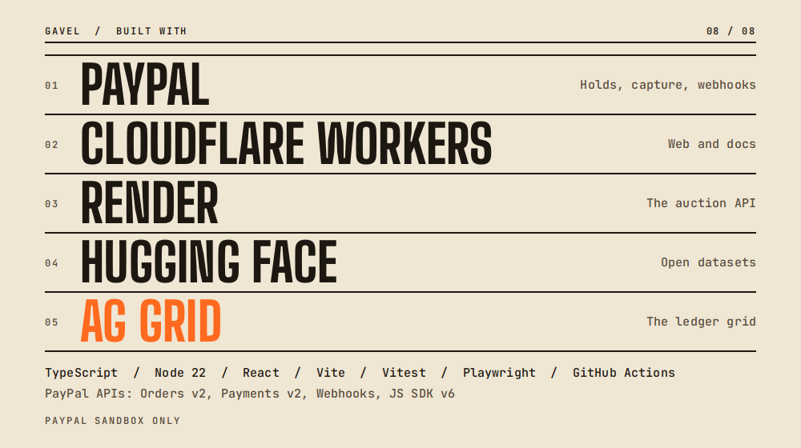

_The partners in large type, the rest of the stack below._

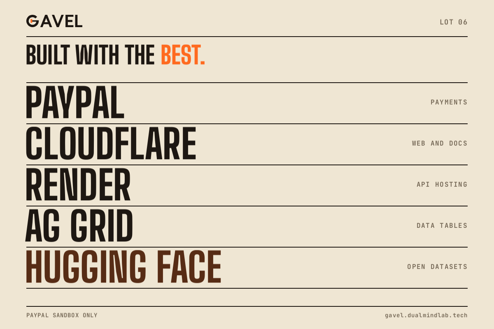

_Who does what: PayPal payments, Cloudflare web and docs, Render API hosting, AG Grid data tables, Hugging Face open datasets._

## Challenges we ran into

Correctness costs more than the happy path.

- **Holds must be idempotent.** A retry or a double tap must not make a second hold. Webhooks also arrive twice or out of order, so handlers de-duplicate and the saga never trusts one event alone. Real events carried fields our simulator lacked, so we test against six sanitized real fixtures.
- **Void on loss, and what "released" means.** After a final capture, a follow-up void answers 422 PREVIOUSLY_CAPTURED and the authorization reads CAPTURED. We treat that as the remainder being released, and we say plainly that it is inferred, not read from a buyer balance.
- **The soft close.** Two bids landing together must get one ordered answer: one accepted, one refused as not higher.
- **How long a hold lasts.** PayPal's pages disagree (3 days versus 29, with one reauthorization). We run a real timed probe, and until it reports, demo holds are made minutes before the capture.
- **Voice in noise.** On a held-out noisy set of 120 synthetic clips, measured once against thresholds fixed beforehand, wrong accept was 0.058 for Groq and 0.092 for Deepgram against a 0.05 limit. That is why every spoken bid stays behind a confirm prompt.
- **Speed.** On the sandbox, hammer to settled for 6 holds has p95 6927.43 ms against a 6000 ms target, and hammer to captured p95 3766.67 ms against 2500 ms (49 of 50, incomplete). Both targets are missed.
- **Flaky CI and honest numbers.** Browser and sandbox runs flake, so we separated a real failure from a flaky one before trusting a green run, and every figure here names what it measured. The sandbox also needs US accounts and USD.

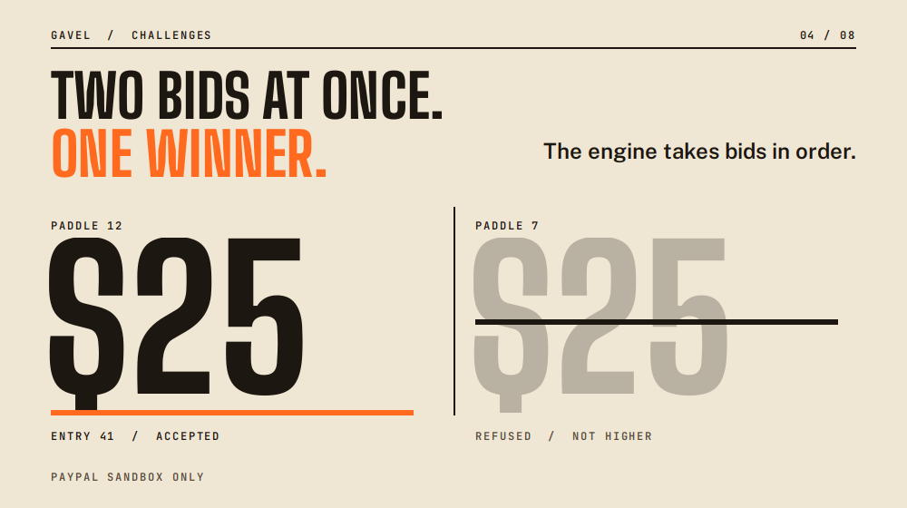

_Two bids arrive together: one is accepted, one is refused as not higher._

## Accomplishments that we're proud of

- A real server process was killed after the capture request and before the response. On restart with the same data folder it settled with one capture of 12500 equal to the hammer price, two losers voided, a journal equal to PayPal and a ledger of 19 entries that verifies. That ran on a CI runner, not on the deployed host.
- Live speech through the audio socket: both providers answered 24 of 24 synthetic clips; no bid was accepted without a confirm.
- The hosted judge flow passed all 17 steps on the live domains.
- More than 4,500 test cases run in CI, and all eight P0 security items pass.
- Audit waves found and closed real bugs: as of 9 Nov 2026, 172 deep-dig issues and 597 red-team issues are closed on GitHub (the deep-dig round was still running).

_Kill survived, voice 24 of 24 synthetic clips, chain verifies._

## What we learned

- A hold is a better auction primitive than a charge: a refused bid is a fact, not a guess.
- During settlement, never trust one source of truth. Ask PayPal, journal every step, and treat "unknown" as a stop.
- Label every number with what it measured. We kept real sandbox, simulated and synthetic results apart and left the misses on the page.

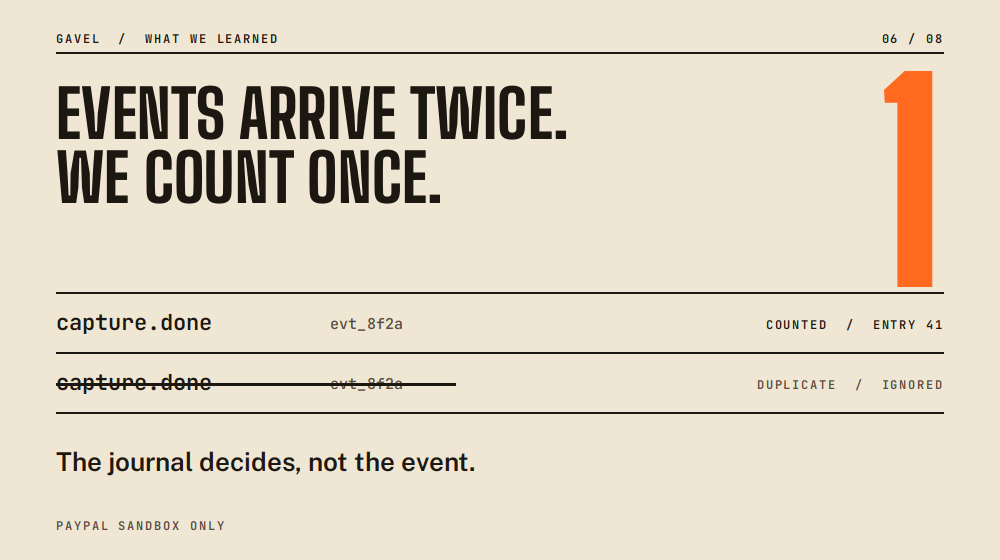

_The same event arrives twice and is counted once._

## What's next for GAVEL

- Read out the G3 probe and set the reauthorize behaviour from it.
- Connect the web console microphone to the audio socket, then test voice with a person in a real room and in recorded noise.
- More payment methods through the same hold and capture shape.
- An organizer dashboard: lots, bidders, settlement and the ledger in one view.
- Repeat the process kill on the deployed host.
- Ship the APIMatic portal and SDKs once they are generated and checked.

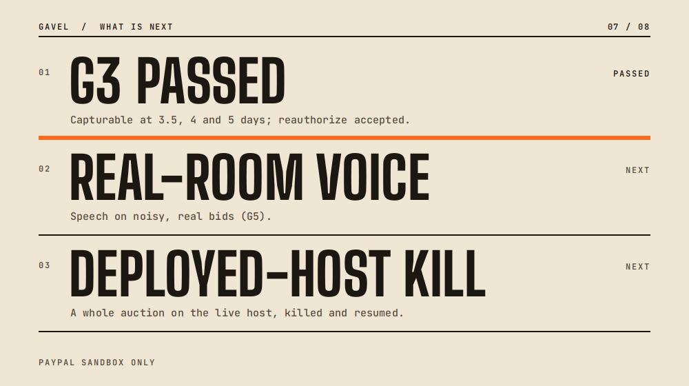

_Next: the G3 probe result, real-room voice, a kill on the deployed host._

## Team

Two builders.

- **Harsh Bhanushali** ([harshbhx](https://github.com/harshbhx)): the auction engine, PayPal payments and settlement, voice, evidence, and operations.
- **Dhairya Patel** ([DhairyaPatel-Devloper](https://github.com/DhairyaPatel-Devloper)): the web UI, accessibility, UX polish, the end-to-end scenario runner, and deploys on Render.

## Try it

_Closing slide: web app, docs and source._

- [Judge panel](https://gavel.dualmindlab.tech/try): a live sandbox room, no login
- [Scripted demo](https://gavel.dualmindlab.tech/demo/scripted): about one minute, recorded
- [Docs](https://docs.gavel.dualmindlab.tech) and [API reference](https://docs.gavel.dualmindlab.tech/api-reference)
- [Source, MIT licence](https://github.com/harshbhx/gavel-auction)

PayPal sandbox only. Bids are held, not charged, and no real money moves anywhere in this project.
