# Devpost copy-paste guide: GAVEL (PayPal AI Hackathon)

One file to submit from. Every field of the Devpost form, in form order, as a ready-to-paste block with its character count. The text is generated from [`brand/devpost/DESCRIPTION.md`](DESCRIPTION.md) and [`brand/devpost/FIELDS.md`](FIELDS.md); if the wording changes, change those two files first and keep this guide in step. Counts are Unicode characters, including spaces and Markdown, measured on 11 Nov 2026.

**Deadline: Thu 12 Nov 2026, 12:00 pm PST (20:00 UTC, Fri 13 Nov 01:30 IST).**

Rules for the person pasting:

- Paste only what is inside a block. Do not paste the block fence lines.
- Bracketed placeholders such as `[JUDGE_KEY]` are filled on Devpost only. Never commit a real key, password or login, and never paste them into this file.
- Do not add the words "passed" or "proven" next to G3 or G5. G3 reads RUNNING until the final reading is recorded in `docs/GATES.md`.
- Say "GitHub release" for the SDKs. They are not on npm, PyPI or NuGet, and there is no hosted developer portal.
- PayPal sandbox only. No claim of a live human or real-room voice test.

## Limits used

| Field                    | Limit                                   | Source                              |
| ------------------------ | --------------------------------------- | ----------------------------------- |
| Project name             | 60 characters                           | FIELDS.md, confirm on the live form |
| Elevator pitch (tagline) | 200 characters                          | FIELDS.md, confirm on the live form |
| Built with               | 25 tags                                 | FIELDS.md, confirm on the live form |
| Gallery image            | JPG, PNG or GIF, 5 MB, 3:2              | FIELDS.md, confirm on the live form |
| Video                    | under 3 minutes, public on YouTube      | Hackathon rules                     |
| Other text fields        | no limit found; counts shown for sizing | not published, so none is claimed   |

## 1. Project name

Limit 60. Count: 5.

```text
GAVEL
```

## 2. Elevator pitch

Limit 200. Count: 172.

```text
A live auction on PayPal holds: bidders hold a ceiling, the hammer captures only the winning price and voids the rest, and a hash-chained ledger anyone can verify seals it.
```

Short tagline, if the form has a second line (limit 60 in FIELDS.md). Count: 47.

```text
Every bid is a hold. The hammer is the payment.
```

## 3. About the project (story)

The form has one Markdown editor, headed by the section names below. Paste the sections in this order into the same editor, or paste the whole story at once (block 3.0, the full text of `DESCRIPTION.md`). The per-section blocks are for pasting one at a time or for re-pasting a single section after an edit. Images are raw GitHub URLs on `main`, so they render once the PR merges. Check the preview after pasting.

### 3.0 Whole story in one paste

Count: 17812.

```text


_GAVEL: every bid is a hold, the hammer is the payment._

**An auction where the bid is a PayPal hold, the hammer is the payment, and the record can be checked by anyone.**

## Inspiration

Picture a charity night. The auctioneer calls 200 dollars for a signed print. A woman near the back has her hand half raised, and she lowers it. Her card would be charged the moment she bids, and she is not sure she wants the print that much. Across the room, a man bids 400 with a grin, wins, and is never heard from again. The organizer spends a week chasing an invoice, with a paper sheet as the only record.

PayPal already has the answer in its payments model. You can authorize an amount, which holds it, and capture later, which takes it. That is the shape of an auction. Hold a ceiling when a bidder joins, let them bid anywhere under it, and at the hammer capture only the winning price while the other holds go back untouched.

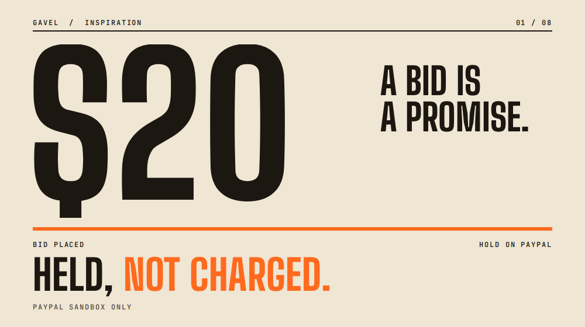

_A price counts up to $20, then the line "Held, not charged" sweeps across it._

## What it does

GAVEL turns that idea into a working room. Everything runs in the PayPal sandbox; no real money moves.

- **Hold.** A bidder approves a ceiling as a PayPal authorization. It is held, not charged.
- **Bid.** A deterministic engine runs an ascending English auction with a minimum increment and a soft close. A bid above the ceiling is refused. Bids come from phones, a QR code or the console. The auctioneer can also speak a bid into the console microphone; it waits for the bidder's confirm.
- **Hammer.** The auctioneer holds a button to close the lot. GAVEL captures only the winning price from the winner's hold and voids every other hold. Until that capture, money is held, not charged.
- **Receipt and verify.** Every accepted bid goes into a hash-chained ledger that anyone can check in the browser.
- **Voice.** The auctioneer speaks a bid into the console microphone (tap to start and stop, or press and hold). It is parsed, validated and then waits for the bidder's confirm ("Did you mean 350 for paddle 12?"). The microphone works when the server has a speech provider, a bidder phone has no microphone, and voice was tested, so a judge can also bid by tap, QR or typed entry.

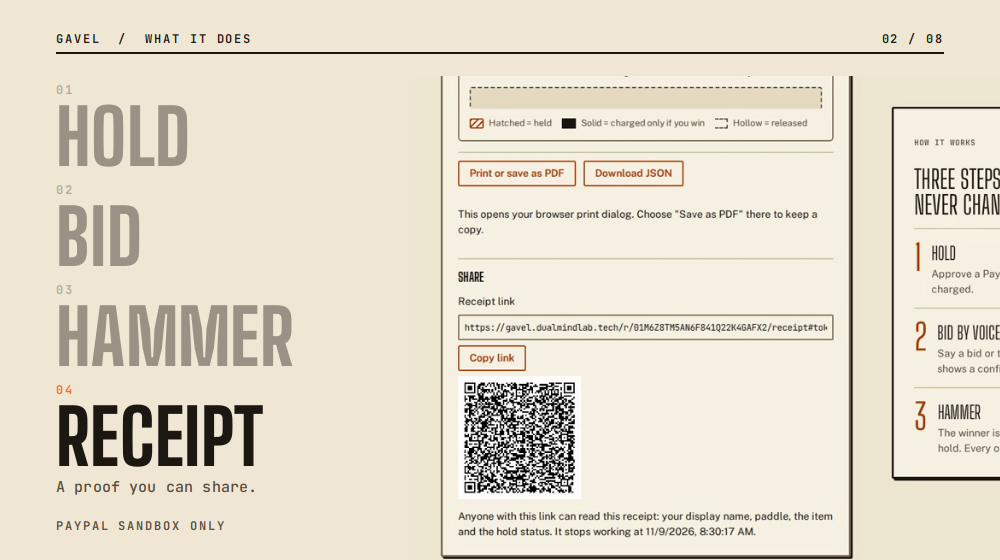

_Hold, bid, hammer, receipt: the four steps, with the real screen for each._

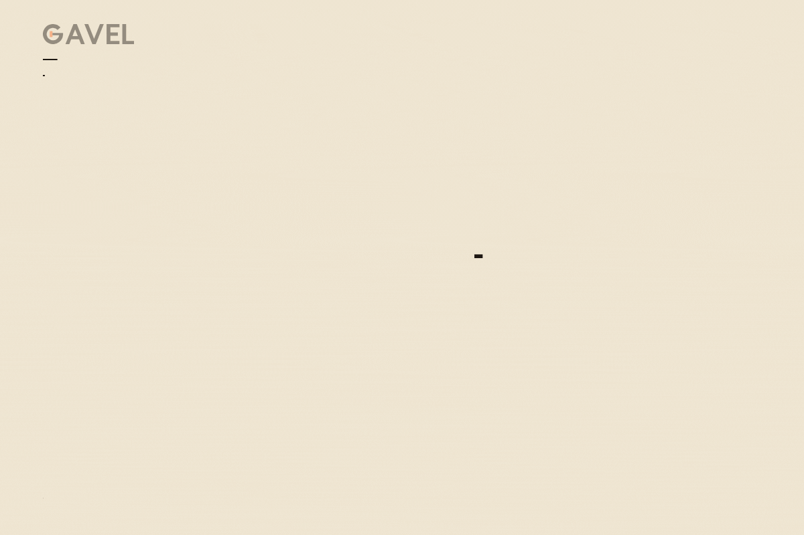

_How it works: a ceiling is held, bids come in under it, the hammer captures the winning price, and the receipt closes the lot._

### Try it in 60 seconds, no account

1. Open the [judge panel](https://gavel.dualmindlab.tech/try) and start a demo room.
2. Join the room as a bidder from the hub and register a sandbox hold.
3. Bid, then press and hold the hammer on the console.
4. Read the receipt, then open the audit page and verify the ledger chain in your browser.
5. The [scripted demo](https://gavel.dualmindlab.tech/demo/scripted) plays a recorded room in about a minute.
6. Prefer HTTP? Use the shared judge key in the Devpost testing instructions (optional, the steps above need no key) and follow [Call the API as a judge](https://docs.gavel.dualmindlab.tech/docs/judges/call-the-api): open a room, bid, hammer and read the ledger with curl. The [API reference](https://docs.gavel.dualmindlab.tech/api-reference) has a Try it panel, and the [docs](https://docs.gavel.dualmindlab.tech) cover the rest.

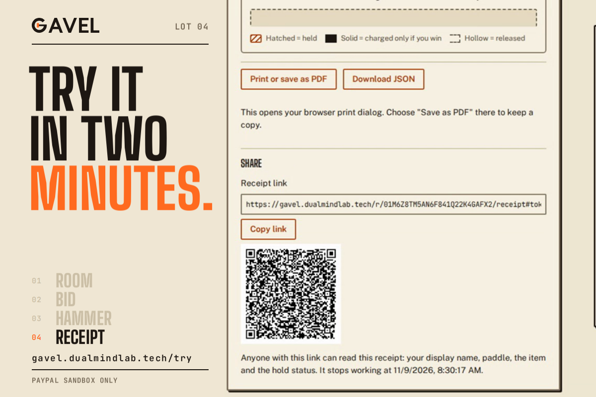

_Two ways in for a judge, no login._

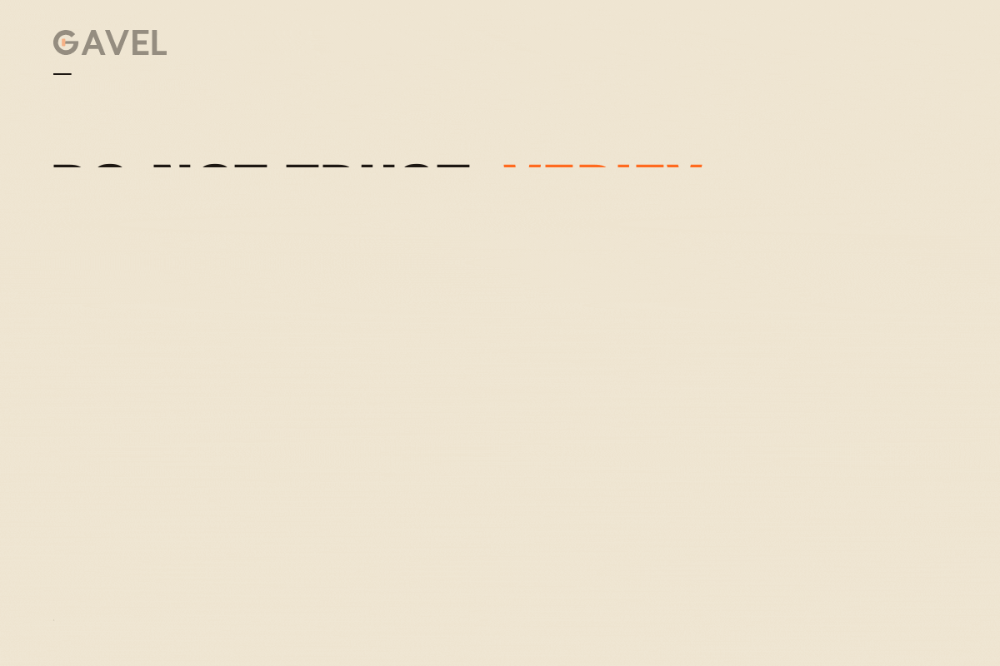

_Do not trust, verify: every accepted bid goes into a hash-chained ledger, and anyone can re-check the public export. Hashes shown are shortened examples._

## How we built it

GAVEL is a TypeScript monorepo (Node 22, npm workspaces) started on 4 Nov 2026, with a Python reference implementation used for differential tests of the engine and the parser.

- **A deterministic engine.** `packages/engine` holds the rules, commands, events and the ledger, with no Node built-ins, so the same events always give the same result. Money is integer cents.
- **A tamper-evident ledger.** Each entry carries the hash of the one before it; an edited entry is marked as edited.
- **PayPal holds with a journaled settlement.** `packages/payments` uses Orders v2 with intent AUTHORIZE and Payments v2 for authorize, capture, void and reauthorize, JS SDK v6 and signature-verified webhooks. The [settlement saga](https://docs.gavel.dualmindlab.tech/docs/how-it-works/settlement-saga) writes a journal. If the process dies mid-settlement, it asks PayPal what is true and continues instead of repeating. An unknown answer stops for review.
- **Voice with a confirm step.** Audio goes to Deepgram (nova-3) with Groq (whisper-large-v3-turbo) as failover, then a rule-based parser and a validator.
- **Cloudflare Workers and Render.** The web app and docs site run on Cloudflare with security headers. The API and WebSocket host is one always-on Node service on Render with a 1 GB disk for the ledger and settlement journals.
- **An AG Grid ledger lab.** The audit ledger, console bid history and holds are AG Grid Community tables with filters, CSV export and an in-browser chain check.
- **A judge API.** Per-judge keys open a sandbox room over HTTP. The OpenAPI 3.1 spec is linted in CI and checked against the router. Beta SDKs generated from it with APIMatic are a [GitHub release](https://github.com/harshbhx/gavel-auction/releases/tag/sdk-v0.0.5), sandbox only; there is no hosted developer portal.
- **Open evidence.** Five Hugging Face datasets and a read-only Evidence Explorer, each labelled for what it measured, with sha256 manifests. Browse them in the [Hugging Face collection](https://huggingface.co/collections/harshbhx/gavel-evidence-auction-holds-hammer-and-receipts-6af0afebebb37eb4c9184504) or the [Evidence Explorer](https://huggingface.co/spaces/harshbhx/gavel-evidence-explorer).
- **Hardening.** A 24-item security review (all eight P0 items pass, residuals named for the rest) and red team and blue team rounds.

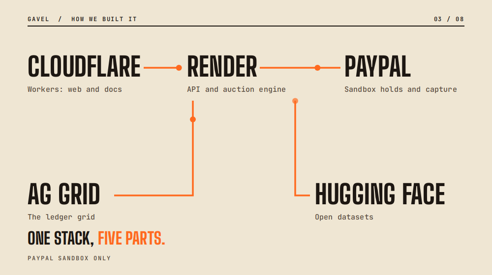

_The stack: Cloudflare Workers, Render, PayPal sandbox, AG Grid and Hugging Face._

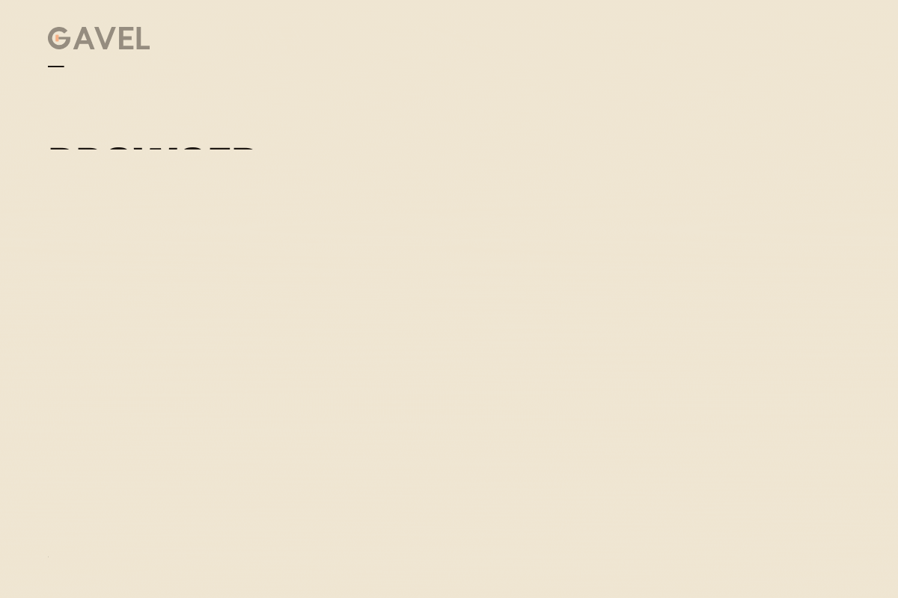

_One bid, four hops through the stack._

### Evidence before claims

We kept a [gate file](https://github.com/harshbhx/gavel-auction/blob/main/docs/GATES.md) (`docs/GATES.md`) and let nothing count until a real run backed it. Status today:

- **G0, G1, G2 and G4 pass** on the real PayPal sandbox: app and buyers, partial capture with final_capture, wallet and guest-card holds, and six real webhooks verified.
- **G3 is running: final reading 12 Nov.** It started 7 Nov 2026 03:06 UTC and reads out at about 12 Nov 06:17 UTC.
- **G5: tested, with a confirm step on every voice bid.** Voice bids were tested on synthetic speech clips, not by a person in a room (Deepgram 11 of 11 and Groq 9 of 11 scripted bids parsed exactly), and the confirm prompt protects every voice bid.
- The 30-day settlement run on a fake clock is labelled simulated. The [real versus simulated page](https://docs.gavel.dualmindlab.tech/docs/judges/real-vs-simulated) says which part is which.

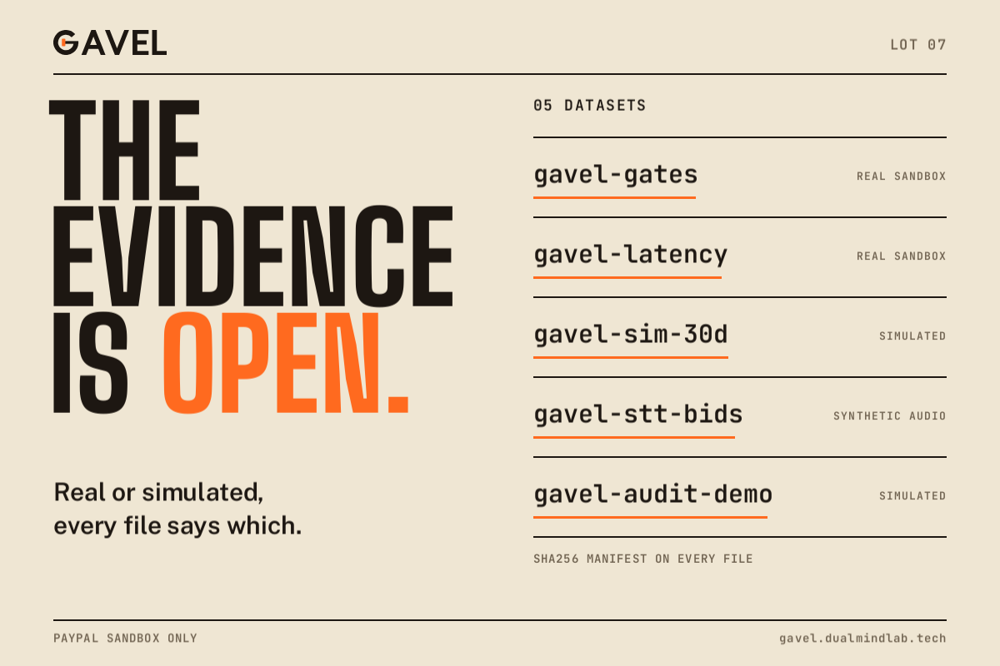

_Open data and the gate status._

### AI in the product

**Runtime AI.** AI is used for voice bidding. Audio from the auctioneer's console microphone goes to speech-to-text: Deepgram (model nova-3) with Groq (model whisper-large-v3-turbo) as failover. A rule-based parser turns the transcript into a structured bid, and a deterministic validator checks it against the auction rules. The model never decides a winner and never moves money, and every spoken bid waits for a confirm.

**AI tools used while building.** AI coding assistants, for coding help and documentation drafts.

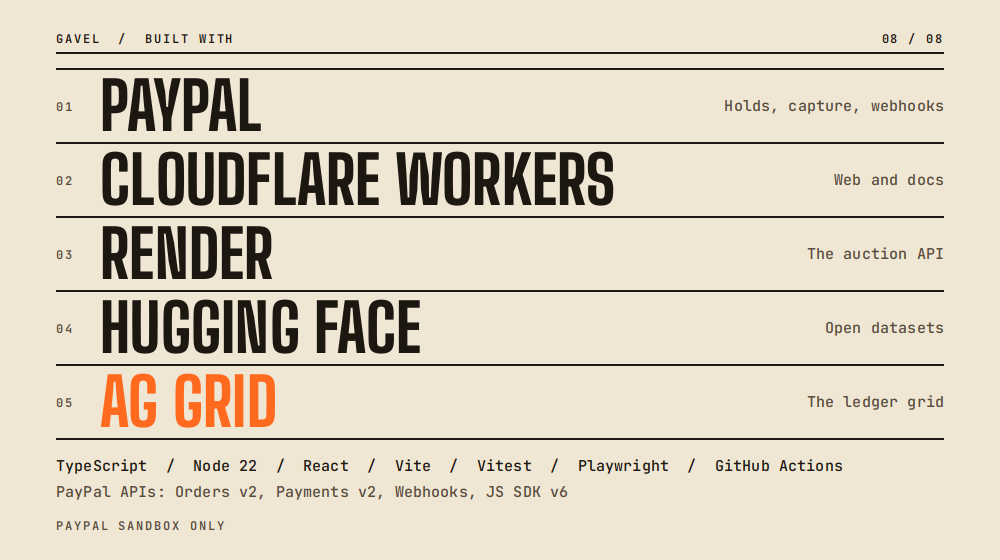

_The partners in large type, the rest of the stack below._

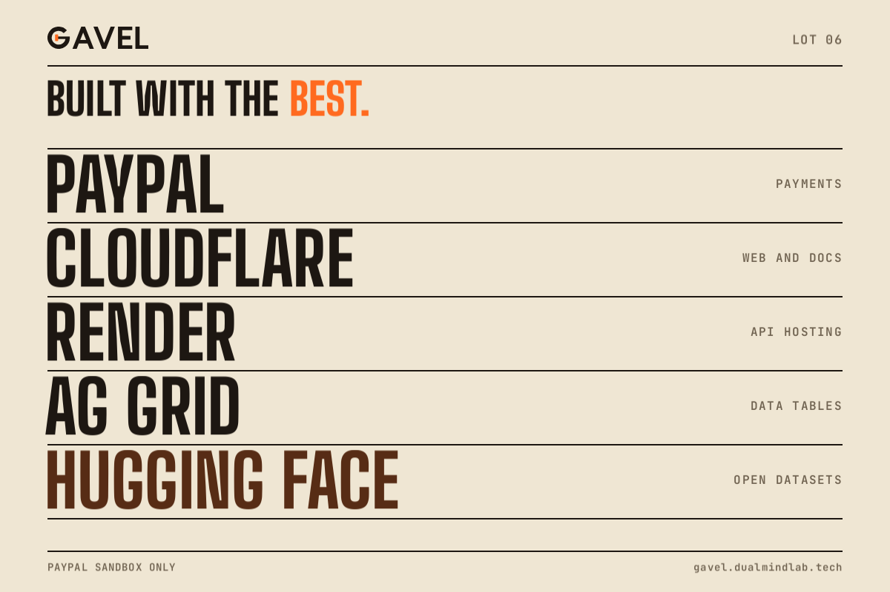

_Who does what: PayPal payments, Cloudflare web and docs, Render API hosting, AG Grid data tables, Hugging Face open datasets._

## Challenges we ran into

Correctness costs more than the happy path. [Findings that mattered](https://docs.gavel.dualmindlab.tech/docs/judges/findings-that-mattered) lists the red-team bugs it found, with fixes and tests.

- **Holds must be idempotent.** A retry or a double tap must not make a second hold. Webhooks also arrive twice or out of order, so handlers de-duplicate and the saga never trusts one event alone. Real events carried fields our simulator lacked, so we test against six sanitized real fixtures.
- **Void on loss, and what "released" means.** After a final capture, a follow-up void answers 422 PREVIOUSLY_CAPTURED and the authorization reads CAPTURED. We treat that as the remainder being released, and we say plainly that it is inferred, not read from a buyer balance.
- **The soft close.** Two bids landing together must get one ordered answer: one accepted, one refused as not higher.
- **How long a hold lasts.** PayPal's pages disagree (3 days versus 29, with one reauthorization). We run a real timed probe, and until it reports, demo holds are made minutes before the capture.
- **Voice in noise.** Speech-to-text gets less exact when the room is noisy, so a spoken bid never counts until the bidder confirms it, and every voice bid shows what was heard before it counts. We tested with 120 noisy clips.
- **Flaky CI and honest numbers.** Browser and sandbox runs flake, so we separated a real failure from a flaky one before trusting a green run, and every figure here names what it measured. The sandbox also needs US accounts and USD.

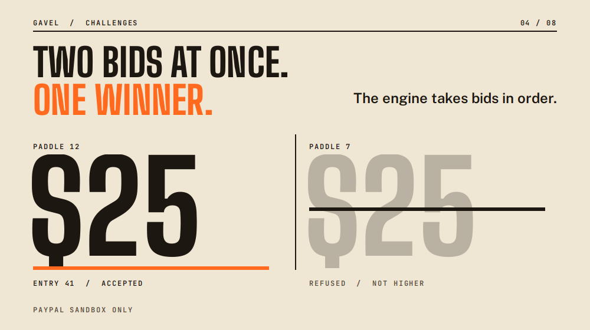

_Two bids arrive together: one is accepted, one is refused as not higher._

## Accomplishments that we're proud of

- A real server process was killed after the capture request and before the response. On restart with the same data folder it settled with one capture of 12500 equal to the hammer price, two losers voided, a journal equal to PayPal and a ledger of 19 entries that verifies. That ran on a CI runner, not on the deployed host ([evidence](https://github.com/harshbhx/gavel-auction/blob/main/docs/evidence/server-kill/server-kill-evidence.md)).
- Live speech through the audio socket: both providers answered 24 of 24 test clips; no bid was accepted without a confirm ([run](https://github.com/harshbhx/gavel-auction/actions/runs/42575018866), [evidence](https://github.com/harshbhx/gavel-auction/blob/main/docs/evidence/voice-live-socket/README.md)).
- The hosted judge flow passed all 17 steps on the live domains ([evidence](https://github.com/harshbhx/gavel-auction/blob/main/docs/evidence/hosted/README.md)).
- PageSpeed Insights scored the landing page 100 for Performance, Accessibility, Best Practices and SEO on both mobile and desktop (lab data, 10 Nov 2026, landing page only, not the whole app).
- More than 4,500 test cases run in CI, and all eight P0 security items pass ([security review](https://github.com/harshbhx/gavel-auction/blob/main/docs/SECURITY-REVIEW.md)).
- Audit waves found and closed real bugs: as of 9 Nov 2026, 172 deep-dig issues and 597 red-team issues are closed on GitHub (the deep-dig round was still running).
- Every change went through a pull request and CI: 727 merged pull requests and 1,528 issues closed as completed, as of 11 Nov 2026.

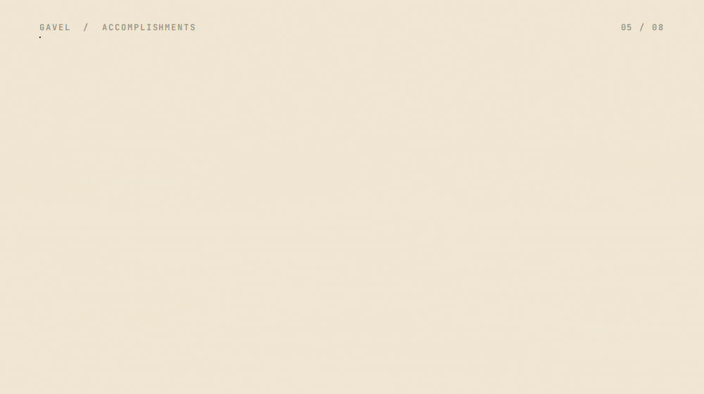

_Kill survived, voice 24 of 24 clips, chain verifies._

## What we learned

- A hold is a better auction primitive than a charge: a refused bid is a fact, not a guess.
- During settlement, never trust one source of truth. Ask PayPal, journal every step, and treat "unknown" as a stop.
- Label every number with what it measured. We kept real sandbox and simulated results apart.

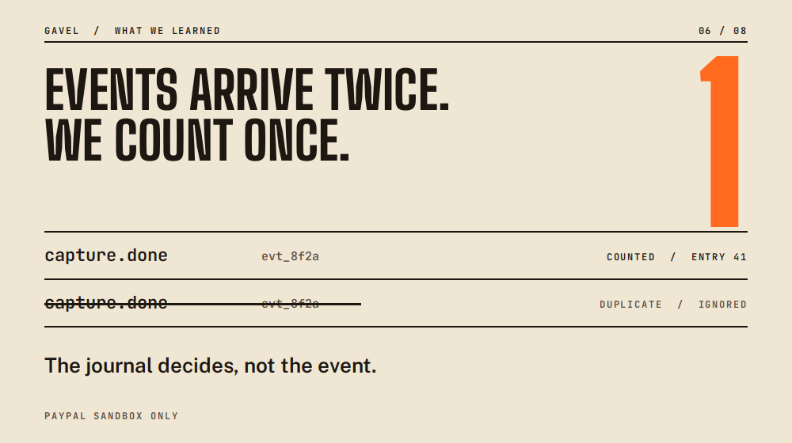

_The same event arrives twice and is counted once._

## What's next for GAVEL

- Read out the G3 probe and set the reauthorize behaviour from it.
- Test the console microphone with a person in a real room and in recorded noise.
- More payment methods through the same hold and capture shape.
- An organizer dashboard: lots, bidders, settlement and the ledger in one view.
- Repeat the process kill on the deployed host.

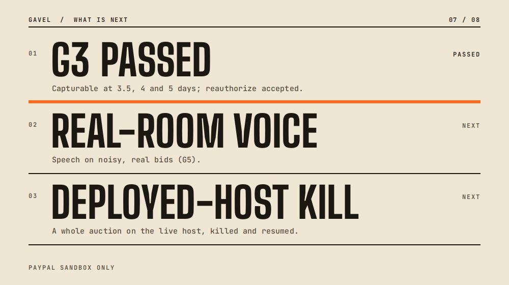

_Next: the G3 probe result, real-room voice, a kill on the deployed host._

## Read more and proof

- [Findings that mattered](https://docs.gavel.dualmindlab.tech/docs/judges/findings-that-mattered): the red-team bugs, their fixes and tests
- [Real versus simulated](https://docs.gavel.dualmindlab.tech/docs/judges/real-vs-simulated): what each claim is backed by
- [Evidence map](https://docs.gavel.dualmindlab.tech/docs/proof/evidence-map) and the [gate file](https://github.com/harshbhx/gavel-auction/blob/main/docs/GATES.md): every claim to its run
- [Real server kill](https://github.com/harshbhx/gavel-auction/blob/main/docs/evidence/server-kill/server-kill-evidence.md): kill after the capture, one capture, journal equals PayPal
- [Live voice run](https://github.com/harshbhx/gavel-auction/blob/main/docs/evidence/voice-live-socket/README.md): 24 of 24 clips, no bid without a confirm
- [Open datasets](https://huggingface.co/collections/harshbhx/gavel-evidence-auction-holds-hammer-and-receipts-6af0afebebb37eb4c9184504) and [Evidence Explorer](https://huggingface.co/spaces/harshbhx/gavel-evidence-explorer)
- [Crash recovery](https://docs.gavel.dualmindlab.tech/docs/how-it-works/crash-recovery) and [settlement saga](https://docs.gavel.dualmindlab.tech/docs/how-it-works/settlement-saga)
- [Security review](https://github.com/harshbhx/gavel-auction/blob/main/docs/SECURITY-REVIEW.md) and [known limits](https://github.com/harshbhx/gavel-auction/blob/main/docs/LIMITATIONS.md)
- [Rubric map](https://docs.gavel.dualmindlab.tech/docs/judges/rubric-map): the judging criteria, each tied to evidence

## Team

Two builders.

- **Harsh Bhanushali** ([harshbhx](https://github.com/harshbhx)): the auction engine, PayPal payments and settlement, voice, evidence, and operations.
- **Dhairya Patel** ([DhairyaPatel-Devloper](https://github.com/DhairyaPatel-Devloper)): the web UI, accessibility, UX polish, the end-to-end scenario runner, and deploys on Render.

## Try it


_Closing slide: web app, docs, source and the two builders._

- [Judge panel](https://gavel.dualmindlab.tech/try): a live sandbox room, no login
- [Scripted demo](https://gavel.dualmindlab.tech/demo/scripted): about one minute, recorded
- [Docs](https://docs.gavel.dualmindlab.tech) and [API reference](https://docs.gavel.dualmindlab.tech/api-reference)
- [Demo video](https://youtu.be/S5TrcJO-E9o), 2:56, captions on
- [Source, MIT licence](https://github.com/harshbhx/gavel-auction)

PayPal sandbox only. Bids are held, not charged, and no real money moves anywhere in this project.
```

### 3.1 Intro (banner and one line, top of the editor)

Count: 355.

```text


_GAVEL: every bid is a hold, the hammer is the payment._

**An auction where the bid is a PayPal hold, the hammer is the payment, and the record can be checked by anyone.**
```

### 3.2 Inspiration

Count: 1028.

```text
## Inspiration

Picture a charity night. The auctioneer calls 200 dollars for a signed print. A woman near the back has her hand half raised, and she lowers it. Her card would be charged the moment she bids, and she is not sure she wants the print that much. Across the room, a man bids 400 with a grin, wins, and is never heard from again. The organizer spends a week chasing an invoice, with a paper sheet as the only record.

PayPal already has the answer in its payments model. You can authorize an amount, which holds it, and capture later, which takes it. That is the shape of an auction. Hold a ceiling when a bidder joins, let them bid anywhere under it, and at the hammer capture only the winning price while the other holds go back untouched.


_A price counts up to $20, then the line "Held, not charged" sweeps across it._
```

### 3.3 What it does

Count: 3311.

```text
## What it does

GAVEL turns that idea into a working room. Everything runs in the PayPal sandbox; no real money moves.

- **Hold.** A bidder approves a ceiling as a PayPal authorization. It is held, not charged.
- **Bid.** A deterministic engine runs an ascending English auction with a minimum increment and a soft close. A bid above the ceiling is refused. Bids come from phones, a QR code or the console. The auctioneer can also speak a bid into the console microphone; it waits for the bidder's confirm.
- **Hammer.** The auctioneer holds a button to close the lot. GAVEL captures only the winning price from the winner's hold and voids every other hold. Until that capture, money is held, not charged.
- **Receipt and verify.** Every accepted bid goes into a hash-chained ledger that anyone can check in the browser.
- **Voice.** The auctioneer speaks a bid into the console microphone (tap to start and stop, or press and hold). It is parsed, validated and then waits for the bidder's confirm ("Did you mean 350 for paddle 12?"). The microphone works when the server has a speech provider, a bidder phone has no microphone, and voice was tested, so a judge can also bid by tap, QR or typed entry.


_Hold, bid, hammer, receipt: the four steps, with the real screen for each._


_How it works: a ceiling is held, bids come in under it, the hammer captures the winning price, and the receipt closes the lot._

### Try it in 60 seconds, no account

1. Open the [judge panel](https://gavel.dualmindlab.tech/try) and start a demo room.
2. Join the room as a bidder from the hub and register a sandbox hold.
3. Bid, then press and hold the hammer on the console.
4. Read the receipt, then open the audit page and verify the ledger chain in your browser.
5. The [scripted demo](https://gavel.dualmindlab.tech/demo/scripted) plays a recorded room in about a minute.
6. Prefer HTTP? Use the shared judge key in the Devpost testing instructions (optional, the steps above need no key) and follow [Call the API as a judge](https://docs.gavel.dualmindlab.tech/docs/judges/call-the-api): open a room, bid, hammer and read the ledger with curl. The [API reference](https://docs.gavel.dualmindlab.tech/api-reference) has a Try it panel, and the [docs](https://docs.gavel.dualmindlab.tech) cover the rest.


_Two ways in for a judge, no login._


_Do not trust, verify: every accepted bid goes into a hash-chained ledger, and anyone can re-check the public export. Hashes shown are shortened examples._
```

### 3.4 How we built it

Count: 5394.

```text
## How we built it

GAVEL is a TypeScript monorepo (Node 22, npm workspaces) started on 4 Nov 2026, with a Python reference implementation used for differential tests of the engine and the parser.

- **A deterministic engine.** `packages/engine` holds the rules, commands, events and the ledger, with no Node built-ins, so the same events always give the same result. Money is integer cents.
- **A tamper-evident ledger.** Each entry carries the hash of the one before it; an edited entry is marked as edited.
- **PayPal holds with a journaled settlement.** `packages/payments` uses Orders v2 with intent AUTHORIZE and Payments v2 for authorize, capture, void and reauthorize, JS SDK v6 and signature-verified webhooks. The [settlement saga](https://docs.gavel.dualmindlab.tech/docs/how-it-works/settlement-saga) writes a journal. If the process dies mid-settlement, it asks PayPal what is true and continues instead of repeating. An unknown answer stops for review.
- **Voice with a confirm step.** Audio goes to Deepgram (nova-3) with Groq (whisper-large-v3-turbo) as failover, then a rule-based parser and a validator.
- **Cloudflare Workers and Render.** The web app and docs site run on Cloudflare with security headers. The API and WebSocket host is one always-on Node service on Render with a 1 GB disk for the ledger and settlement journals.
- **An AG Grid ledger lab.** The audit ledger, console bid history and holds are AG Grid Community tables with filters, CSV export and an in-browser chain check.
- **A judge API.** Per-judge keys open a sandbox room over HTTP. The OpenAPI 3.1 spec is linted in CI and checked against the router. Beta SDKs generated from it with APIMatic are a [GitHub release](https://github.com/harshbhx/gavel-auction/releases/tag/sdk-v0.0.5), sandbox only; there is no hosted developer portal.
- **Open evidence.** Five Hugging Face datasets and a read-only Evidence Explorer, each labelled for what it measured, with sha256 manifests. Browse them in the [Hugging Face collection](https://huggingface.co/collections/harshbhx/gavel-evidence-auction-holds-hammer-and-receipts-6af0afebebb37eb4c9184504) or the [Evidence Explorer](https://huggingface.co/spaces/harshbhx/gavel-evidence-explorer).
- **Hardening.** A 24-item security review (all eight P0 items pass, residuals named for the rest) and red team and blue team rounds.


_The stack: Cloudflare Workers, Render, PayPal sandbox, AG Grid and Hugging Face._


_One bid, four hops through the stack._

### Evidence before claims

We kept a [gate file](https://github.com/harshbhx/gavel-auction/blob/main/docs/GATES.md) (`docs/GATES.md`) and let nothing count until a real run backed it. Status today:

- **G0, G1, G2 and G4 pass** on the real PayPal sandbox: app and buyers, partial capture with final_capture, wallet and guest-card holds, and six real webhooks verified.
- **G3 is running: final reading 12 Nov.** It started 7 Nov 2026 03:06 UTC and reads out at about 12 Nov 06:17 UTC.
- **G5: tested, with a confirm step on every voice bid.** Voice bids were tested on synthetic speech clips, not by a person in a room (Deepgram 11 of 11 and Groq 9 of 11 scripted bids parsed exactly), and the confirm prompt protects every voice bid.
- The 30-day settlement run on a fake clock is labelled simulated. The [real versus simulated page](https://docs.gavel.dualmindlab.tech/docs/judges/real-vs-simulated) says which part is which.


_Open data and the gate status._

### AI in the product

**Runtime AI.** AI is used for voice bidding. Audio from the auctioneer's console microphone goes to speech-to-text: Deepgram (model nova-3) with Groq (model whisper-large-v3-turbo) as failover. A rule-based parser turns the transcript into a structured bid, and a deterministic validator checks it against the auction rules. The model never decides a winner and never moves money, and every spoken bid waits for a confirm.

**AI tools used while building.** AI coding assistants, for coding help and documentation drafts.


_The partners in large type, the rest of the stack below._


_Who does what: PayPal payments, Cloudflare web and docs, Render API hosting, AG Grid data tables, Hugging Face open datasets._
```

### 3.5 Challenges we ran into

Count: 1885.

```text
## Challenges we ran into

Correctness costs more than the happy path. [Findings that mattered](https://docs.gavel.dualmindlab.tech/docs/judges/findings-that-mattered) lists the red-team bugs it found, with fixes and tests.

- **Holds must be idempotent.** A retry or a double tap must not make a second hold. Webhooks also arrive twice or out of order, so handlers de-duplicate and the saga never trusts one event alone. Real events carried fields our simulator lacked, so we test against six sanitized real fixtures.
- **Void on loss, and what "released" means.** After a final capture, a follow-up void answers 422 PREVIOUSLY_CAPTURED and the authorization reads CAPTURED. We treat that as the remainder being released, and we say plainly that it is inferred, not read from a buyer balance.
- **The soft close.** Two bids landing together must get one ordered answer: one accepted, one refused as not higher.
- **How long a hold lasts.** PayPal's pages disagree (3 days versus 29, with one reauthorization). We run a real timed probe, and until it reports, demo holds are made minutes before the capture.
- **Voice in noise.** Speech-to-text gets less exact when the room is noisy, so a spoken bid never counts until the bidder confirms it, and every voice bid shows what was heard before it counts. We tested with 120 noisy clips.
- **Flaky CI and honest numbers.** Browser and sandbox runs flake, so we separated a real failure from a flaky one before trusting a green run, and every figure here names what it measured. The sandbox also needs US accounts and USD.


_Two bids arrive together: one is accepted, one is refused as not higher._
```

### 3.6 Accomplishments that we're proud of

Count: 1883.

```text
## Accomplishments that we're proud of

- A real server process was killed after the capture request and before the response. On restart with the same data folder it settled with one capture of 12500 equal to the hammer price, two losers voided, a journal equal to PayPal and a ledger of 19 entries that verifies. That ran on a CI runner, not on the deployed host ([evidence](https://github.com/harshbhx/gavel-auction/blob/main/docs/evidence/server-kill/server-kill-evidence.md)).
- Live speech through the audio socket: both providers answered 24 of 24 test clips; no bid was accepted without a confirm ([run](https://github.com/harshbhx/gavel-auction/actions/runs/42575018866), [evidence](https://github.com/harshbhx/gavel-auction/blob/main/docs/evidence/voice-live-socket/README.md)).
- The hosted judge flow passed all 17 steps on the live domains ([evidence](https://github.com/harshbhx/gavel-auction/blob/main/docs/evidence/hosted/README.md)).
- PageSpeed Insights scored the landing page 100 for Performance, Accessibility, Best Practices and SEO on both mobile and desktop (lab data, 10 Nov 2026, landing page only, not the whole app).
- More than 4,500 test cases run in CI, and all eight P0 security items pass ([security review](https://github.com/harshbhx/gavel-auction/blob/main/docs/SECURITY-REVIEW.md)).
- Audit waves found and closed real bugs: as of 9 Nov 2026, 172 deep-dig issues and 597 red-team issues are closed on GitHub (the deep-dig round was still running).
- Every change went through a pull request and CI: 727 merged pull requests and 1,528 issues closed as completed, as of 11 Nov 2026.


_Kill survived, voice 24 of 24 clips, chain verifies._
```

### 3.7 What we learned

Count: 585.

```text
## What we learned

- A hold is a better auction primitive than a charge: a refused bid is a fact, not a guess.
- During settlement, never trust one source of truth. Ask PayPal, journal every step, and treat "unknown" as a stop.
- Label every number with what it measured. We kept real sandbox and simulated results apart.


_The same event arrives twice and is counted once._
```

### 3.8 What's next for GAVEL

Count: 642.

```text
## What's next for GAVEL

- Read out the G3 probe and set the reauthorize behaviour from it.
- Test the console microphone with a person in a real room and in recorded noise.
- More payment methods through the same hold and capture shape.
- An organizer dashboard: lots, bidders, settlement and the ledger in one view.
- Repeat the process kill on the deployed host.


_Next: the G3 probe result, real-room voice, a kill on the deployed host._
```

### 3.9 Team and Try it (end of the story)

Count: 2713.

```text
## Read more and proof

- [Findings that mattered](https://docs.gavel.dualmindlab.tech/docs/judges/findings-that-mattered): the red-team bugs, their fixes and tests
- [Real versus simulated](https://docs.gavel.dualmindlab.tech/docs/judges/real-vs-simulated): what each claim is backed by
- [Evidence map](https://docs.gavel.dualmindlab.tech/docs/proof/evidence-map) and the [gate file](https://github.com/harshbhx/gavel-auction/blob/main/docs/GATES.md): every claim to its run
- [Real server kill](https://github.com/harshbhx/gavel-auction/blob/main/docs/evidence/server-kill/server-kill-evidence.md): kill after the capture, one capture, journal equals PayPal
- [Live voice run](https://github.com/harshbhx/gavel-auction/blob/main/docs/evidence/voice-live-socket/README.md): 24 of 24 clips, no bid without a confirm
- [Open datasets](https://huggingface.co/collections/harshbhx/gavel-evidence-auction-holds-hammer-and-receipts-6af0afebebb37eb4c9184504) and [Evidence Explorer](https://huggingface.co/spaces/harshbhx/gavel-evidence-explorer)
- [Crash recovery](https://docs.gavel.dualmindlab.tech/docs/how-it-works/crash-recovery) and [settlement saga](https://docs.gavel.dualmindlab.tech/docs/how-it-works/settlement-saga)
- [Security review](https://github.com/harshbhx/gavel-auction/blob/main/docs/SECURITY-REVIEW.md) and [known limits](https://github.com/harshbhx/gavel-auction/blob/main/docs/LIMITATIONS.md)
- [Rubric map](https://docs.gavel.dualmindlab.tech/docs/judges/rubric-map): the judging criteria, each tied to evidence

## Team

Two builders.

- **Harsh Bhanushali** ([harshbhx](https://github.com/harshbhx)): the auction engine, PayPal payments and settlement, voice, evidence, and operations.
- **Dhairya Patel** ([DhairyaPatel-Devloper](https://github.com/DhairyaPatel-Devloper)): the web UI, accessibility, UX polish, the end-to-end scenario runner, and deploys on Render.

## Try it


_Closing slide: web app, docs, source and the two builders._

- [Judge panel](https://gavel.dualmindlab.tech/try): a live sandbox room, no login
- [Scripted demo](https://gavel.dualmindlab.tech/demo/scripted): about one minute, recorded
- [Docs](https://docs.gavel.dualmindlab.tech) and [API reference](https://docs.gavel.dualmindlab.tech/api-reference)
- [Demo video](https://youtu.be/S5TrcJO-E9o), 2:56, captions on
- [Source, MIT licence](https://github.com/harshbhx/gavel-auction)

PayPal sandbox only. Bids are held, not charged, and no real money moves anywhere in this project.
```

## 4. Built with

23 tags, limit 25 (two spare: `paypal-webhooks`, `speech-to-text`). Type or paste them one at a time; Devpost makes a tag at each comma. `apimatic` is in because the SDKs are a GitHub release.

```text
typescript, node.js, react, vite, python, paypal, paypal-orders-api, paypal-payments-api, paypal-js-sdk, cloudflare-workers, render, ag-grid, hugging-face, deepgram, groq, websockets, openapi, vitest, playwright, github-actions, next.js, fumadocs, apimatic
```

## 5. Try it out links

One URL per line. Do not add the developer portal: it is not hosted.

```text
https://gavel.dualmindlab.tech/try
https://gavel.dualmindlab.tech/demo/scripted
https://docs.gavel.dualmindlab.tech
https://docs.gavel.dualmindlab.tech/api-reference
https://docs.gavel.dualmindlab.tech/docs/judges/call-the-api
https://huggingface.co/spaces/harshbhx/gavel-evidence-explorer
https://github.com/harshbhx/gavel-auction
```

Labels, if the form takes them: Live app: judge panel; Scripted demo (about 1 minute); Docs; API reference; Call the API as a judge; Evidence Explorer (Hugging Face); GitHub repository (MIT).

### 5.1 Read more and proof links (paste into the same links field, after the block above)

Every URL was fetched and returned 200 on 12 Nov 2026. None is invented: they are the docs pages, evidence files and the Hugging Face collection already linked from the story's "Read more and proof" section. Add them if the field takes more than the eight above; the same list is in the story text.

```text
https://docs.gavel.dualmindlab.tech/docs/judges/findings-that-mattered
https://docs.gavel.dualmindlab.tech/docs/judges/real-vs-simulated
https://docs.gavel.dualmindlab.tech/docs/proof/evidence-map
https://github.com/harshbhx/gavel-auction/blob/main/docs/GATES.md
https://github.com/harshbhx/gavel-auction/blob/main/docs/evidence/server-kill/server-kill-evidence.md
https://github.com/harshbhx/gavel-auction/blob/main/docs/evidence/voice-live-socket/README.md
https://huggingface.co/collections/harshbhx/gavel-evidence-auction-holds-hammer-and-receipts-6af0afebebb37eb4c9184504
https://docs.gavel.dualmindlab.tech/docs/how-it-works/crash-recovery
https://github.com/harshbhx/gavel-auction/blob/main/docs/SECURITY-REVIEW.md
https://github.com/harshbhx/gavel-auction/blob/main/docs/LIMITATIONS.md
https://docs.gavel.dualmindlab.tech/docs/judges/rubric-map
```

Labels: Findings that mattered; Real versus simulated; Evidence map; Gate file (GATES.md); Real server kill evidence; Live voice run evidence; Open datasets (Hugging Face collection); Crash recovery; Security review; Known limits; Rubric map.

## 6. Video demo link

Count: 28.

```text
https://youtu.be/S5TrcJO-E9o
```

Film v3.2, 2:56, public, captions SRT, uploaded by the co-owner. Open it signed out (private window) before submitting, and check that the captions are on.

## 7. Image gallery and thumbnail

Upload in this order. All files are in `brand/devpost/gallery/` (1200x800, 3:2, JPG/PNG/GIF, largest 1.4 MB, limit 5 MB). Only slot 1 is animated; if Devpost refuses the GIF, use `01-hero.png`.

Thumbnail: `brand/devpost/thumbnail.png` (1200x800, static).

| #   | File                       | Type         | Caption chars |
| --- | -------------------------- | ------------ | ------------- |
| 1   | 01-hero.gif                | animated GIF | 153           |
| 2   | 02-how-it-works.png        | static PNG   | 179           |
| 3   | 03-architecture.png        | static PNG   | 205           |
| 4   | 04-judge-flow.png          | static PNG   | 159           |
| 5   | 05-audit-and-verify.png    | static PNG   | 157           |
| 6   | 06-partners.png            | static PNG   | 175           |
| 7   | 07-open-data-and-gates.png | static PNG   | 143           |
| 8   | 08-ending.png              | static PNG   | 60            |

Captions to paste, one per image:

1. `01-hero.gif` (153 characters)

```text
GAVEL is a live auction where every bid is a PayPal authorization hold and only the winner is charged, at the hammer. PayPal sandbox only, no real money.
```

2. `02-how-it-works.png` (179 characters)

```text
Four moves. A bidder approves a ceiling as a hold, bids in an ascending auction, the auctioneer hammers, and only the winning price is captured while every other hold is released.
```

3. `03-architecture.png` (205 characters)

```text
One bid, four hops. The browser reaches a Cloudflare Worker, which reaches the auction API on Render. The API holds and captures with PayPal sandbox and appends every accepted bid to a hash-chained ledger.
```

4. `04-judge-flow.png` (159 characters)

```text
Try it in two minutes, no login. Open /try, start a room, bid, hammer and read the receipt. /demo/scripted plays a recorded room in your tab in about a minute.
```

5. `05-audit-and-verify.png` (157 characters)

```text
Do not trust, verify. Every accepted bid goes into a hash-chained ledger, and anyone can re-check the public export. The hashes shown are shortened examples.
```

6. `06-partners.png` (175 characters)

```text
PayPal runs the holds, Cloudflare serves the web app and the docs, Render hosts the API, AG Grid draws the ledger, bids and holds tables, Hugging Face hosts the open evidence.
```

7. `07-open-data-and-gates.png` (143 characters)

```text
The evidence is open: five small datasets, each with a sha256 manifest and labelled for what it is.
```

8. `08-ending.png` (60 characters)

```text
Try it. Verify it. No login. Web app, docs and source links.
```

The credits outro GIF `brand/devpost/outro/09-outro-credits.gif` is already inside the story (block 3.9). Do not add it to the gallery.

Slide 6 does not name APIMatic and slide 4 shows a receipt dated 9 Nov: see the stale-image list in the pull request. They are not wrong claims, only gaps.

## 8. Testing instructions

Source: [`docs/judges/DEVPOST-TESTING.md`](../../docs/judges/DEVPOST-TESTING.md). Fill the five placeholders on Devpost only: `[JUDGE_KEY]` (the shared key, sandbox rooms only, does not expire), `[BUYER_A_EMAIL]`, `[BUYER_A_PASSWORD]`, `[BUYER_B_EMAIL]`, `[BUYER_B_PASSWORD]` (the sandbox buyers, see [`SANDBOX-BUYERS.md`](../../docs/judges/SANDBOX-BUYERS.md)). Count with placeholders: 3174.

```text
For judges: start at https://gavel.dualmindlab.tech/try (judge panel). No login: https://gavel.dualmindlab.tech/demo/scripted. Demo room: https://gavel.dualmindlab.tech/demo. Trust and FAQ: https://docs.gavel.dualmindlab.tech/docs/judges/trust-and-faq.

GAVEL is a live auction where every bid is a PayPal authorization hold. At the hammer only the winning price is captured and every other hold is voided. Everything runs in the PayPal sandbox: no real money moves, and you should never use your own PayPal account.

No login path (about 1 minute)

1. Open https://gavel.dualmindlab.tech/demo/scripted
2. It plays a recorded room in your browser with no server and no PayPal calls. It is labelled "Scripted demo: recorded events, no PayPal calls".

Judge key (optional, for HTTP)

You do not need a key for any path above or below: a keyless judge room on /try works without one. To drive a room over HTTP instead, use the shared judging key and follow https://docs.gavel.dualmindlab.tech/docs/judges/call-the-api

- Shared judge key: [JUDGE_KEY]

Live sandbox room (about 3 minutes)

1. Open https://gavel.dualmindlab.tech and press "Start a demo auction". The page /try lists the same steps.
2. The room opens on the room hub, which shows a room code, a QR code and buttons for the big screen, the console and the bidder view. Join as a bidder from the hub (button, room code, or scan the QR code on a phone) with any name and a ceiling, and keep the big screen open in a second window.
3. Press and hold the approve button for 3 seconds. In the PayPal sandbox window log in with this sandbox buyer:
   - Email: [BUYER_A_EMAIL]
   - Password: [BUYER_A_PASSWORD]
     (Sandbox test account only. If a login is refused, try the second buyer below.)
   - Second buyer: [BUYER_B_EMAIL] / [BUYER_B_PASSWORD]
4. Place a bid, then open the console from the hub and press and hold hammer.
5. You should see: the hold shown as held while bidding, then after the hammer the winner captured for the winning price only and the other holds released. The receipt and the audit trail (a ledger chained by hash) open from the room.

Notes for testers

- A room lasts about thirty minutes. Do the whole run in one sitting.
- The hosted API keeps its data on a 1 GB persistent disk, so a room normally survives a host restart until it expires. If a room is gone anyway, start a new demo auction.
- If the host is busy or judge rooms are off, the page says so and offers the scripted demo.
- Voice bidding was tested, so a spoken bid always asks for confirmation on the bidder's screen. The auctioneer console microphone works only when the server has a speech provider (the console says when it is off), and bidder phones have no microphone. Typed and QR bids work without it.
- Sandbox buyers are US accounts and the auction is in USD.

SDKs (TypeScript, Python, C#, beta, sandbox only): GitHub release https://github.com/harshbhx/gavel-auction/releases/tag/sdk-v0.0.5 (not on npm, PyPI or NuGet).

More: judge walkthrough https://github.com/harshbhx/gavel-auction/blob/main/docs/JUDGES.md and the docs site https://docs.gavel.dualmindlab.tech/docs/judges
```

## 9. Team members

Add both on the Devpost team field (each must accept the invite, and both need a Devpost account).

- Harsh Bhanushali, GitHub harshbhx
- Dhairya Patel, GitHub DhairyaPatel-Devloper

The team text inside the story (block 3.9) already credits both. Credits follow `git log`.

## 10. Additional info and form extras

Use for "Additional info", the reuse statement and the AI-tools disclosure, whichever the live form asks for. Count: 1376. Replace `[AI_TOOL_NAME_AND_VENDOR]` by hand on Devpost (the repository's banned-word check rejects the product name, so it is not written here). If the form also asks for category, developer account ID, country or tool feedback, fill them from your own account.

```text
Reuse statement: GAVEL was started on 4 Nov 2026, after the 1 Oct 2026 start of the Submission Period, so it is new work made for this hackathon.

Sandbox only: every PayPal call is the PayPal sandbox. No real money moves anywhere and no live charge is shown or claimed.

Status of the evidence gates (see docs/GATES.md in the repository): G0, G1, G2 and G4 pass on the real PayPal sandbox. G3 (honor period and reauthorize) is a real probe that is still running; its final reading is 12 Nov 2026 about 06:17 UTC. G5 (voice) was tested (Deepgram 11 of 11 scripted bids parsed exactly, Groq 9 of 11), with a confirm step on every voice bid; it has not been tested with a live human or in a real room.

SDKs: TypeScript, Python and C# SDKs (gavel-sdk 0.0.5, beta) were generated with APIMatic and are published as a GitHub release, https://github.com/harshbhx/gavel-auction/releases/tag/sdk-v0.0.5. They are not on npm, PyPI or NuGet, and the APIMatic developer portal is not hosted.

AI tools used while building: [AI_TOOL_NAME_AND_VENDOR] for coding assistance and documentation drafts. AI at runtime: Deepgram (nova-3) with Groq (whisper-large-v3-turbo) as failover for speech-to-text on the auctioneer microphone; a rule-based parser and a deterministic validator decide the bid, and every spoken bid waits for a confirm. The AI never decides a winner and never moves money.
```

## 11. Code repository URL

```text
https://github.com/harshbhx/gavel-auction
```

Public, MIT `LICENSE` at the root. Check the About box on GitHub shows "MIT license".

## 12. Pre-submit checklist

Do these in order. Tick each only after you saw it yourself.

- [ ] G3 final reading. After 12 Nov 06:17 UTC, open the `gate-g3` run, record the result in `docs/GATES.md`, then update the G3 wording in blocks 3.0, 3.4 (Evidence before claims), 3.5, 3.8 and 10, and in the gallery text if needed. Until it is recorded, G3 stays "running, final reading 12 Nov". Never write "passed" unless the recorded result says so.
- [ ] Merge this pull request (or paste from the branch) so the raw image URLs in the story load. Open the story preview and check every image shows.
- [ ] Video: open https://youtu.be/S5TrcJO-E9o in a private window, signed out. It plays, it is public, captions are on, no buyer login or key is on screen, the length is under 3:00.
- [ ] Links: open every URL in block 5 signed out. The app, docs, API reference, call-the-api page, Hugging Face Space, the SDK release and the repo all load.
- [ ] Judge key tested: with the shared key, follow [Call the API as a judge](https://docs.gavel.dualmindlab.tech/docs/judges/call-the-api) once (open a room, bid, hammer, read the ledger). Confirm the key is the non-expiring one.
- [ ] Sandbox buyers: log in to the PayPal sandbox with buyer A and buyer B, approve one hold in a demo room, and confirm both logins work. Then paste them into block 8 on Devpost only.
- [ ] Keyless path: https://gavel.dualmindlab.tech/demo/scripted and a room on /try work without any key.
- [ ] Paste blocks 1 to 11 into the form. Re-read the story preview once for broken images or odd characters.
- [ ] Gallery: upload the 8 files in the order of section 7, then the thumbnail. Check each caption.
- [ ] Team: both members added and accepted.
- [ ] Tags: 23 tags, `apimatic` present.
- [ ] CI green on `main` (https://github.com/harshbhx/gavel-auction/actions/workflows/ci.yml).
- [ ] Keep the Render service, the Worker and the sandbox buyers alive until the end of judging (1 to 15 Dec 2026).
- [ ] Submit before 12 Nov 12:00 pm PST (13 Nov 01:30 IST). The internal target is 12 Nov 04:00 PST (12:00 UTC). Open the live project page afterwards and look at it signed out.
