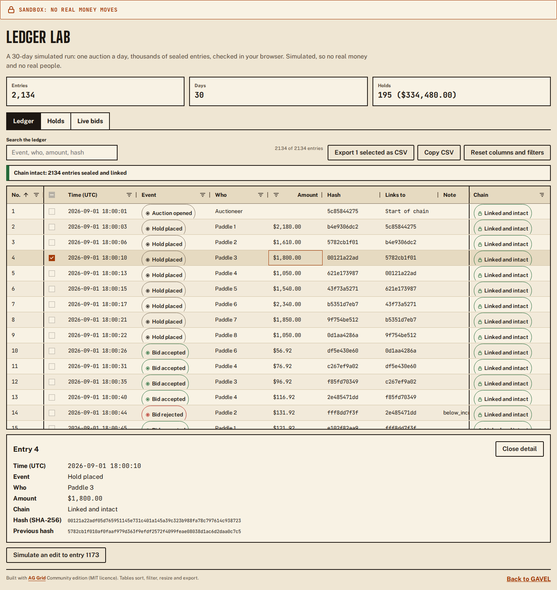
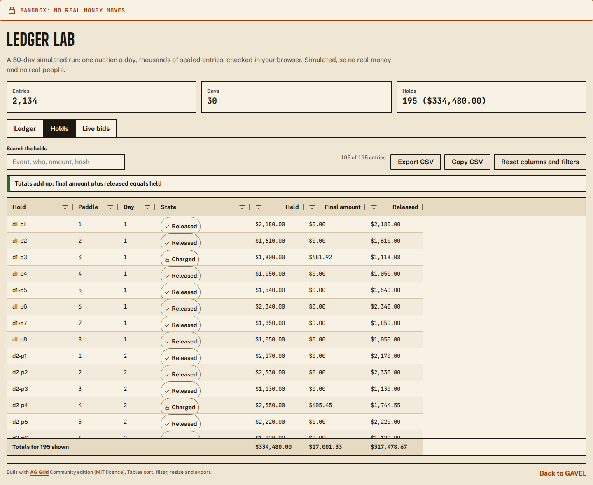
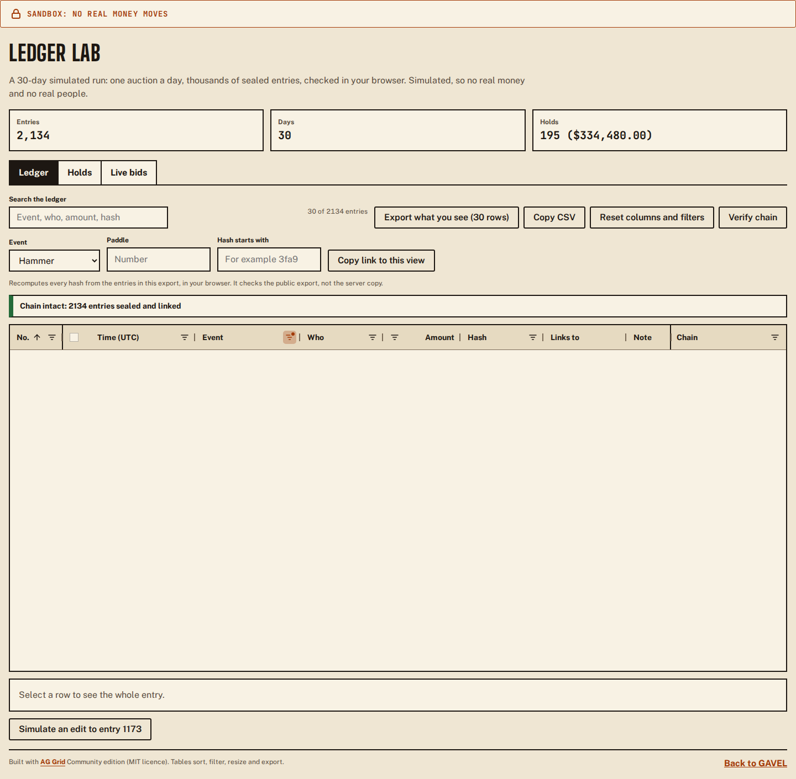
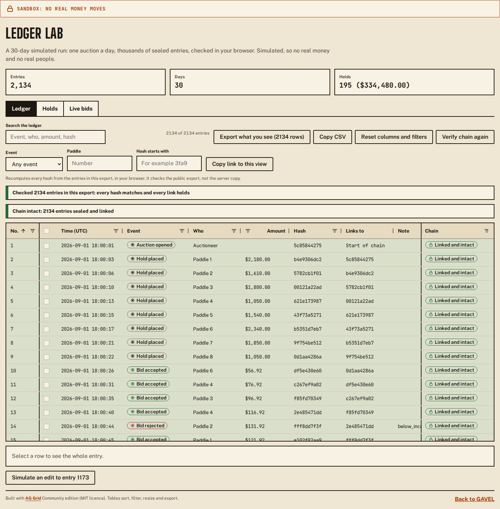
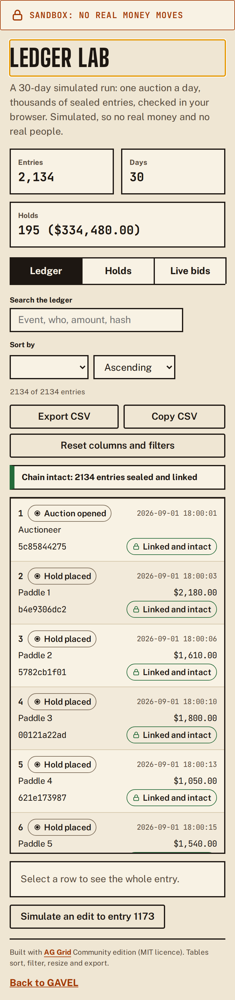

# AG Grid in GAVEL

GAVEL's tables are [AG Grid](https://www.ag-grid.com/) Community edition (`ag-grid-community` and `ag-grid-react`, both MIT). There is no licence key, no watermark, and nothing from AG Grid Enterprise: every feature below is in the free edition.

## Where the grids are

| Grid         | Where                                                                                        | What it shows                                                                       |
| ------------ | -------------------------------------------------------------------------------------------- | ----------------------------------------------------------------------------------- |
| `LedgerGrid` | Audit page (the grid is the default view, with a Table / Grid switch) and the `/ledger` page | The ledger, one row per entry. Chain status only where entries are sealed (the lab) |
| `BidsGrid`   | Auctioneer console (List / Table switch) and the `/ledger` live tab                          | The live bid history, newest first                                                  |
| `HoldsGrid`  | The `/ledger` holds tab                                                                      | Holds and settlement states, with a totals row pinned at the bottom                 |

The code is in `packages/web/src/grid/`. The `/ledger` page (ledger lab) feeds all three from a seeded 30-day simulated run: 2,134 sealed entries, no real money and no real people.

## What each grid does

**LedgerGrid**

- Pinned number column, sorting on every column, a search box (AG Grid quick filter), per-column filters, column resize and reorder.
- Three plain filters above the grid: event, paddle and hash prefix. They write into the grid's own column filters (so the header filter menus show the same values), and with the search box they are kept in the page URL as `gq` (search text) and `gf` (the AG Grid filter model as JSON). Copy the link and a judge opens the same filtered ledger. A link is read defensively: unknown columns and malformed JSON are dropped and the whole ledger shows.
- Multi-row selection with checkboxes and a detail panel for the selected entry (full hash and the hash it links to).
- Export what you see: the button says how many rows it will write ("Export what you see (30 rows)"), and the file has exactly the rows that pass the filters, in the order shown (the selected rows when some are selected). The file is named `gavel-ledger-<room id>-<UTC time>.csv`, so two exports never collide and each says where it came from. It uses the Community `exportDataAsCsv`. Copy CSV is next to it. Cells that start with `=`, `+`, `-`, `@`, a tab or a carriage return get a leading apostrophe so a spreadsheet cannot run them as formulas (a note that starts with `-` is exported with the apostrophe).
- Verify chain: the button recomputes every hash from the entries in the grid (WebCrypto SHA-256, in the browser), then marks the rows one by one: rows not reached yet read "Checking", intact rows get a green edge and the chip "Linked and intact", an edited row turns red and the line above names it. Under reduced motion the result appears at once. The text next to the button says what it is: a check of the public export, not of the server's copy.
- Column state (sort, order and widths) is remembered per grid in `sessionStorage`, so it survives a reload or a switch of tab and is gone when the browser tab closes. "Reset columns and filters" clears it.
- Keyboard: Tab enters the table and the next Tab leaves it (the grid's `tabToNextCell` and `tabToNextHeader` return `false`, so a keyboard user never walks thousands of cells to get past it). Arrow keys move between cells and rows, Page Up and Page Down jump, Enter selects a row, Space toggles a checkbox. The focus ring is 3 px. A line for screen readers reads the keys out.
- A chip with a word and an icon for the event and for the chain status of every row, never colour alone.
- Chain check (sealed entries only, for example the `/ledger` lab; audit-page rows carry no hash yet, so their chain status reads "Not sealed"): the grid re-hashes every entry in the browser (WebCrypto SHA-256) and compares each link with the entry before. An entry edited after sealing is marked "Edited after sealing", the row is highlighted, and the line above the grid names the first broken entry. In the lab, "Simulate an edit to entry N" changes one amount without touching the stored hash so you can watch the check find it. A `verdicts` prop lets another verifier supply the results instead.
- Under 700 px wide the table becomes one card per row (still virtualised, no sideways scroll) with a sort select.

**BidsGrid**

- New and changed bids go in with `applyTransaction` (add and update, keyed by `getRowId`), so rows that did not change are not rebuilt. Newest first. Changed cells flash, except for visitors who prefer reduced motion.
- A render that brings no change sends nothing to the grid. A component test checks both.
- A search box, "Export what you see" (`gavel-bids-<room id>-<time>.csv`) and the same remembered column state as the other grids.

**HoldsGrid**

- One row per hold with a state chip (Held, Released, Charged, and the steps between). Amounts are integer cents shown as dollars, in mono numerals.
- Export what you see (`gavel-holds-<room id>-<time>.csv`, data rows only: the pinned totals row stays on screen and out of the file, so the CSV sorts cleanly in a spreadsheet).
- A pinned bottom row totals what is on screen and follows the filters. A line under the toolbar says whether settled holds add up (final amount plus released equals held).

## Theming

`src/grid/theme.ts` builds one theme with the theming API: `themeQuartz.withParams({...})`, mapped to the Newsprint tokens (paper surface, ink text, hard 2 px borders, square corners, a thick ink focus ring, mono numerals through the `gv-grid-num` class). Light only. A unit test reads `tokens.css` and fails if the grid colours drift from the palette.

## Performance

Rows and columns are virtualised by AG Grid. The lab loads a 30-day run (2,134 entries): the browser draws only the visible rows, and a screen spec scrolls to the middle of the ledger and checks that fewer than 150 rows are in the page.

## Bundle

The grids are lazy. Each is behind `React.lazy`, and the Vite config puts the library in one named chunk (`assets/ag-grid-*.js`, via `manualChunks` in `packages/web/vite.config.ts`), so the landing and bidder pages do not download it. Only the modules the grids use are registered in `src/grid/agRuntime.ts`, not `AllCommunityModule`; a feature that needs another module logs an AG Grid error and fails agModules.test.tsx, so add it there. The web-budget check (`packages/web/scripts/check-size.mjs`) fails the build if AG Grid ever lands in the initial route, and holds the `ag-grid-*` chunk to its own budget (380 KB gzip). The layout hooks (`useNarrow`, `useReducedMotion`) live in `src/util/useMedia.ts`, outside the chunk.

## Screenshots

The `ui-screens` CI artifact has the view `grid`: ledger lab (intact, scrolled, search, detail, edited entry), holds, live bids, the audit page grid view and the console bid history, on desktop and phone.

## Tests

- `test/unit/ledgerModel.test.ts`: chain sealing, intact, tampered and broken results, the 30-day run.
- `test/unit/bidsModel.test.ts`: the transaction diff.
- `test/unit/gridTheme.test.ts`: theme colours match the tokens.
- `test/unit/gridHelpers.test.ts`: export file names, the remembered column layout, the filters in the URL (round trip, damaged links).
- `test/component/LedgerGrid.test.tsx`, `BidsGrid.test.tsx`, `HoldsGrid.test.tsx`: rows, sort, search, filter, export, pinned column, detail panel, tamper highlight, transactions, totals.
- `test/component/LedgerGridTools.test.tsx`: export of what you see (label, count, file name), the three filters and the URL, a shared link, remembered columns, Verify chain (intact and edited ledgers), Tab leaving the table.
- `test/visual/a11y.spec.ts` and `keyboard.spec.ts`: axe on the `/ledger` page (each tab, after Verify chain, as phone cards) and a keyboard walk: Tab in, arrows by row, Enter selects, Tab out, focus ring width and contrast.
- `test/screens/grid.spec.ts`: the pictures, plus virtualisation, the marked row, no sideways scroll on a phone, a real CSV download (name and row count), a filtered link, Verify chain, and sort that survives a reload.

Built with [AG Grid](https://www.ag-grid.com/).
