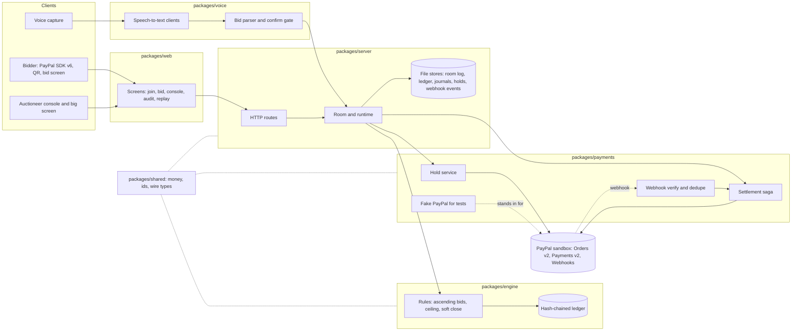

# GAVEL architecture

Refs #322. Built from `docs/PLAN.md` and the package layout on main. The settlement flow is verified in code only against the fake PayPal, apart from the sandbox gate steps noted in `docs/GATES.md` (authorize, capture with final_capture, remainder release, webhook verification). A shipped SVG (`docs/submission/architecture.svg`, #322) is still to be produced from this diagram.

## Packages



Mounted in `packages/server/src/boot/compose.ts`: the room WebSocket gateway (`createGateway`) and the `/audio` voice socket (`createAudioHost`), which feeds each decision into the room through `Room.submitVoiceBid`. The speech provider is cached transcripts unless `VOICE_STT` names a live provider with its key. No live speech run is recorded (gate G5 NOT RUN).

## Settlement flow

```mermaid
sequenceDiagram
  participant B as Bidder
  participant S as Server and room
  participant E as Engine
  participant P as PayPal sandbox
  participant W as Webhooks

  B->>S: register with a ceiling
  S->>P: create order intent AUTHORIZE
  B->>P: approve in the SDK popup
  S->>P: authorize order, hold created
  P-->>W: PAYMENT.AUTHORIZATION.CREATED
  loop bidding
    B->>S: bid (voice, QR or typed)
    S->>E: validate (ceiling, increment, state)
    E-->>S: accepted, ledger entry appended
  end
  S->>E: hammer, winner is the highest valid bid
  S->>P: truth check on the winner hold
  S->>P: capture winning price, final_capture true
  P-->>W: PAYMENT.CAPTURE.COMPLETED
  S->>P: void every other hold
  P-->>W: PAYMENT.AUTHORIZATION.VOIDED
  S->>P: read the winner authorization
  Note over S,P: remainder reads released after final capture; a void answers 422 PREVIOUSLY_CAPTURED and counts as released
  W->>S: verified event confirms state, deduped
  S->>E: final ledger entry, settled
```

Invariants (from `docs/PLAN.md` section 4): at most one capture; captured is at most the ceiling; each non-winner voided once; captured plus released equals holds; safe under retry, duplicate and out-of-order webhooks. If the winner's hold is expired, declined or voided, the saga falls back to the runner-up. If a capture outcome is unknown, settlement stops for review.
