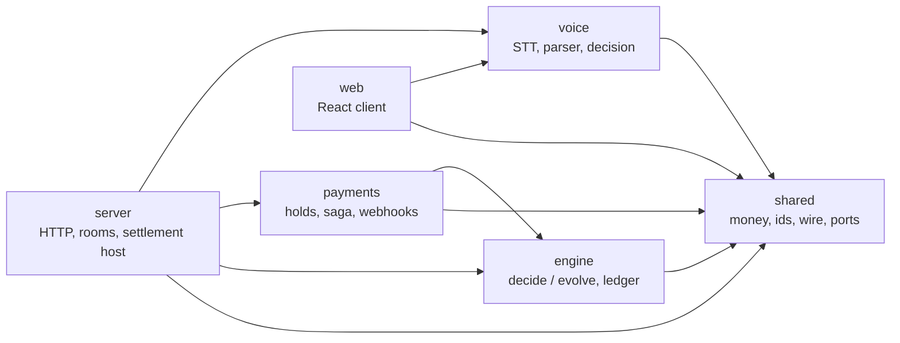

GAVEL is one strict TypeScript monorepo with seven workspace packages under `packages/`. This track is for people who read, run, change or review the code. Every page here was written from the source; each package page names the files and the tests that guard its rules.

## The picture

An arrow means "may import". The arrows are the table `ALLOWED` in `.dependency-cruiser.cjs`; CI enforces them, so a package cannot quietly reach into one that is not listed.

<Cards>
  <Card title="shared" href="/docs/builders/packages/shared" description="Money in cents, ids, wire messages, ports, config schema." />
  <Card title="engine" href="/docs/builders/packages/engine" description="The pure auction core and the hash-chained ledger." />
  <Card title="payments" href="/docs/builders/packages/payments" description="PayPal holds, the settlement saga, webhooks, the fake PayPal." />
  <Card title="server" href="/docs/builders/packages/server" description="The single process that hosts rooms, HTTP, WebSocket and settlement." />
  <Card title="voice" href="/docs/builders/packages/voice" description="Speech-to-text clients, bid parser, the AUTO or CONFIRM decision." />
  <Card title="web" href="/docs/builders/packages/web" description="The browser client." />
  <Card title="e2e" href="/docs/builders/packages/e2e" description="Scenario DSL and end-to-end specs." />
  <Card title="infra" href="/docs/builders/packages/infra" description="Workflows, deploy files and the checks around them." />
</Cards>

## The dependency rule

Direction is `shared`, then `engine`, then `payments`; `voice` depends on `shared` only; `server` sits on top of the four; `web` imports `shared` and `voice` only.

| Package | May import |
| --- | --- |
| `shared` | nothing from the workspace |
| `engine` | `shared` |
| `payments` | `shared`, `engine` |
| `voice` | `shared` |
| `server` | `shared`, `engine`, `payments`, `voice` |
| `web` | `shared`, `voice` |

Two further rules are in the same file or its companion scripts:

- **The <Term id="engine">engine</Term> is pure.** The rule `engine-no-node-io` forbids `fs`, `net`, `http`, `child_process`, `os` and the other Node I/O modules under `packages/engine/src/`, except the folders `node/` and `testing/`. `packages/engine/scripts/check-imports.mjs` repeats the check and also fails when the engine declares a runtime dependency.
- **Payments keeps one runtime dependency.** The root script `check:deps` runs `depcruise`, `scripts/check-engine-purity.mjs` and the payments check that `zod` is the only runtime dependency.

<Held title="What the rule does not say">
The rule limits what a package may import. It does not say a package uses everything it may import: in `packages/payments/src` the engine is not imported at run time, because the <Term id="saga">saga</Term> reads the engine's <Term id="hammer">hammer</Term> result through a structural type (`PlanOutcome` in `saga/plan.ts`). The engine is a development dependency of payments, used by its tests.
</Held>

## How to read the repo

<Steps>
<Step>
Start with the words: [glossary](/docs/reference/glossary) and the [concepts](/docs/start/concepts) page.
</Step>
<Step>
Read `packages/shared/src/index.ts` for the vocabulary the other packages share, then [shared](/docs/builders/packages/shared).
</Step>
<Step>
Read the engine's `decide/index.ts` and `evolve.ts`: one command in, entries out, state folded from entries. See [engine](/docs/builders/packages/engine).
</Step>
<Step>
Read `packages/payments/src/saga/machine.ts` (the transition table), then [payments](/docs/builders/packages/payments).
</Step>
<Step>
Read `packages/server/src/boot/compose.ts`: it is the one place where every package is wired together. See [server](/docs/builders/packages/server).
</Step>
</Steps>

## More for builders

- [Run and test](/docs/builders/run-and-test), [repo layout](/docs/builders/repo-layout) and [contributing](/docs/builders/contributing).
- [Architecture](/docs/reference/architecture), [events](/docs/reference/events), [configuration](/docs/reference/configuration), [data model](/docs/reference/data-model) and [WebSocket protocol](/docs/reference/websocket-protocol).

<CodePaths
  paths={[
    { path: '.dependency-cruiser.cjs', note: 'the dependency direction rules' },
    { path: 'scripts/check-engine-purity.mjs', note: 'the engine purity check run by check:deps' },
    { path: 'packages/server/src/boot/compose.ts', note: 'where every package is wired' },
  ]}
/>
