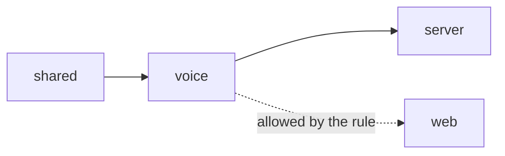

`packages/voice` turns speech into a structured bid, or into a question for the bidder. It never decides whether a bid is valid: the engine does that. Its job ends at a decision (`auto`, `confirm` or `drop`) and, for an accepted one, a `PlaceBid` command the server submits to the room.

<GateBadge id="G5" /> Speech accuracy was measured on synthetic audio only (PARTIAL: the first run missed the threshold, the fixes were chosen on the same clips), so spoken bids always go through the confirm prompt. See [Voice and the confirm gate](/docs/how-it-works/voice-and-confirm) and [Gate G5](/docs/proof/gates).

## Responsibilities

<Steps>
<Step>

### Capture and frame audio

`src/audio` frames PCM (20 ms frames, 100 ms batches), resamples, finds the end of an utterance and queues it. `src/browser` holds the browser capture state machine, the mute controller (push-to-talk and open mic, with a keepalive every 5 s while muted) and the degraded-mode handling.

</Step>
<Step>

### Talk to a speech provider

`src/stt` has one interface (`SttProvider`) and five implementations: Deepgram (`ReconnectingDeepgramStt`), Groq (`GroqStt`), Web Speech (browser only), `FakeStt` and `ReplayStt` (cached transcripts). `FailoverStt` chains providers and `selectProvider` picks them from the environment.

</Step>
<Step>

### Parse and decide

`src/parser` reads the amount and the paddle or speaker from a transcript with rules. `src/decide` scores the reading, merges it with an optional model reading, applies the policy thresholds and writes the confirm prompt. `src/pipeline/pipeline.ts` ties segmentation, parsing and deciding together; `bid-command.ts` maps a decision to an engine `PlaceBid`.

</Step>
<Step>

### Limit the stream

`src/session.ts` enforces the limits of the `/audio` socket (byte and message rates, stream caps, idle sweep). It holds no socket and no timer, so it is a pure state holder that the server drives.

</Step>
</Steps>

## Where it sits

The dependency rule in `.dependency-cruiser.cjs` lets `voice` import only `shared`. The server imports voice, and the web client is allowed to. The engine and payments are not imported as values; the package ESLint config allows type-only imports of them.

## Public interface

Everything is exported from `src/index.ts` (`main` and `types` both point at it). The groups:

| Group | Exports |
| --- | --- |
| Parsing | `parseUtterance`, `parseUtteranceOutcome`, `ParseResult`, `PARSE_FLAGS` |
| Deciding | `decide`, `CONFIRM_TTL_MS`, `Decision`, `ConfirmPrompt`, `VOICE_REASONS`, `buildAudit` |
| Pipeline | `VoicePipeline`, `STALE_SEGMENT_MS`, `RETRACT_ADVISORY_MS`, `toPlaceBid`, `resolveConfirm`, `commandIdFromKey` |
| Providers | `selectProvider`, `STT_NAMES`, `FailoverStt`, `ReplayStt`, `SttProvider`, `SttEvent` |
| Wire | `encodeBatch`, `decodeBatch`, `VoiceFrameError` |
| Session | `createVoiceSession`, `AUDIO_ERROR_CODES`, `AUDIO_IDLE_MS` |
| Audit | `toAuditRecord`, `auditRecordSchema`, `voiceEvidenceSchema` |
| Budget | `BUDGET_LIMITS_MS`, `budgetCheck`, `latencyOf`, `percentile` |

The exported surface is recorded in `etc/voice.api.md`; a change to it needs the `interface` label (see [Contributing](/docs/builders/contributing)).

## Key files

<Files>
  <Folder name="packages/voice" defaultOpen>
    <Folder name="src" defaultOpen>
      <Folder name="audio" />
      <Folder name="browser" />
      <Folder name="stt" defaultOpen>
        <File name="provider.ts" />
        <File name="select.ts" />
        <File name="failover.ts" />
        <File name="deepgram-reconnect.ts" />
        <File name="groq.ts" />
        <File name="replay.ts" />
      </Folder>
      <Folder name="parser" />
      <Folder name="segment" />
      <Folder name="decide" defaultOpen>
        <File name="config.ts" />
        <File name="policy.ts" />
        <File name="decide.ts" />
        <File name="validate.ts" />
      </Folder>
      <Folder name="pipeline" defaultOpen>
        <File name="pipeline.ts" />
        <File name="bid-command.ts" />
        <File name="faults.ts" />
        <File name="latency.ts" />
      </Folder>
      <Folder name="eval" />
      <File name="session.ts" />
      <File name="privacy.ts" />
      <File name="index.ts" />
    </Folder>
    <Folder name="fixtures" />
    <Folder name="scripts" />
    <Folder name="test" />
  </Folder>
</Files>

| File | What it holds |
| --- | --- |
| `src/stt/select.ts` | `selectProvider`: unset `VOICE_STT` tries Deepgram then Groq; a named provider is used or startup fails with `unknown_provider`, `missing_key` or `unavailable`. Errors never contain a key |
| `src/stt/failover.ts` | `FailoverStt`: switches provider on a closed connection, an error or a silent stream. Ambient room noise does not arm the silence timer: only a mean-square level above about -35 dBFS counts as speech |
| `src/stt/deepgram-reconnect.ts` | Reconnecting Deepgram client; the audio of the last seconds is replayed after a switch |
| `src/decide/config.ts` | `defaultConfig`: `auto` 0.85, `confirm` 0.5 |
| `src/decide/decide.ts` | The decision step; `CONFIRM_TTL_MS` is 8000 |
| `src/pipeline/pipeline.ts` | `VoicePipeline`; a segment older than `STALE_SEGMENT_MS` (5000) is treated as stale, `RETRACT_ADVISORY_MS` is 8000 |
| `src/pipeline/faults.ts` | Speech health: status degraded when no final transcript arrives for 8 s while the level meter shows speech, down after 15 s; transcript sanity checks (2000 characters, character runs) |
| `src/pipeline/latency.ts` | Latency budget: components sum to the total; limits p50 1200 ms and p95 2000 ms with a model, p50 700 ms and p95 2000 ms rules-only |
| `src/privacy.ts` | `PRIVACY_NOTICE` and `PERSISTED_VOICE_KEYS`, the only voice fields that are stored |

## Thresholds and limits

<TypeTable
  type={{
    'auto': { description: 'Confidence at or above this, with no hard flag, may be accepted without a prompt.', type: 'number', default: '0.85' },
    'confirm': { description: 'From here up to auto the bidder is asked; below it the segment is dropped.', type: 'number', default: '0.5' },
    'CONFIRM_TTL_MS': { description: 'How long a confirm prompt stays open.', type: 'number', default: '8000' },
    'AUDIO_MAX_BYTES_PER_SEC': { description: 'Bytes one audio stream may send per second.', type: 'number', default: '65536' },
    'AUDIO_MAX_FRAMES_PER_SEC': { description: 'Messages one stream may send per second.', type: 'number', default: '100' },
    'AUDIO_MAX_SESSION_MS': { description: 'Longest single stream.', type: 'number', default: '1800000' },
    'AUDIO_MAX_STREAMS_PER_TOKEN': { description: 'Streams per auctioneer token.', type: 'number', default: '2' },
    'AUDIO_MAX_STREAMS_PER_ROOM': { description: 'Streams per room.', type: 'number', default: '4' },
    'AUDIO_IDLE_MS': { description: 'A stream with no frame for this long frees its slot.', type: 'number', default: '15000' },
  }}
/>

Only the `auctioneer` and `console` roles may open an audio stream (`AUDIO_ROLES`); screens and bidders never can.

## Invariants

- **A spoken bid never skips the engine.** `toPlaceBid` sets `commandId` with `commandIdFromKey` (a hash of the auction id and the utterance idempotency key), so a replayed utterance maps to the same id and books once, even if two providers heard it. The provider name is not part of the key.
- **Below the auto threshold, the bidder is asked.** With no model reading wired into the running pipeline, every bid scores below 0.85 and reaches a confirm prompt (stated in the package README).
- **Only audit fields in `PERSISTED_VOICE_KEYS` are persisted.** The test `test/privacy.test.ts` guards the list against the audit schema.
- **No key in an error.** `SttConfigError` messages name the provider, never the key.
- **The held-out text set is frozen.** `fixtures/text/HELDOUT.sha256` is checked in CI against the base branch.

## Tests that guard it

| Area | Test files |
| --- | --- |
| Provider selection and failover | `test/stt/select.test.ts`, `select-deepgram.test.ts`, `failover.test.ts`, `deepgram-reconnect.test.ts`, `groq-retry.test.ts`, `groq-timeout.test.ts` |
| Decision policy and prompts | `test/decide/policy.test.ts`, `score.test.ts`, `validate.test.ts`, `prompts.test.ts`, `wording.test.ts`, `audit.test.ts` |
| Pipeline | `test/pipeline/pipeline.test.ts`, `faults.test.ts`, `latency.test.ts`, `prompt-expiry.test.ts`, `prompt-identity.test.ts`, `crosstalk.test.ts` |
| Bid command mapping | `test/pipeline-bid-command.test.ts`, `test/pipeline-bounds.test.ts` |
| Stream limits | `test/session.test.ts`, `test/session-idle.test.ts` |
| Parser corpus | `test/corpus.test.ts`, `test/labels.test.ts` |
| Privacy and held-out guard | `test/privacy.test.ts`, `test/heldout-guard.test.ts` |
| Evaluation harness | `test/eval/gate.test.ts`, `metrics.test.ts`, `report.test.ts`, `cli.test.ts` |
| Browser capture and mute | `test/browser/capture.test.ts`, `mute.test.ts`, `degraded.test.ts`, `capture-state.test.ts` |

## Scripts

| Script | What it does |
| --- | --- |
| `npm run test -w @gavel/voice` | Package unit tests |
| `npm run eval -w @gavel/voice -- --mode live --provider deepgram` | Scores recordings through a real provider; needs a key |
| `npm run scan:secrets -w @gavel/voice` | Scans the package for vendor key patterns (runs in the `ci.yml` voice job) |
| `npm run check:heldout -w @gavel/voice` | Guards the held-out text set |
| `npm run size -w @gavel/voice` | Bundle size limit |

<NotVerified title="What the evidence covers">

The G5 clips are synthetic and noise-free: 24 eSpeak clips and a second set of the same 24 utterances in a human-like synthetic voice. On the cached eval, Deepgram nova-3 scores exact 1.000 and wrong-accept 0.000 on both sets, and Groq whisper-large-v3-turbo with a bid prompt scores exact 0.923 and wrong-accept 0.000. The first run (Deepgram nova-2, Groq without a prompt) had wrong-accept 0.083 to 0.167. The fixes and options were chosen on these same clips, so G5 is PARTIAL, not a pass. There has been no real-room or noisy-room test. Vendor retention terms for the speech and model vendors are unverified.

</NotVerified>

<CodePaths
  paths={[
    { path: 'packages/voice/README.md', note: 'status, wiring and the live eval procedure' },
    { path: 'packages/voice/src/index.ts', note: 'the public surface' },
    { path: 'packages/voice/src/decide/config.ts', note: 'AUTO and CONFIRM thresholds' },
    { path: 'packages/voice/src/stt/select.ts', note: 'provider selection' },
    { path: 'packages/voice/src/session.ts', note: 'audio stream limits' },
    { path: 'packages/voice/src/pipeline/latency.ts', note: 'latency budget' },
    { path: 'etc/voice.api.md', note: 'committed API report' },
  ]}
/>
