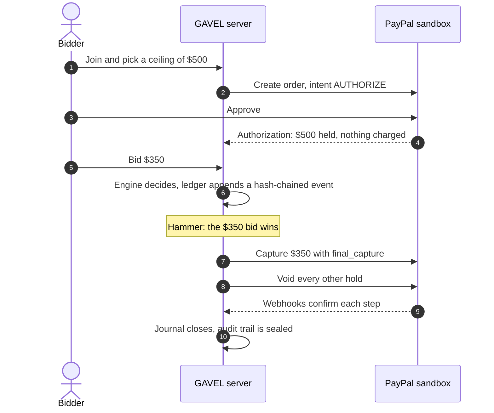

1. **Approve a <Term id="ceiling">ceiling</Term>.** A bidder approves the most they may bid. PayPal places an <Term id="authorization">authorization</Term> <Term id="hold">hold</Term> for that amount. Nothing is charged.
2. **<Term id="bid">Bid</Term>.** A deterministic <Term id="engine">engine</Term> accepts or rejects each bid against the ceilings and writes every event to a <Term id="hash-chain">hash-chained</Term> <Term id="ledger">ledger</Term>.
3. **<Term id="hammer">Hammer</Term>.** The <Term id="saga">settlement saga</Term> <Term id="capture">captures</Term> the winning price, <Term id="void">voids</Term> every other hold, and records each step in a <Term id="journal">journal</Term> so a crash cannot double-charge anyone.

| Page | The question it answers |
| --- | --- |
| [Money flow](/docs/how-it-works/money-flow) | Where is the money at each moment? |
| [Settlement saga](/docs/how-it-works/settlement-saga) | Which states can a settlement be in, and which moves are legal? |
| [Crash recovery](/docs/how-it-works/crash-recovery) | What happens when the process dies mid-capture? |
| [Voice and the confirm gate](/docs/how-it-works/voice-and-confirm) | Can speech become a bid on its own? |
| [Voice bidding in the web](/docs/how-it-works/voice-in-the-web) | Can the auctioneer just speak a bid in the browser? |
| [Engine and ledger](/docs/how-it-works/engine-and-ledger) | How are bids decided and recorded? |

