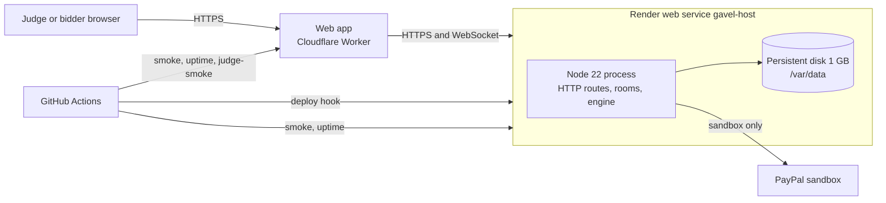

GAVEL's API and WebSocket host runs as one Render web service. Every judge room, the simulated demo, the hash-chained ledger and the sandbox hold records live on it. This page says what that service is, why it is shaped that way, and what we have not done.

<NotVerified title="What this page does and does not claim">

The service shape below comes from `render.yaml`, `docs/DEPLOY.md`, `docs/DECISIONS.md` (D-0006, D-0018) and the workflows in `.github/workflows`. We publish no uptime figure for the Render host: the repository holds no measurement of it. One hosted run (workflow `evidence-hosted`, run 42558107791, 9 Nov 2026) measured warmup after idle (n=2, max 662.17 ms against a 3000 ms budget; the host may never go cold because the uptime workflow pings it every 5 minutes, and Render was redeployed during the run) and the webhook route (n=50, p95 112.03 ms from a GitHub runner, network included). Evidence is in `docs/evidence/hosted/`. Two settings live in the Render dashboard, not in the blueprint, so the repository cannot prove them: the zero-downtime deploy switch and the custom domain.

</NotVerified>

## Architecture

| Piece | Where | Why |
| --- | --- | --- |
| Web app | Cloudflare Worker with static assets | Static files and edge caching suit it. It holds no state. |
| API, rooms, WebSocket | Render web service, Node, `starter` plan, always on | A room is one live process with sockets; Render runs it as a normal long-lived server. |
| Room log, ledger, journals, holds, webhook events | Files on the Render disk at `/var/data` | Written by one process, replayed on restart (D-0018). |

The service answers at `https://gavel-auction-z2nm.onrender.com`. The web app is a separate Worker, served at `https://gavel.dualmindlab.tech` (the `workers.dev` address still works); the API lists it in `CORS_ORIGINS` and checks both fetches and WebSocket upgrades against that list.

## Why Render fits this host

- **A long-lived Node process.** Rooms keep sockets open and state in memory, then append to a log. A web service gives us exactly that without rewriting the host for a function platform. D-0006 chose a single Node server on Render, and the realtime spike decision kept it (the Durable Object alternative was never built, so it is not a fallback).
- **A persistent disk.** The stores are plain files, each owned by one process with no cross-process lock. A Render web service has an ephemeral filesystem, so without the disk a redeploy would wipe the room log, ledger, journals and holds while sandbox authorizations still exist at PayPal. The 1 GB disk at `/var/data` fixes that (D-0018).
- **A blueprint in the repo.** `render.yaml` describes the whole service, so the host can be recreated from the repository plus the dashboard secrets.
- **A deploy hook.** Deploys are started from GitHub Actions, so a deploy is a reviewed, logged workflow run, not a side effect of a push.

## The render.yaml walkthrough

The file is [`render.yaml`](https://github.com/harshbhx/gavel-auction/blob/main/render.yaml). The parts that matter:

<Steps>
<Step>

**One web service, one instance.** `type: web`, `runtime: node`, `plan: starter`, `numInstances: 1`. One instance is a correctness rule, not a cost choice: two processes would share one set of files with no lock.

</Step>
<Step>

**Build and start.** The build is `npm ci --include=dev --ignore-scripts && npm run build -w @gavel/server`. Dev packages are installed because esbuild is a dev dependency and `NODE_ENV=production` would skip it; install scripts stay off because service secrets are in the build environment. The start command is `npm run start:prod -w @gavel/server`, plain `node` on the bundled `dist/main.js`, so no test or dev tooling is in the runtime.

</Step>
<Step>

**Health check.** `healthCheckPath: /healthz`. Render uses it to decide that a new deploy is up. The host also serves `/readyz` (200 when the store answers) and `/warmup`; the smoke test and the uptime probe use them.

</Step>
<Step>

**Auto deploy off.** `autoDeploy: false`. Nothing deploys on push; the deploy hook does (next section).

</Step>
<Step>

**The disk.** `disk` named `gavel-data`, mounted at `/var/data`, 1 GB. Together with `DATA_DIR=/var/data` and `STORE=file`, every file store lives on it.

</Step>
<Step>

**Environment variables.** Fixed values sit in the blueprint: `NODE_VERSION=22`, `NODE_ENV=production`, `TRUSTED_PROXY_HOPS=1` (the host trusts one proxy hop, Render's, when it reads the client address for rate limits; `docs/SECURITY-REVIEW.md` SEC-14 notes this is not confirmed against the live host), `STORE`, `DATA_DIR`, `PAYMENTS=sandbox` and `PAYPAL_ENV=sandbox`. Values that differ per environment or are secret are declared with `sync: false`, so Render asks for them in the dashboard: `PUBLIC_URL`, `CORS_ORIGINS`, `WEB_ORIGIN`, `TOKEN_SECRET`, `ADMIN_KEY` and the PayPal sandbox credentials. Secret values are never in the repository.

</Step>
</Steps>

### Zero-downtime deploys are off

Render normally starts the new instance before it stops the old one. With files on one disk that would put two writers on one snapshot, so D-0018 requires turning zero-downtime deploys off for this service. That is a dashboard setting and is not expressed in `render.yaml`, so the repository cannot prove it is on; the practical effect is a short gap while a deploy swaps instances.

## Deploy flow

1. A change to server code reaches `main`. Today the owner then uses Manual Deploy of `main` in the Render dashboard and runs the smoke script. The optional workflows `deploy-staging` (manual) and `deploy-prod` (a `v*` tag, behind a required reviewer) do the same through the deploy hook once their secrets are set; they are not configured now.
2. The job calls the Render **deploy hook** (a secret named `RENDER_DEPLOY_HOOK_URL`) and fails if Render does not answer 2xx.
3. `scripts/wait-version.sh` polls `GET /version` until the host serves the commit being deployed. The old instance can answer first, so a green smoke against the old build would prove nothing.
4. `scripts/smoke.sh` checks `/healthz`, `/warmup`, that an unsigned PayPal webhook is rejected with 400 and that creating an auction without the operator key is 401.
5. Security checks run against the live host.
6. Rollback: `deploy-prod` can be run with `rollback` set. It uses the Render API to redeploy the previous live deploy and waits until `/version` serves that commit. The disk is not rolled back, so a release that changed a store format also needs a restore from the backup workflow's artifact (see [Backup](/docs/safety/backup)). The rollback rehearsal table in `infra/rollback.md` is still empty.

The full CI map is on [CI and deployment map](/docs/run/ci-pipeline).

## What runs on it

- **Judge rooms.** A judge opens `/try` on the web app and starts a real sandbox auction. The API creates the room through `POST /api/judge/rooms`, behind the `JUDGE_ROOMS` flag, with per-address and per-host creation limits and a room lifetime.
- **The simulated demo.** The scripted demo and the simulated bidders run on the same host, labelled as simulated in the interface.
- **PayPal sandbox only.** `PAYMENTS=sandbox`; no real money moves.

## What we monitor

| Check | Where it runs | What it touches |
| --- | --- | --- |
| Smoke after every deploy | `deploy-staging`, `deploy-prod` | `/healthz`, `/warmup`, webhook rejection, operator-key gate |
| Uptime probe, every 5 minutes | `uptime` workflow | `/healthz`, `/readyz`, `/warmup`; two failed rounds in a row open one issue |
| Nightly judge walkthrough | `judge-smoke` workflow | The hosted web app, which calls the Render API; fails red when the target is not configured |
| Daily encrypted backup | `backup` workflow | The host's admin export route; the ledger, journals, holds and room log leave the disk as one encrypted artifact |

The uptime probe only runs when the repository variable `UPTIME_ENABLED` is `true`. GitHub may delay scheduled runs, so the workflow is a watcher, not a measured availability figure. We state no uptime percentage.

## Custom domain

The API's own domain, `api.gavel.dualmindlab.tech`, is live and answers `/healthz` with 200; the `onrender.com` address above still works. What ties a client to one address is the API origin compiled into the web build, `CORS_ORIGINS` and `PUBLIC_URL`.

## What we do not use

We use Render for one web service with a persistent disk, a deploy hook and the deploy API for rollback. We do **not** use Render Postgres, Render Key Value, Render cron jobs, preview environments or background workers today. The `server-postgres` workflow tests a Postgres path against a CI database; that is not a Render database.

## What we would do next

| Next step | Why | What it needs |
| --- | --- | --- |
| Render Postgres for the stores | Removes the single-writer file rule and gives point-in-time recovery | A Postgres store behind the existing store interfaces; D-0018 lists it as deferred |
| Render Key Value (managed Redis) for room fan-out | Lets more than one instance share live room events | A pub/sub layer in the room service, then `numInstances` above 1 and zero-downtime deploys on |
| Render cron jobs | Move the ledger backup and the judge-room sweep off GitHub schedules | Entries in `render.yaml` and a backup that can reach the disk |
| Preview environments | A real host per pull request instead of fakes in CI | A second disk and sandbox credentials per preview, which has a cost |
| Disk snapshot before store changes | D-0018 asks for it before a deploy that changes a format | A written runbook step |

Each of these is a plan, not a shipped feature.
