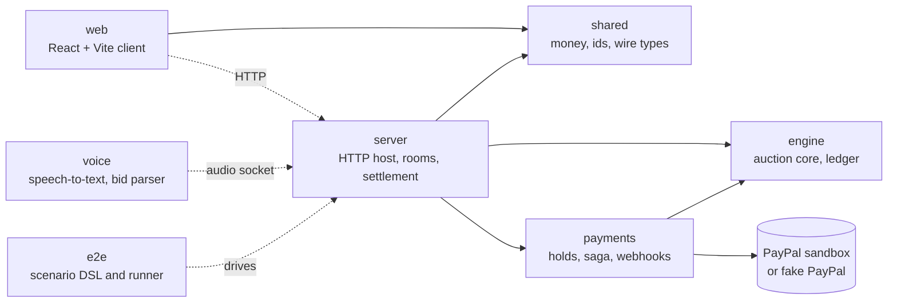

| Package | Purpose |
| --- | --- |
| `packages/shared` | Money in integer cents, ids, wire types, <Term id="replay">replay</Term> bundle format |
| `packages/engine` | Pure auction core and hash-chained <Term id="ledger">ledger</Term> |
| `packages/payments` | <Term id="hold">Hold</Term> service, settlement <Term id="saga">saga</Term>, <Term id="webhook">webhook</Term> verification, <Term id="fake-paypal">fake PayPal</Term>, gate scripts |
| `packages/voice` | Audio capture, speech-to-text clients, bid parser, decision step |
| `packages/server` | Single-process host: HTTP routes, room runtime, settlement scheduling, file stores |
| `packages/e2e` | Scenario DSL, runner and end-to-end specs |
| `packages/web` | Browser client (React and Vite) |

Money is always integer cents. The dependency rules are enforced in CI by `dependency-cruiser` and an engine purity check.

## Where the pieces mount

`packages/server/src/boot/compose.ts` mounts the room WebSocket gateway and the `/audio` voice socket, which feeds each decision into the room. The speech provider is cached transcripts unless `VOICE_STT` names a live provider with its key.

<CodePaths
  paths={[
    { path: 'docs/submission/ARCHITECTURE.md', note: 'the full diagram and details' },
    { path: 'packages/server/src/boot/compose.ts', note: 'where everything is wired' },
    { path: '.dependency-cruiser.cjs', note: 'the dependency rules' },
  ]}
/>
